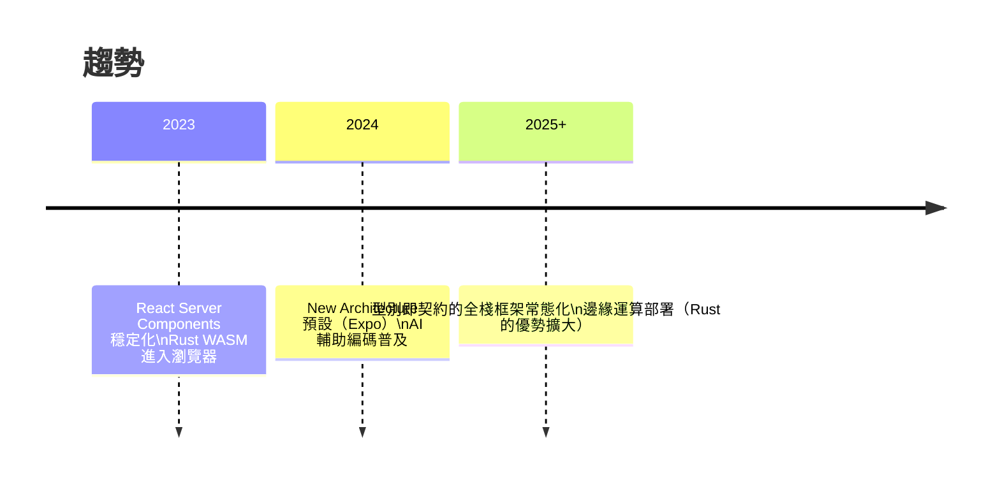
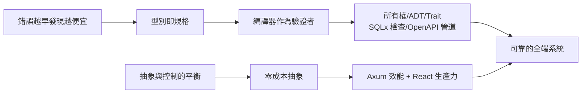

# 5.4 效能最佳化與未來展望

## 效能分析的第一定律

$$\text{先測量，再最佳化} \quad(\text{Knuth: premature optimization is the root of all evil})$$

效能工作必須以**量測**開始，否則你在最佳化錯的東西。關鍵指標：

- 後端：吞吐量（RPS）、延遲分布（**P50/P95/P99**，均值會說謊）、錯誤率
- 前端：TTI（可互動時間）、列表滾動 FPS、bundle 大小

$$\text{可用性感受由尾延遲決定}： \text{P99} \gg \text{mean} \quad\text{（長尾才是痛點）}$$

## 後端最佳化：熱點與手段

### 1. N+1 查詢問題

```rust
// 反模式：每篇文章再查一次作者 → 1 + N 次查詢
for post in posts {
    post.author = repo::find_user(&pool, post.user_id).await?;
}

// 正解：一次 JOIN 或 WHERE IN
let rows = sqlx::query_as!(PostWithAuthor,
    "SELECT p.*, u.name AS author_name
     FROM posts p JOIN users u ON u.id = p.user_id
     WHERE p.id = ANY($1)", &ids)
    .fetch_all(&pool).await?;
```

$$T_{N+1} = (N+1) \cdot RTT \quad\Rightarrow\quad T_{join} = 1 \cdot RTT$$

### 2. 快取的層次與一致性代價

| 層 | 工具 | 一致性問題 |
|----|------|-----------|
| 記憶體 | `moka`（本地 LRU） | 多實例各自為政 |
| 共享 | Redis | 需失效策略 |
| HTTP | Cache-Control / ETag | 客戶端快取 |

快取的唯一難題是**失效**（電腦科學兩大難題之一）。實務法則：快取「不變式資料」（以 ID + 版本為 key），寫入時主動失效；絕不快取會被併發修改的聚合。

### 3. 資料庫

- 索引要跟著查詢模式走：`EXPLAIN ANALYZE` 是唯一真相
- 分頁用 cursor（`WHERE created_at < $1`）而非 `OFFSET`（OFFSET 是 $O(n)$ 掃描）
- 大量寫入用批次（單一 `INSERT ... VALUES (...), (...)`）

### 4. 併發細節（回顧 2.3）

- CPU 密集 → `tokio::task::spawn_blocking` 或 rayon，避免餓死 worker
- 批次 I/O → `try_join_all`（序列 → 併發）

## 前端最佳化

### 渲染最小化

```tsx
// 只在 done 變更時重渲染單列
const TodoItem = React.memo(function TodoItem({ todo, onToggle }) {
  return /* ... */;
}, (a, b) => a.done === b.done && a.title === b.title);
```

### 列表虛擬化

FlatList 已內建視窗化（windowing）：只渲染可視區 ± 緩衝區的列。

$$\text{渲染成本}： O(n) \Rightarrow O(\text{視窗高度})$$

### 資源與啟動

- Hermes 引擎（Expo 預設）：AOT 位元碼，啟動更快
- 圖片：`expo-image` 快取 + 適當尺寸 + WebP
- bundle 分析：把重依賴（圖表庫等）延遲載入

## 全鏈路的理論上限

Amdahl 定律給出最佳化的天花板：

$$S = \frac{1}{(1-p) + \dfrac{p}{s}}$$

其中 $p$ 是可加速比例、$s$ 是加速倍數。**序列部分（1-p）決定極限** —— 全鏈路中，最難縮短的是網路 RTT 與人類反應時間。所以：CDN 把靜態資源推近、API 就近部署、樂觀更新把感知延遲歸零（4.4），都是在壓縮這個序列項。

## 未來展望

### 技術演化方向



值得關注的連接點：

1. **Rust → WebAssembly**：同一套 Rust 驗證/解析邏輯可編譯進前端，兩端共用程式碼（Leptos/Yew 甚至是「React 思想 + Rust」的全面嘗試）
2. **Server Components**：把「伺服器渲染 + 串流」與 React 模型融合，前端資料抓取進一步內化
3. **AI 輔助**：當型別即規格，LLM 生成程式碼的正確性可被編譯器驗證 —— 型別系統成為人機協作的契約介面

## 結語：本書的統一主題

回顧全書，所有技術選擇都服務於同一條因果鏈：



技術會過時，這條因果鏈不會。換框架時，問的問題依然是：**它把哪類錯誤往左移了？它的抽象成本是什麼？** 這就是理論給你的、超越任何單一技術的判斷力。

## 習題

1. 對你的 Todo 應用做延遲量測，找出 P99 尾延遲的來源並修復。
2. 用 Amdahl 定律估算：若網路 RTT 占總延遲 60%，其他部分快 10 倍，總加速比？
3. 選一個未出現在本書的技術（如 GraphQL、tRPC），用本書的因果鏈框架分析它解決什麼問題、代價是什麼。
