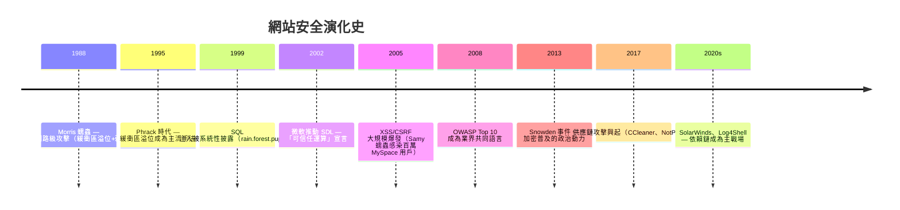
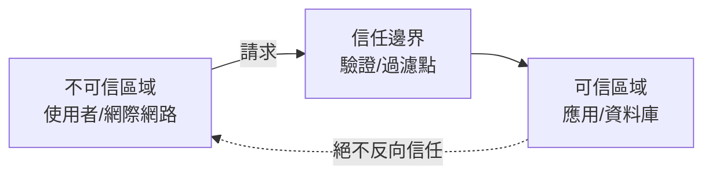
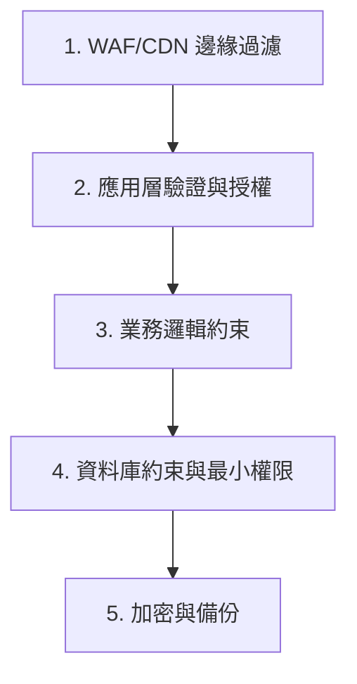

# 1.1 資訊安全演進史與 CIA 三元素

## 安全的問題意識：攻防是演化的雙螺旋

安全不是一個功能，而是一場持續的軍備競賽。每個時代的防禦決定於當時的攻擊形態，而每次防禦普及又催生新攻擊：

## CIA 三元素：安全到底在保護什麼

| 元素 | 定義 | 網站上的具體問題 | 典型防禦 |
|------|------|-----------------|---------|
| **機密性** Confidentiality | 資料只讓該看的人看 | 資料庫外洩、旁路讀取 | 加密、授權控制（3.3） |
| **完整性** Integrity | 資料不被未授權竄改 | 篡改訂單金額、竄改網頁 | 簽章、輸入驗證、審計 |
| **可用性** Availability | 該用時用得到 | DDoS、勒索軟體 | 限流、CDN（4.4）、冗餘 |

三者天生互相制衡：**極致的機密性（全部加密+離線）會犧牲可用性**；極致的可用性（到處備援開放）會擴大攻擊面。安全設計的本質是**在三者之間依業務需求取捨**，不存在「最安全」只有「最合適」。

### 擴充：AAA

- **Authentication 認證**：你是誰（3.2）
- **Authorization 授權**：你能做什麼（3.3）
- **Auditing 審計**：你做過什麼（5.3）

## 核心概念：信任邊界（Trust Boundary）

**所有攻擊的本質都是「從不可信區域把資料/控制流送過信任邊界」**：

- SQL 注入：不可信的字串越過「資料/程式碼」的邊界（3.1）
- XSS：不可信的內容越過「資料/腳本」的邊界（2.1）
- CSRF：不可信的網站借用使用者的可信身份（2.2）

於是得到安全設計的第一公理：

$$\text{不信任任何越過邊界的輸入} \quad \text{（Zero Trust 的雛形）}$$

## 深度防禦（Defense in Depth）

中世紀城堡的啟發：護城河、外牆、內牆、主塔 —— 單層失守不致淪陷。對應到 Web（參考《網站設計基礎知識》4.3 的三道驗證防線）：

**假設每一層都會失守**（這是 Zero Trust 與傳統「城堡護城河」的差別：現代假設攻擊者已經在網內）。

## 安全的經濟學

攻擊者的決策也是理性計算：

$$\text{攻擊動力} \propto \frac{\text{預期收益}}{\text{成本 + 被抓風險}}$$

防禦的目標不必是「讓攻擊不可能」，而是**讓你比鄰居難攻**（風險轉移）或**把攻擊成本抬過收益**（如 1.4 節 Argon2 的慢雜湊）。這解釋了許多「為什麼夠了」的工程判斷。

## 習題

1. 用 CIA 分析「你的 Todo 應用被刪光資料」屬於哪個元素的失守，列出至少三層可加的防禦。
2. 找出你最近寫的一個 API，標出所有信任邊界與越過邊界的資料。
3. 為什麼「安全靠 obscurity（隱藏實作細節）」不可靠？舉一反例與正例。
