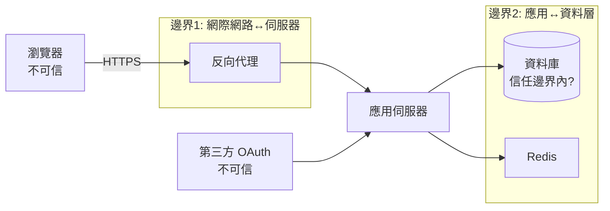
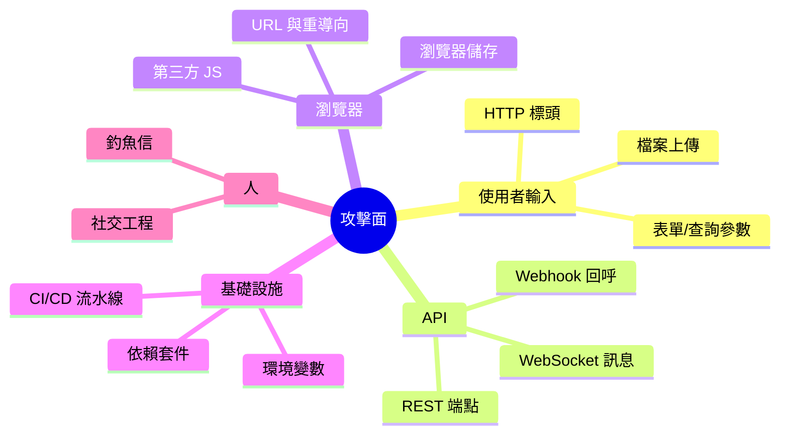

# 1.2 威脅模型與攻擊面：像攻擊者一樣思考

## 為什麼防禦必須先畫圖

「要防駭」是無法執行的目標。可執行的目標是：**針對具體的攻擊者、具體的資產、具體的入口，讓攻擊成本超過收益**。這就是威脅建模（threat modeling）。

$$\text{風險} = \text{資產價值} \times \text{威脅發生機率} \times \text{漏洞嚴重度}$$

## 四問法（微軟 SDL 的核心方法）

對任何系統回答四個問題：

1. **我們在建構什麼？** —— 畫資料流圖（DFD）
2. **哪裡會出錯？** —— 用 STRIDE 枚舉威脅
3. **我們要怎麼處理？** —— 移轉/消除/減輕/接受
4. **我們處理好了嗎？** —— 測試與回顧

### 資料流圖：標出信任邊界

**每一條穿越邊界的線，都是一個潛在攻擊入口**。安全審查就從數線條開始。

## STRIDE 威脅分類（微軟，1999）

| 威脅 | 違反 | 網站實例 | 本書章節 |
|------|------|---------|---------|
| **S**poofing 冒充 | 認證 | 假登入頁、竊取 session | 3.2 |
| **T**ampering 竄改 | 完整性 | 改表單金額、改 cookie | 3.1 |
| **R**epudiation 否認 | 不可否認性 | 下單後否認 | 5.3 審計日誌 |
| **I**nformation disclosure 資訊洩漏 | 機密性 | IDOR 讀他人資料 | 3.3 |
| **D**enial of Service 拒絕服務 | 可用性 | 慢查詢攻擊、DDoS | 3.4 |
| **E**levation of privilege 權限提升 | 授權 | 普通用戶呼叫 admin API | 3.3 |

## 攻擊面（Attack Surface）盤點

網站的全部入口：

兩條收縮原則：

1. **最小攻擊面**：不需要的端點、埠、權限全部關閉。你不用的功能不可能被攻破。
2. **最小權限**（least privilege）：每個組件只拿到完成工作所需的最小權限（DB 帳號只給 SELECT/INSERT，不給 DROP）。

## 攻擊者畫像：不是所有人都一樣

| 攻擊者 | 動機 | 手法 | 防禦重點 |
|--------|------|------|---------|
| 機會型（掃描器） | 批量賺錢 | 自動掃全網的已知漏洞 | 補丁、預設安全 |
| 定向 APT | 竊密/間諜 | 供應鏈、社交工程、零日 | 縱深防禦、監控 |
| 內部人員 | 報復/利益 | 合法權限的濫用 | 最小權限、審計 |
| 研究者/bounty | 名譽/獎金 | 合規測試 | 漏洞獎勵計畫（5.4） |

**90% 的網站死於機會型攻擊的已知漏洞** —— 這既是壞消息（你不需要被天才盯上就會淪陷），也是好消息（打好補丁與基本配置就贏過大多數）。

## 實作：為聊天室做威脅建模

| 資產 | 威脅（STRIDE） | 處理 |
|------|---------------|------|
| 訊息內容 | I：旁聽 | wss + TLS（4.1） |
| 暱稱 | T：注入 HTML | textContent（2.1） |
| 訊息頻道 | D：刷屏 | 每秒限 5 則（3.4） |
| 連線 | S：偽裝他人暱稱 | 登入制 + 暱稱唯一 |
| 記錄 | R：否認說過的話 | 訊息落庫帶時間與使用者（5.3） |

這張表就是**可執行的安全待辦清單** —— 威脅建模把「安全」從形容詞變成名詞。

## 習題

1. 為你的網站畫 DFD，標出所有信任邊界與穿越資料。
2. 對「檔案上傳」功能跑一遍 STRIDE，每個字母至少一條威脅與對應防禦。
3. 內部人員威脅為什麼無法靠防火牆解決？設計兩條制度性防禦。
