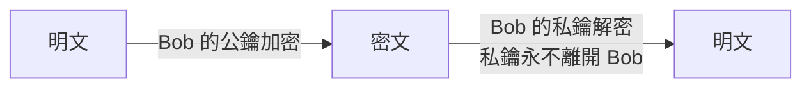

# 1.3 密碼學基礎：雜湊、加密與簽章

## 安全的數學地基

密碼學是唯一讓「信任」可以計算的工程學：不用相信網路中間的任何人，只需要相信數學與密鑰的保管。

## 三件工具與三種問題

| 問題 | 工具 | 特性 | 網站用途 |
|------|------|------|---------|
| 資料被看過？ | 對稱加密 | 加解密同一把鑰、快 | TLS 資料流、磁碟加密 |
| 怎麼安全交換鑰？ | 非對稱加密 / DH | 公私鑰對、慢 | TLS 握手 |
| 資料被改過？ | 雜湊 + HMAC | 單向、有指紋 | 密碼儲存、完整性 |
| 他是誰？ | 數位簽章 | 私鑰簽、公鑰驗 | JWT、憑證（HTTP書 2.2） |

## 雜湊：單向的指紋機

$$H: \text{任意長度} \to \text{固定長度}， \quad H(x) \text{ 易算}， \quad x \text{ 難反推}$$

好雜湊的三性質：

1. **單向性（preimage resistance）**：給 h 難找 x 使 H(x)=h
2. **抗碰撞性（collision resistance）**：難找 x≠y 使 H(x)=H(y)
3. **雪崩效應**：改 1 bit，輸出面目全非

```bash
echo -n "hello" | shasum -a 256
# 2cf24dba5fb0a30e26e83b2ac5b9e29e1b161e5c1fa7425e73043362938b9824
```

### MD5/SHA1 的死亡：攻擊成本曲線

| 演算法 | 破解年份 | 現況 |
|--------|---------|------|
| MD5（1992） | 2004 碰撞攻擊實用化 | 禁用 |
| SHA-1（1995） | 2017 SHAttered（Google 實證碰撞） | 禁用於簽章 |
| SHA-256（2001） | 至今安全 | 通用首選 |
| SHA-3 / BLAKE3 | 2012 / 2021 | 新選項 |

**教訓：密碼學演算法會過期**。1990 年代「MD5 很安全」是當時的事實，工程師必須追蹤成本曲線 —— 對抗雜湊碰撞的算力需求每年下降，密碼學壽命是可以預估的倒數計時。

### 鹽（Salt）：打擊彩虹表

純雜湊密碼的弱點：攻擊者預先計算常用密碼的雜湊表（彩虹表），查表即破解。

$$\text{儲存} = H(\text{salt} \| \text{password})， \quad \text{salt 為每用戶隨機值}$$

鹽讓彩虹表失效（同一密碼不同鹽 → 不同雜湊）。但鹽**不防暴力破解** —— 對付 GPU 叢集需要慢雜湊（1.4 節 Argon2）。

## 對稱加密：AES

```bash
# 用 openssl 體驗 AES-256-GCM
openssl enc -aes-256-gcm -in file -out file.enc -K $KEY -iv $IV
```

- **AES**（2001，Rijndael）：區塊 128-bit，金鑰 128/192/256-bit
- 模式很重要：**ECB 禁用**（相同明文塊產生相同密文，企鵝圖攻擊），用 **GCM**（含認證）或 CBC+HMAC

$$\text{AES-256 的暴力破解} \approx 2^{256} \text{ 次} \gg \text{宇宙時間}$$

對稱加密的數學強度不是問題，**鑰匙的保管與分發才是**——這正是非對稱加密存在的理由。

## 非對稱加密：一對鑰匙的魔法



- **RSA**（1977）：基於大數因數分解難題
- **ECC**（橢圓曲線，1985）：同強度金鑰短得多（RSA-3072 ≈ ECC-256），現代首選

歷史插曲：公鑰密碼學 1976 年由 Diffie–Hellman 公開發表；英國 GCHQ 的 Ellis 與 Cocks 其實早在 1973 年秘密發明 —— 軍方保密 vs 學術開放，**開放版本改變了世界**（密碼學從軍事科技變成 HTTP 標配）。

## 數位簽章：反過來用

$$\text{簽章} = \text{Sign}(\text{私鑰}， \text{資料})； \quad \text{任何人可用公鑰驗證}$$

簽章提供**完整性 + 不可否認性**：JWT 的第三段、TLS 憑證鏈、軟體套件簽章（4.2 供應鏈防禦）全是它。

## HMAC：帶鑰的雜湊

$$\text{HMAC}(k, m) = H((k \oplus opad) \| H((k \oplus ipad) \| m))$$

一般雜湊任何人都能算；HMAC 只有持鑰者能算 —— 用於 API 簽名（AWS）、JWT HS256、webhook 驗證。**要辨別「誰傳的」用 HMAC/簽章，只驗「沒被改」用雜湊**。

## 實務鐵律

1. **不要自己發明密碼演算法**（ Schneider 原則）：業餘設計的密碼系統幾乎必破；用 vetted 函式庫（libsodium、WebCrypto、Rust 的 ring）
2. **nonce/IV 永不重複使用**（相同 IV+金鑰 = 災難，WPA2 的 KRACK 類問題）
3. **演算法可替換設計**：存「演算法版本」欄位，未來可遷移（密碼儲存特別重要，見 1.4）

## 習題

1. 為什麼密碼儲存用雜湊而非加密？被偷資料庫時兩者的差別？
2. ECB 模式的企鵝圖攻擊說明什麼原理？找出其修復（CBC/GCM）如何解決。
3. 你的 API 需要「確認請求來自合作方」—— 該用雜湊、HMAC 還是簽章？為什麼？
