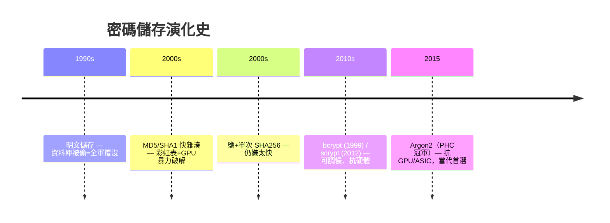

# 1.4 密碼儲存：從明文到 Argon2

## 一條用事故鋪成的演化路

密碼儲存的每一代技術，都是上一代**被駭事故**的答案：



## 為什麼「快」是敵人

密碼驗證的數學模型：

$$\text{攻擊者總時間} = N_{\text{候選密碼}} \times T_{\text{單次驗證}}$$

防禦的槓桿只有兩個：

1. **加大 $N$ **：密碼政策要求長度與複雜度（但使用者會用 Password1!）
2. **加大 $T$ **：故意讓驗證變慢 —— 這是演算法層的防禦

GPU 的算力曲線讓第 2 條成為唯一可靠的槓桿：

| 演算法 | GPU 猜測速度（RTX 級，8 字元小寫） | 破解時間量級 |
|--------|-----------------------------------|-------------|
| SHA-256 | ~數十億/秒 | 數天 |
| bcrypt（cost 12） | ~數萬/秒 | 數萬年 |
| Argon2id（64MB memory） | 更低 | 更久 |

**慢 1000 倍 = 攻擊成本乘 1000** —— 經濟學防禦（1.1 節）的教科書應用。

## Argon2 的三個旋鈕

Argon2（2015 Password Hashing Competition 冠軍，RFC 9106）不只「慢」，而是**佔資源**：

| 參數 | 意義 | 防什麼 |
|------|------|--------|
| `memory_cost` | 每次雜湊佔用的記憶體 | GPU/ASIC 有海量算力但記憶體貴 |
| `time_cost` | 迭代次數 | 拖時間 |
| `parallelism` | 平行度 | 利用多核，兼顧使用者體驗 |

**記憶體困難（memory-hard）**是相對 bcrypt 的本質優勢：GPU 的並行優勢被記憶體需求壓制。

## 實作：Rust（前書後端）

```rust
use argon2::{Argon2, PasswordHasher, PasswordVerifier, password_hash::{SaltString, PasswordHash, rand_core::OsRng}};

pub fn hash_password(plain: &str) -> Result<String> {
    let salt = SaltString::generate(&mut OsRng);           // 每用戶隨機鹽
    let argon2 = Argon2::default();
    let hash = argon2.hash_password(plain.as_bytes(), &salt)?;
    Ok(hash.to_string())    // 自含參數的 PHC 格式字串
}

pub fn verify_password(plain: &str, stored: &str) -> bool {
    PasswordHash::new(stored)
        .and_then(|parsed| Argon2::default().verify_password(plain.as_bytes(), &parsed))
        .is_ok()
}
```

儲存格式（PHC string）**自含演算法與參數**：

```
$argon2id$v=19$m=19456,t=2,p=1$<salt>$<hash>
 └演算法   └版本  └參數    └鹽     └雜湊
```

**可升級性的關鍵**：參數內嵌於雜湊字串，未來改安全等級時，只需在使用者登入成功時用新參數重雜湊（lazy rehashing）—— 舊資料仍可驗證，新標準逐步覆蓋。

### JS 端（Node.js）對照

```javascript
import argon2 from 'argon2';
const hash = await argon2.hash(password, { type: argon2.argon2id, memoryCost: 19456, timeCost: 2 });
await argon2.verify(hash, password);
```

## 鹽的正確理解

- **每用戶不同**（隨機生成，不需要保密地存）
- 鹽**不是秘鑰**：鹽防彩虹表，防離線暴力的是「慢」
- 進階：**pepper**（應用層秘鑰，存在 HSM/KMS 不進資料庫）在 DB 被偷但 KMS 未淪陷時再加一層

## 政策與流程

| 議題 | 建議 |
|------|------|
| 最小長度 | ≥ 12 字元；**不要**強迫特殊符號（NIST 800-63B 的反直覺建議） |
| 密碼強度檢查 | 對照洩漏密碼清單（HIBP API）而非強迫複雜度 |
| 限速 | 登入嘗試限流（3.4），加二次驗證（3.2） |
| 遷移 | 檢測到舊格式 → 登入成功時升級重雜湊 |

NIST 的啟示：**強迫定期換密碼、強迫特殊符號都被撤回了** —— 研究顯示這些規則讓使用者選出可預測的模式（Summer2024!）。安全政策也要跟著證據演化。

## 習題

1. 計算：若 Argon2id 單次 100ms，攻擊者用 1000 台 GPU 每台 100 H/s，破 12 位元隨機密碼需多久？
2. 實作 lazy rehashing：登入時檢測 PHC 字串參數低於新標準則重雜湊。
3. 為什麼 NIST 撤回「定期換密碼」？這對「安全規則基於證據而非直覺」有何啟示？
