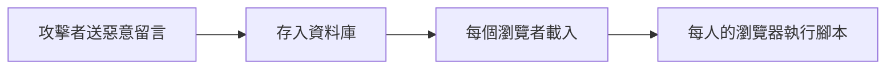
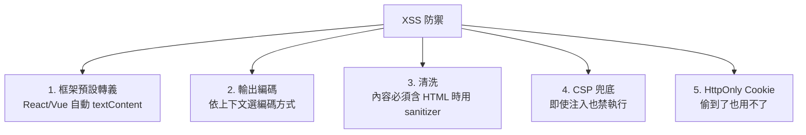

# 2.1 XSS：注入的三種形態與根源

## Web 安全的第一名罪

XSS（Cross-Site Scripting，1995 年前後出現、2000 年微軟命名）是 Web 漏洞的常青樹：OWASP Top 10 從第一版（2003）至今始終在列。

## 根源：資料與程式碼的邊界

回顧 1.1 的第一公理。瀏覽器的問題在於：**HTML 把「文字」與「程式（script）」混在同一份文件裡**：

```html
<p>留言：你好</p>          ← 文字
<script>evil()</script>   ← 程式碼
```

若應用把**不可信輸入**未經處理地拼進 HTML，攻擊者送出的「資料」就被瀏覽器當「程式」執行：

```javascript
// 留言板：把輸入直接塞進 DOM
el.innerHTML = comment;
// 攻擊者留言：
```

**為什麼這麼嚴重**：腳本運行在受害者與你的**同源**（same-origin）下，可讀 cookie、localStorage、token、代表使用者操作 API —— 攻擊者借用的是**使用者的合法身份**（1.2 STRIDE 的 Spoofing + Elevation）。

## 三種形態

### 1. Stored XSS（儲存型）— 最危險



Payload 持久化，**所有訪客中招** —— Samy 蠕蟲（2005）在 MySpace 上 20 小時感染一百萬用戶（自我複製型 stored XSS），MySpace 服务器宕机。**蠕蟲化**是 XSS 的終極形態：腳本不但偷資料，還以受害者身份再發佈自己。

### 2. Reflected XSS（反射型）

```
https://shop.com/search?q=<script>...</script>
```

Payload 在 URL 裡、隨回應「反射」出來。需要誘導受害者點擊特製連結（釣魚信）—— 單次性、但可配合短網址隱藏。

### 3. DOM-based XSS

```javascript
// 純前端問題：資料不經伺服器，直接從 location 讀入 DOM
el.innerHTML = new URLSearchParams(location.search).get('q');
```

伺服器完全看不到攻擊（安全掃描器也看不到）—— **只在客戶端發生的信任邊界穿越**，SPA 時代比例大增。

## 防禦總綱：讓輸入永遠是資料



### 框架的貢獻：預設安全

```jsx
function Comment({ text }) {
  return <p>{text}</p>;    // React 自動轉義 — 等價 textContent
  // return <p dangerouslySetInnerHTML={{__html: text}} />;  ← 逃生艙，需 sanitizer
}
```

**框架最大的安全貢獻是「預設安全」（secure by default）**：開發者必須**刻意**（dangerouslySetInnerHTML 這個名字就在羞辱你）才會打開注入之門。這是 2000 年代手拼字串時代的直接教訓。

### 依上下文編碼：一個輸出點一種編碼

| 輸出位置 | 編碼方式 |
|---------|---------|
| HTML 本文 | `&<>"'` 實體 |
| HTML 屬性 | 引號包裹 + 屬性編碼 |
| `<script>` 內 | **避免**，改用 JSON + 外部取得 |
| URL 參數 | `encodeURIComponent` |

```javascript
// ❌ 最常見的破口：把伺服器資料內聯進 script
<script>const user = { name: "${userName}" };</script>
// name = `</script><script>alert(1)</script>` → 逃逸！

// ✅ 改從 API 取得，或用 CSP 允許的 JSON endpoint
```

### Sanitizer：內容必須帶 HTML 時

```javascript
import DOMPurify from 'dompurify';
el.innerHTML = DOMPurify.sanitize(userHtml);
// 白名單保留 <b> <a>，剝離 <script> onerror= javascript:
```

白名單（只允許安全標籤）而非黑名單（過濾已知壞的）—— **黑名單永遠追不完繞過技巧**（`<scrscriptipt>`、大小寫、編碼雙層繞過……）。

## SameSite Cookie 與 HttpOnly（縱深防禦）

```
Set-Cookie: session=...; HttpOnly; Secure; SameSite=Lax
```

- `HttpOnly`：JS 讀不到 cookie → XSS 偷不走 session（但偷得到 token/localStorage！）
- `SameSite`：主要防 CSRF（2.2），順便降低 XSS 的跨站利用面

**HttpOnly 的教訓**：token 放 cookie + HttpOnly，比放 localStorage 更抗 XSS —— 這是架構級防禦（選錯儲存位置，前端寫得再乾淨都會被偷）。

## 檢查清單

- [ ] 全部用框架的預設插值（React JSX、Vue `{{}}`），禁用原始 innerHTML
- [ ] 必須的 HTML 經 DOMPurify 白名單清洗
- [ ] 資料不內聯進 `<script>`
- [ ] Cookie：HttpOnly + Secure + SameSite
- [ ] 上線前 CSP（2.4）至少 `report-only` 模式驗證

## 習題

1. 為何 stored XSS 能蠕蟲化？設計一個自複製 XSS 的傳播鏈並列出斷鏈點。
2. 說明「白名單清洗」與「黑名單過濾」的勝負原因。
3. 為什麼 token 放 localStorage 在 XSS 面前比 HttpOnly cookie 脆弱？設計整合方案。
