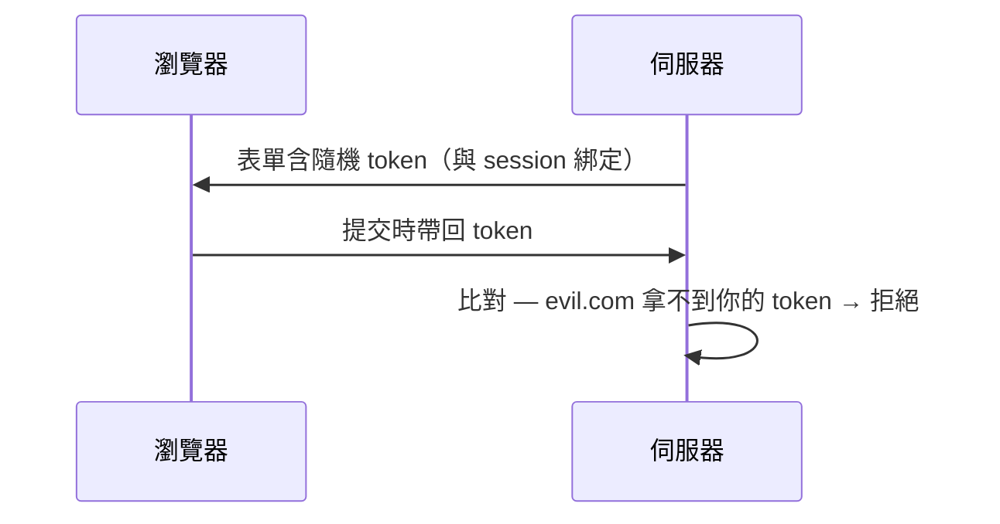

# 2.2 CSRF：被信任的身份被利用

## 攻擊場景：銀行網站成了幫兇

2001 年前後被系統性提出的 CSRF（Cross-Site Request Forgery）的恐怖之處：**攻擊者不需要偷到任何東西**。

```mermaid
sequenceDiagram
    participant V as 受害者
    participant B as 瀏覽器
    participant E as evil.com
    participant S as bank.com

    V->>S: 登入（瀏覽器存了 session cookie）
    V->>E: 被誘導開啟惡意頁
    E->>B: <form action="bank.com/transfer" method="POST"><input name="to" value="attacker"><input name="amt" value="10000"></form> 自動送出
    B->>S: POST /transfer（**瀏覽器自動附上 bank.com 的 cookie！**）
    S->>S: session 有效 → 視為合法操作
    Note over S: 轉帳成功 — S 全程不知情
```



## 根源：Cookie 的自動附帶 + 請求無法自證

$$\text{CSRF 成立的兩個前提}：
\begin{cases}
\text{瀏覽器自動附帶身份憑證（cookie）} \\
\text{伺服器無法區分「本人發的」與「他站代發的」}
\end{cases}$$

第一前提是 HTTP 憑證模型的設計（方便），第二前提是伺服器只看「憑證有效」不看「請求發起者」。CSRF 不違反同源策略（請求可以發出，只是**讀不到回應**）—— 這是很多開發者誤判的點。

## 為什麼 GET 有原罪

```html

<!-- 或一行 CSS -->
<style>body { background: url("https://bank.com/logout") }</style>
```

狀態變更操作若用 GET，任何能發出請求的標籤都是武器。**第一防線：狀態變更一律 POST/PUT/DELETE**（《HTTP 書》1.x 語意規則的安全回報）。

## 防禦一：SameSite Cookie（現代預設解）

```
Set-Cookie: session=...; SameSite=Lax; Secure; HttpOnly
```

| 值 | 跨站請求帶 cookie？ | 效果 |
|----|--------------------|------|
| `Strict` | 完全不帶 | 最安全；從外部連結進站也未登入，體驗差 |
| `Lax`（預設） | 頂層 GET 導航帶；POST/iframe/JS 不帶 | 擋掉絕大多數 CSRF |
| `None` | 都帶 | 需 `Secure`；僅跨站功能必要時 |

Chrome 2020 起預設 `Lax` —— **瀏覽器層的預設安全**，與 React 自動轉義（2.1）同一哲學：把安全做成預設值。

## 防禦二：CSRF Token（經典正解）



```rust
// Axum：double-submit cookie 模式
// 表單與 cookie 各帶一份同值隨機碼，伺服器比對
async fn handle(Form(f): Form<Transfer>, State(st): State<AppState>) -> Result<...> {
    let cookie_tok = f.csrf_token;
    let header_tok = st.session.get_csrf(&f.session_id);
    (cookie_tok == header_tok).then_some(()).ok_or(AppError::Forbidden)?;
    // ...
}
```

原理：跨站的 evil.com 可以「發請求」但**讀不到你網域的 cookie 或頁面內容**（同源策略）—— 所以它無法把 token 帶上。Token 的安全性直接寄生於**同源策略**，環環相扣。

## 防禦三：Origin 標頭驗證（簡單有效）

```rust
let origin = req.headers().get("origin")
    .ok_or(AppError::Forbidden)?;
(origin == "https://example.com").then_some(()).ok_or(AppError::Forbidden)?;
```

瀏覽器在跨站 POST 必帶 `Origin`（與 `Referer`，可被隱私插件剝除所以 Origin 較可靠）。驗證它等於白名單發起者。

## 防禦四：鑑權改用 Token 而非 Cookie

```
Authorization: Bearer <jwt>   ← JS 手動附加，瀏覽器不會自動帶
```

**JWT 放 localStorage/手動 header 的架構天然免疫 CSRF**（2.4 遠端請求需腳本主動帶）—— 但代價是回頭暴露 XSS 風險（2.1 的教訓：HttpOnly cookie 更抗 XSS）。

$$\text{CSRF} \leftrightarrow \text{XSS 的蹺蹺板}：
\begin{cases}
\text{Cookie 認證} & \Rightarrow \text{防 XSS 較好，防 CSRF 要下功夫} \\
\text{Bearer token} & \Rightarrow \text{天然防 CSRF，但 XSS 直接偷走 token}
\end{cases}$$

務實解法：**HttpOnly Cookie + SameSite=Lax + 敏感操作加 CSRF token**，三者相加成本最低。

## 檢查清單

- [ ] 狀態變更禁用 GET
- [ ] Cookie：SameSite=Lax（預設）、Secure、HttpOnly
- [ ] 敏感端點驗 Origin 或 CSRF token
- [ ] JSON API 驗 Content-Type（form 隱藏送 JSON 不易）

## 習題

1. 說明「CSRF token 的安全性寄生於同源策略」—— 若瀏覽器移除同源策略會怎樣？
2. 為什麼 SameSite=Strict 會破壞「從郵件連結進來還要重新登入」的體驗？設計取捨方案。
3. 攻擊者可否用 `` 發動 CSRF 攻擊 POST 請求？為什麼 GET+狀態變更是死罪？
