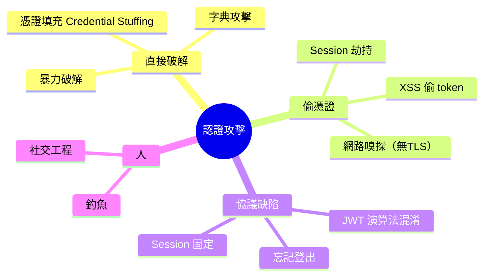
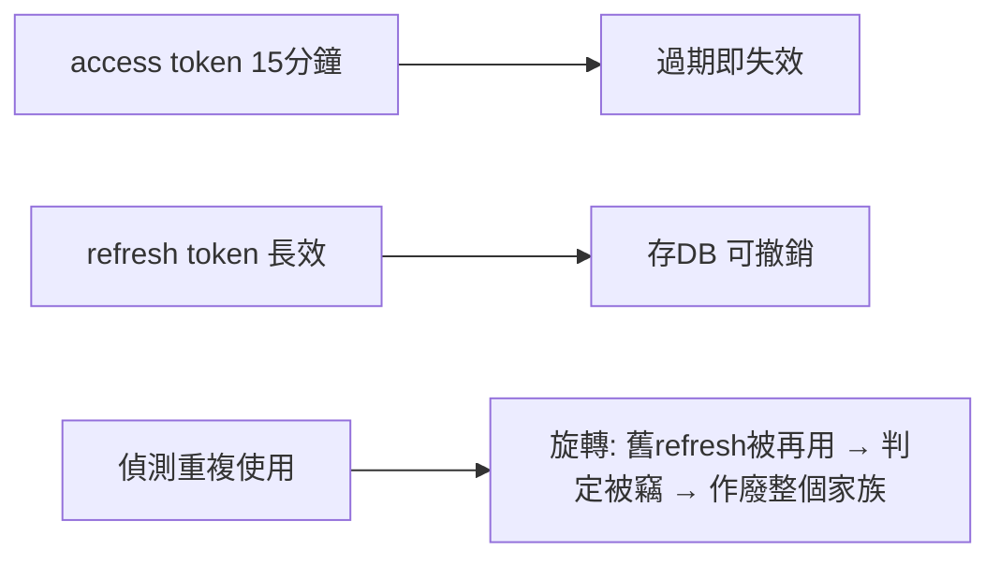
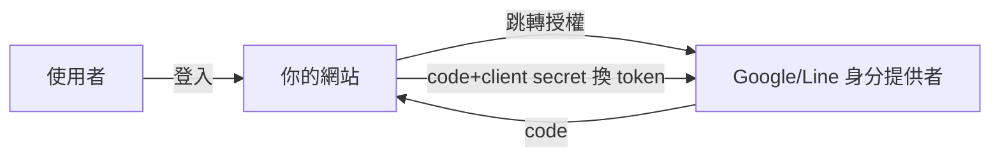

# 3.2 認證攻擊：Session、JWT 與憑證填充

## 認證是攻防的主戰場

對攻擊者而言，**拿到合法身份 = 免繞過所有授權** —— 比 Excel 級的注入划算得多。所以認證被攻擊的方式極多。

## 攻擊面總覽



## 憑證填充：現代最流行的登入攻擊

$$\text{填充} = \text{用外部洩漏的}（帳號，密碼）\text{對}， \text{到你的站試登入}$$

背景：歷年外洩累積數十億組帳密（Collection #1-#5、RockYou2021）。因為**使用者重複用密碼**，填充的成功率約 0.1–2% —— 但量大（每秒數千次）就夠賺。

防禦組合：

| 措施 | 作用 |
|------|------|
| 登入限流（3.4） | 拖慢批量測試 |
| 對照 HIBP 洩漏庫 | 阻止已知洩漏密碼註冊 |
| **MFA 二次驗證** | 密碼洩了也登不進（結構性防禦） |
| 指紋/風控 | 偵測異常（換 IP 大批量試錯） |

**MFA 是憑證填充的剋星**：密碼只證明「知道秘密」，MFA 證明「持有裝置」—— 兩個獨立因素（something you know / have / are）。

## JWT 的攻擊史（回顧前書 3.4 並補防禦）

### 攻擊一：演算法混淆（alg: none / HS↔RS 混淆）

```json
{ "alg": "none", "typ": "JWT" }        // 2015 年多個庫的災難：不驗簽
{ "alg": "HS256" }                     // 對「期待 RS256」的服務：把公鑰當 HMAC 密鑰
```

防禦：驗證端**寫死期望演算法**：

```rust
// 永不接受 token 聲明的演算法
let mut v = Validation::new(Algorithm::RS256);   // 只有 RS256
v.validate_exp = true;
v.validate_aud = Some(true);
```

### 攻擊二：弱密鑰

HS256 密鑰若短/可猜（`secret123`），hashcat 直接離線爆破。**HS256 密鑰 ≥ 256 bit 隨機**，或直接用 RS/ES 非對稱。

### 攻擊三：無法撤銷（前書 3.4 已述）



**Refresh token 旋轉 + 重用偵測**是現行最佳實務：正常流程每次換新 refresh；舊 token 被第二次使用 = 被竊訊號 → 作廢全部關聯 token。

## Session 安全清單

| 風險 | 防禦 |
|------|------|
| 側錄 | 全站 HTTPS（4.1） |
| XSS 偷 cookie | HttpOnly（2.1） |
| 固定攻擊（登入前後用同 session id） | **登入成功後重新生成 session id** |
| 逾時 | idle timeout + absolute timeout |
| 登出 | 伺服器端刪除 session（不只刪前端 cookie） |
| Cookie 屬性 | Secure + SameSite=Lax + HttpOnly（2.2） |

**Session 固定攻擊**的原理：攻擊者先拿一個空 session id 給受害者用，受害者登入後該 id 升級為已認證 —— 攻擊者沿用即進門。防禦就一句：登入時換 id。

## OAuth/SSO 的地位：把認證外包



用 Google 登入的收益：**密碼的攻擊面歸零**（你的站不存密碼）+ 繼承大廠的 MFA。代價：新增 OAuth 流程本身的攻擊面（redirect_uri 驗證、state 防 CSRF、token 外洩）—— 安全問題被轉移而非消滅，這是「攻擊面管理」（1.2）的動態。

## 習題

1. 設計「偵測憑證填充」的風控規則三條（輸入：登入日誌）。
2. JWT 演算法混淆的根因是「信任 token 自述」—— 這違反哪條公理？還有哪些協議犯同錯？
3. 為聊天室加上 Email 驗證碼 MFA：畫出流程並寫出關鍵驗證碼儲存/過期邏輯。
