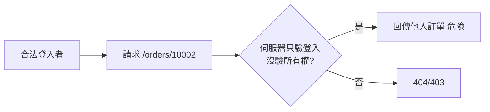

# 3.3 授權漏洞：IDOR 與越權訪問

## 認證通過 ≠ 授權正確

認證（你是誰）與授權（你能做什麼）的混淆是 Web 漏洞的常青問題。**登入成功只回答前者**；以下攻擊全部發生在「合法登入的使用者」身上。

## IDOR：改個數字就看別人的資料

IDOR（Insecure Direct Object Reference，2013 年進 OWASP Top 10 並成為 Bug Bounty 最常見獎項）：

```
GET /api/orders/10001    ← 我的訂單
GET /api/orders/10002    ← 改個數字 → 別人的訂單？？
```



### 防禦：所有權檢查下沉到資料層

回顧前書 5.1 的做法：

```sql
UPDATE todos SET done = NOT done
WHERE id = $1 AND user_id = $2    ← 授權即查詢條件
```

```rust
// 或在 repo 層統一封裝
pub async fn find_user_todo(pool: &PgPool, id: Uuid, user_id: Uuid) -> Option<Todo> {
    sqlx::query_as!(Todo, "SELECT * FROM todos WHERE id = $1 AND user_id = $2", id, user_id)
        .fetch_optional(pool).await.ok().flatten()
}
```

**把「owner 欄位 = 當前使用者」變成所有查詢的強制條件** —— 不存在「先查再檢查」的時間差與遺漏點。這是結構性防禦 vs 紀律性防禦的分野。

### UUID 能防 IDOR 嗎？

不可枚舉的 id（UUID）讓「改數字」變難，但：

- id 會出現在分享連結、日誌、Referer
- **隱藏 ≠ 授權**（1.1 的 obscurity 教訓）

結論：UUID 當輔助，所有權檢查不可省。

## 授權模型：三種正統

### 1. RBAC（角色制）

```rust
enum Role { User, Editor, Admin }

fn can(role: Role, action: Action) -> bool {
    use Role::*;
    match (role, action) {
        (Admin, _) => true,
        (Editor, Action::Publish | Action::Edit) => true,
        (User, Action::Read) => true,
        _ => false,
    }
}
```

適合權限有限的組織系統。弱點：角色爆炸（super-admin-2024-final-v2）。

### 2. ABAC（屬性制）

$$\text{允許} \iff f(\text{主體屬性}， \text{資源屬性}， \text{環境屬性})$$

例：「文檔建立者的同部門成員、在上班時間、可讀」。靈活但難審計。

### 3. 關係型（ReBAC，Google Zanzibar 2019）

「文件的協作者、協作者的同事」—— 權限是**關係圖**。Google Drive 的分享模型、當代授權服務（SpiceDB、OpenFGA）的基礎。

$$\text{選型}： \text{角色少選 RBAC}， \text{規則複雜選 ABAC}， \text{共享關係複雜選 ReBAC}$$

## 權限提升的其他路徑

| 攻擊 | 例 | 防禦 |
|------|-----|------|
| 水平越權 | 改 id 看別人（IDOR） | owner 條件 |
| 垂直越權 | 一般用戶呼叫 admin API | 端點級角色中介層 |
| 隱藏端點 | 「不顯示按鈕」但 API 還在 | **UI 隱藏 ≠ 權限控制** |
| 參數信任 | `req.body.role = "admin"` 被接受 | 白名單欄位（zod/提取器） |
| 功能級遺漏 | 忘記給新端點掛中介層 | 預設拒絕（deny by default）路由設計 |

```rust
// 預設拒絕：router 分組 + 整組中介層（前書 3.2）
let admin = Router::new()
    .route("/admin/users", get(list_all))
    .route_layer(middleware::from_fn(require_admin));   // 忘記掛的端點不會誤入此組
```

**預設拒絕**是授權版的「secure by default」：忘記授權的結果是「不能做」而非「能做」。

## 批量賦能（Mass Assignment）

```javascript
// 把整個 body 丟給 update —— 危險
await User.update(req.user.id, req.body);
// body 混入 "role": "admin" → 自我升權！

// 白名單欄位
const { name, email } = req.body;   // 只取允許的
await User.update(req.user.id, { name, email });
```

與 2.1 XSS 同根源：**相信了不可信資料的形狀**。zod/提取器（前書 3.2）的「只接受宣告過的欄位」是同一防禦。

## 習題

1. 審查你所有 API：列出哪些端點缺 owner 條件或角色中介層，逐一修復。
2. 設計「文件共享」的 ReBAC 資料模型（tables + 查詢）。
3. 為什麼「前端隱藏按鈕」完全不構成防禦？從攻擊者的工具（curl）角度說明。
