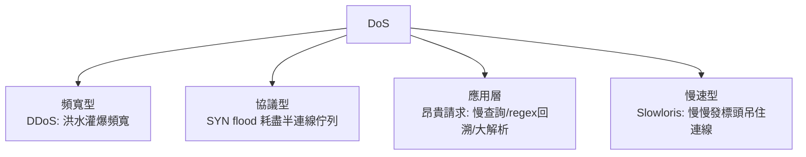
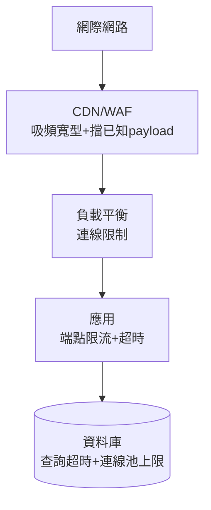

# 3.4 限流與 DoS 防護

## 可用性也是安全（回顧 CIA）

資料被偷（C）、被改（I）之外，**「服務癱瘓」是第三種直接傷害**（A）。DoS 的本質：把系統的有限資源（頻寬、連線、CPU、記憶體、DB 查詢）耗盡。

$$\text{DoS 成立條件}： \lambda_{\text{攻擊}} > \lambda_{\text{容量}} \quad \text{（1.2 攻擊面：任何有限資源都是入口）}$$

## DoS 的分類



- **頻寬型**只能靠上游（CDN/ISP）吸收 —— 你的機器物理上收不完
- **應用層 DoS** 是網站工程師的真正戰場：**每秒 10 個請求也可能是 DoS，如果每個請求讓 DB 做 5 秒全表掃描**

## 應用層限流（Rate Limiting）

### 演算法選擇

| 演算法 | 機制 | 特點 |
|--------|------|------|
| 固定視窗 | 每分鐘重置計數 | 簡單；邊界突刺（兩窗交接口 2 倍量） |
| 滑動視窗日誌 | 記每筆時間戳 | 精確；記憶體貴 |
| **滑動視窗計數** | 前後窗加權 | 精確與成本的平衡，實務首選 |
| **Token Bucket** | 桶裝令牌，以速率補充，請求取令牌 | 允許突發、控制平均速率 |
| Leaky Bucket | 恆定速率漏出 | 削峰填谷 |

$$\text{Token Bucket}： \text{容量 } b， \text{補充速率 } r \Rightarrow \text{允許 } b \text{ 突發，長期 } r \text{ 平均}$$

### 維度選擇：限誰？

| 維度 | 防 |
|------|-----|
| IP | 機會型濫用（注意 NAT 後多使用者、代理池） |
| 帳號 | 登入爆破（比 IP 維度穩） |
| API key | 商業 API 配額 |
| 混合 | 敏感操作（登入/寄信）多重維度疊加 |

```rust
// Axum：tower_governor 按路徑掛限流（前書 3.4）
let sensitive = Router::new()
    .route("/login", post(login))
    .route("/password-reset", post(reset))
    .layer(governor_layer(GovernorConfigBuilder::default()
        .per_second(1)
        .burst_size(5)          // 5 秒內最多 5 次，之後每秒 1 次
        .finish().unwrap()));
```

## 慢速攻擊與連線資源

Slowloris（2009）只需極低頻寬：不斷髮半截標頭，吊住數千連線 —— 傳統「每連線一執行緒」伺服器直接枯竭。

防禦：連線逾時（讀超時、標頭超時）、非同步伺服器（Node/Tokio 天然耐連線數）、反向代理（Nginx 預設擋 slowloris）。

## ReDoS：正則回溯炸彈

```javascript
/(a+)+$/.test("aaaaaaaaaaaaaaaaaaaaaaaaX");
// 災難性回溯 O(2^n) → 單一請求凍結事件循環
```

惡意輸入觸發正則災難回溯 = 單執行緒 JS 服務（前書 6.1）**整站凍結**。防禦：

- 避免 nested quantifier（`(a+)+`、`(a|a)*`）
- RE2 / Rust regex（線性時間引擎，語法受限）
- 正則也限流/限長

## 應用層的昂貴請求

| 資源耗費 | 例 | 防禦 |
|---------|-----|------|
| DB | 複雜查詢、offset 分頁 | 查詢超時、cursor 分頁（前書 5.4） |
| 解析 | 大 XML/zip bomb | 大小上限、深度上限 |
| 圖片 | 上傳 10000×10000 縮圖 | 限制尺寸、串流處理 |
| 幣 | 註冊送信 | 驗證碼 + 限流 |

**每個端點問一句：最壞情況這個請求花多少資源？** —— 這是 1.2 威脅建模 STRIDE 中 D（DoS）的具體化。

## 分層防禦架構



每層的限流數值設計原則：**正常使用者的 P99 行為 + 安全餘量**。過緊傷真用戶（誤殺），過鬆形同虛設 —— 觀測（5.3）先行，再設閾值。

## 習題

1. 為登入端點設計三維限流（IP/帳號/全局），寫出各維度閾值與理由。
2. 找出你專案中最昂貴的三個端點，為每個估算「最壞請求成本」並加防禦。
3. 為什麼 DDoS 無法在自家伺服器上解決？從封包物理路徑說明。
