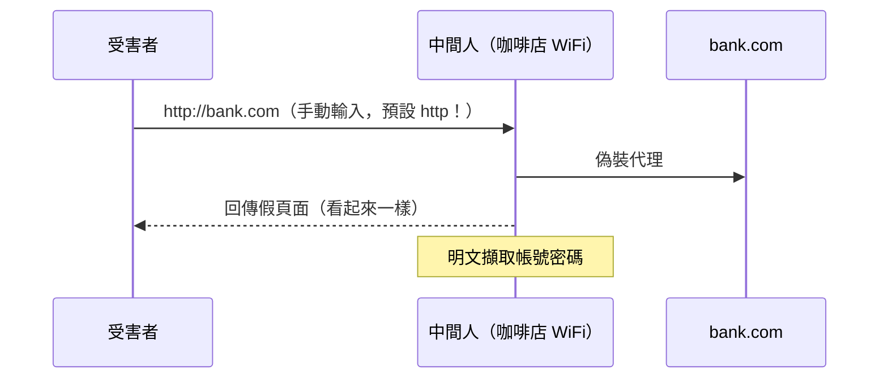

# 4.1 HTTPS 強化與 HSTS

## HTTPS 不是終點而是起點

《HTTP 書》2.2 已講清 TLS 的原理。本章講**啟用之後**的強化：現代 TLS 配置、HSTS、以及降級攻擊的歷史。

## 降級攻擊史：為什麼需要 HSTS

### 攻擊場景：SSL 剝除（SSL Stripping）



使用者在網址欄輸入 `bank.com`，瀏覽器先試 http —— 這個「先 http」的善意預設就是破口。中間人甚至會把 301 轉址假裝成正常（使用者根本不會注意網址欄少一個鎖）。

**HSTS（HTTP Strict Transport Security，RFC 6797，2012）的回答**：

```
Strict-Transport-Security: max-age=31536000; includeSubDomains; preload
```

瀏覽器看到此標頭後，**在 max-age 期間內，對該域名的一切請求強制走 https，且拒絕任何憑證錯誤的例外**（連「點繼續前往」都沒有）。

- `max-age`：策略有效期（一年起跳）
- `includeSubDomains`：覆蓋所有子域（堵 `dev.bank.com` 的旁路）
- `preload`：申請進入 [hstspreload.org](https://hstspreload.org) 清單 —— **第一次訪問就強制 https**（HSTS 標頭本身需要先 https 一次才生效，preload 清單解決「雞生蛋」問題）

$$\text{降級攻擊的防禦邏輯}： \text{把「使用者選擇 https」升級為「域名承諾 https」}$$

## 降級攻擊的歷史課：POODLE 與 FREAK

| 事件 | 年 | 原理 | 教訓 |
|------|-----|------|------|
| POODLE | 2014 | 逼客戶端降級到 SSLv3 再攻擊 padding | 協議支援要**刪**，不是「關閉推薦」 |
| FREAK | 2015 | 逼降級到 512-bit 出口級金鑰 | 伺服器「接受了降級請求」就是漏洞 |
| Logjam | 2015 | 逼降級到 512-bit DH | 同上 |

模式：**攻擊者不破解強演算法，而是把你逼回弱演算法**。所以現代 TLS 配置的第一原則：

- 禁用 TLS 1.0/1.1、SSL 全系
- 只留 **TLS 1.2 + TLS 1.3**（1.3 順便把握手降到 1-RTT，前書 2.1 的因果）

## 現代 TLS 配置（Nginx）

```nginx
ssl_protocols TLSv1.2 TLSv1.3;
ssl_ciphers ECDHE-ECDSA-AES128-GCM-SHA256:ECDHE-RSA-AES128-GCM-SHA256:...;
ssl_prefer_server_ciphers off;        # TLS1.3 建議交給客戶端
ssl_session_cache shared:SSL:10m;
ssl_stapling on;                       # OCSP Stapling
add_header Strict-Transport-Security "max-age=31536000; includeSubDomains" always;
```

- **OCSP Stapling**：憑證吊銷狀態由伺服器「釘」在握手中（避免瀏覽器逐個查 OCSP 的隱私洩漏與延遲）
- `always`：連 4xx/5xx 回應都帶 HSTS 標頭（預設 add_header 在錯誤頁會丟失）

## 憑證自動化：ACME 與 Let's Encrypt

```bash
# certbot 自動簽發+續約（HTTP-01 challenge）
certbot --nginx -d example.com -d www.example.com
```

ACME 協議（2015）的貢獻：**憑證生命週期自動化**，90 天短憑證成為可能 —— 短憑證 = 被偷的憑證快速失效。**自動化讓「短」可承受**，這是工程學對密碼學生命週期的貢獻。

## 混合內容（Mixed Content）陷阱

```html
<!-- https 頁面裡的 http 資源 -->

<script src="http://cdn.example.com/app.js"></script>   ← 主動內容：直接被瀏覽器擋
```

https 頁面載入 http 資源 = 加密形同虛設（中間人可改 http 資源）。瀏覽器現在**主動內容（script）直接擋、被動內容（img）警告**。修法：資源一律相對路徑或 `upgrade-insecure-requests`（2.4 CSP）。

## 上線檢查清單

- [ ] TLS 1.2+，1.3 優先；SSLv3/1.0/1.1 禁用
- [ ] HSTS：max-age ≥ 1 年 + includeSubDomains；站穩後 preload
- [ ] 全站資源 https（無 mixed content）
- [ ] 憑證自動續約 + 到期監控（憑證過期是最蠢也最常見的停機原因）
- [ ] [ssllabs.com/ssltest](https://www.ssllabs.com/ssltest/) 拿 A+

## 習題

1. 畫出「無 HSTS」與「有 HSTS+preload」時，咖啡店攻擊的結果差異。
2. 為什麼 preload 清單「進去容易退出難」（清理要數月）？這對全域承諾的取捨有何啟示？
3. 用 ssllabs 測一個站，指出每個扣分項對應的攻擊史（POODLE/FREAK/...）。
