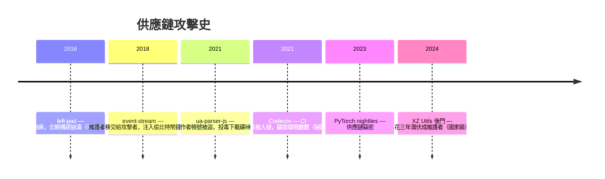
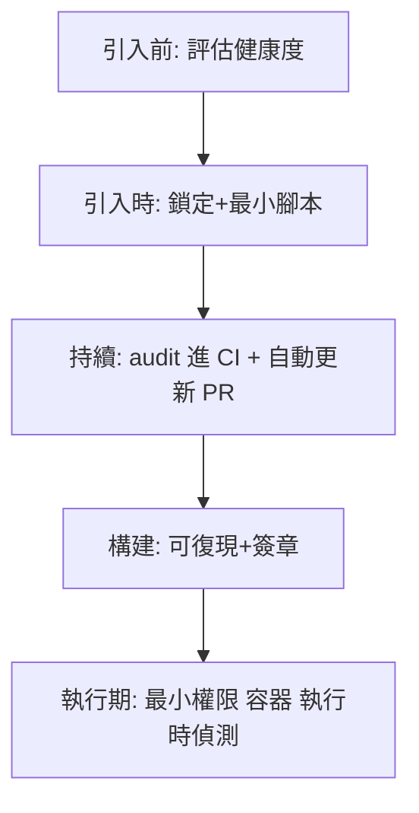

# 4.2 供應鏈攻擊與相依套件安全

## 你信任的代碼，比你想的多

```bash
npm install express     # → 拉下 60+ 個間接依賴
cargo add axum          # → 同樣數百個傳遞依賴
```

$$\text{你實際執行的代碼} \gg \text{你寫的代碼} \quad \text{（比例常是 1:100 以上）}$$

**現代應用的安全邊界被迫擴大到整個依賴樹** —— 攻擊者很早就發現了：攻擊你的代碼難，攻擊你信任的依賴容易。

## 攻擊類型與歷史案例



### 攻擊手法分類

| 手法 | 機制 | 例 |
|------|------|-----|
| 帳號劫持 | 維護者 npm token 被盜 | ua-parser-js |
| 社交接管 | 原作者棄坑，攻擊者「善意接手」 | event-stream |
| 拼錯劫持（typosquatting） | `request-js` vs `request` | 假套件 |
| 依賴混淆 | 內部私有套件名被註冊到公網 | 2021 年多公司中招 |
| 構建系統入侵 | 攻 CI/CD 工具本身 | Codecov、SolarWinds |
| 長期潛伏 | 取得信任後植入後門 | XZ Utils（2024） |

### XZ 事件（2024）的深刻教訓

攻擊者 Jia Tan 用**兩三年**時間：認真貢獻取得信任 → 成為共同維護者 → 執掌發布權 → 在壓縮庫植入針對 sshd 的後門。被發現純屬幸運（一位工程師注意到 500ms 的效能異常）。

$$\text{供應鏈的終極難題}： \text{開源信任模型（人人可貢獻）vs 完整性需求}$$

部分緩解方案：**可復現構建**（任何人都可從源碼重現出位元相同的二進位）+ **簽章與透明日誌**（Sigstore、cargo auditable）。

## 防禦實務

### 1. 鎖定與審計

```bash
npm audit                  # 掃已知 CVE
npm audit fix
cargo audit                # Rust: RustSec 資料庫
cargo deny                 # 許可證+重複版本+來源
pip-audit / safety         # Python
```

`package-lock.json` / `Cargo.lock` **必須進版控** —— 鎖定=可重現=可審計。

### 2. 自動化漏洞掃描進 CI（前書 5.2/5.3）

```yaml
- run: cargo audit --deny warnings
- uses: github/dependency-review-action@v4   # PR 中新依賴的安全性審查
- run: npx @socketsecurity/cli audit        # 偵測安裝腳本/異常行為
```

### 3. 減少依賴（治本）

$$\text{風險} \propto \text{依賴數量} \times \text{依賴品質}$$

問三題才引入新依賴：

1. 標準庫/已有依賴能做嗎？（左-pad 教訓：一個 11 行函數值得依賴嗎）
2. 它健康嗎？（維護者數、更新頻率、下載量、開放 issue 品質）
3. 它的權限範圍？（帶安裝 postinstall 腳本？要求底層權限？）

### 4. 收緊安裝行為

```bash
npm ci --ignore-scripts        # 禁 postinstall 腳本
npm config set ignore-scripts true
```

```toml
# Cargo.toml：限制來源與拒絕未知 registry
[package.metadata.cargo-udeps]
[dependencies]
```

### 5. 秘鑰不進 CI 環境變數之外的地方

Codecov 教訓：**CI 的環境變數（AWS key、token）是供應鏈攻擊的高價值目標** —— 最小權限的 CI 憑證（4.3）、短期 token、OIDC 聯邦登入取代長期密鑰。

## 防禦層次總結



## 習題

1. 對你的專案跑 `npm audit`/`cargo audit`，把每個漏洞分類為「可升級/需重構/可接受」並說明理由。
2. 復現 left-pad 事件：刪除一個深層依賴會影響什麼？`npm ls <pkg>` 觀察依賴樹。
3. 設計「引入新依賴的團隊審核流程」，涵蓋本章三問。
