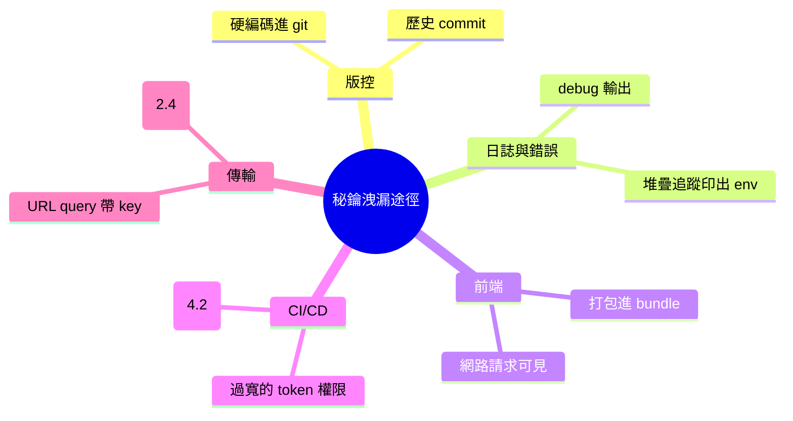
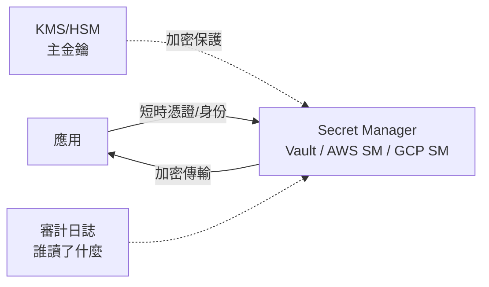
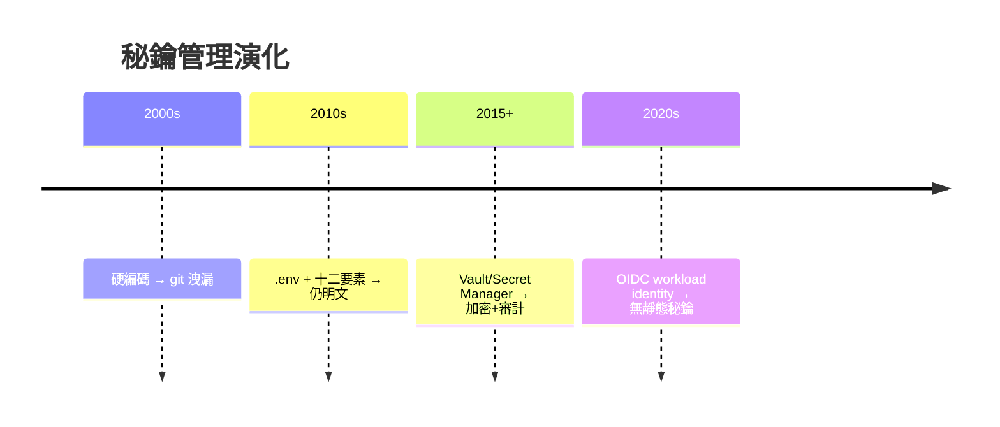
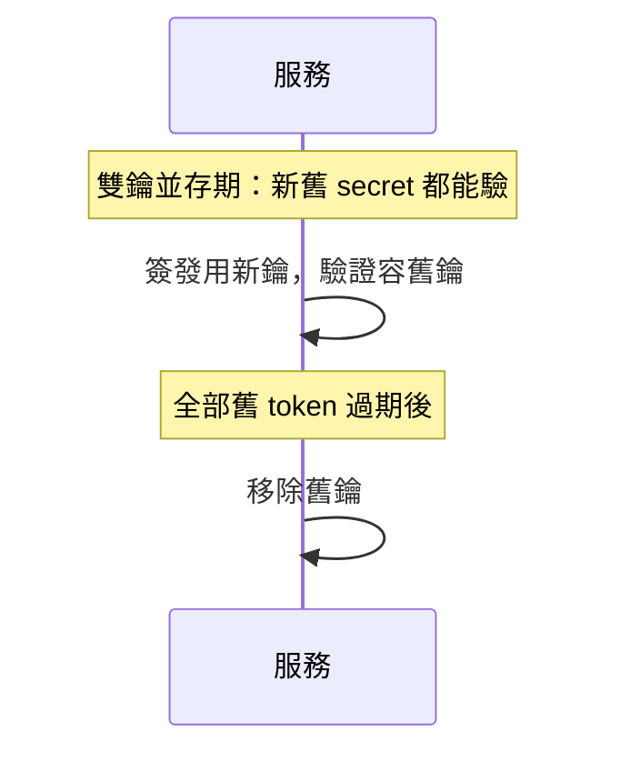

# 4.3 秘鑰管理：從環境變數到 Secret Manager

## 一把鑰匙洩漏的連鎖反應

資料庫密碼、JWT secret、AWS key、API token —— 現代應用跑在幾十把秘鑰上。**任何一把的洩漏都是一次事故**，而秘鑰的最大洩漏源就是開發者自己。

## 洩漏途徑盤點



### 真實代價：git 歷史是永久的

```bash
git log -p | grep -i "api_key"     # 攻擊者自動化掃描公開 repo
# GitHub 上每年數百萬把金鑰被自動發現
```

`git rm` + commit **不會移除歷史**。金鑰進過 git 的正確處置：

1. **立即輪換**（唯一真正有效的事）
2. 清歷史（filter-repo）或乾脆棄庫
3. 加入 pre-commit 掃描（gitleaks、truffleHog）防止再犯

**輪換 > 刪除** —— 秘鑰的價值在有效，不在秘密的位置。

## 第一層：環境變數與 .env

```bash
# .env（gitignore！）
DATABASE_URL=postgres://...
JWT_SECRET=...
```

```javascript
require('dotenv').config();       // 十二要素應用 III：配置與代碼分離
```

十二要素應用（2011）的洞見：**配置屬於部署環境而非代碼** —— 同一份代碼，staging/prod 各自注入配置。環境變數是最低成本的實現。

**但 .env 有天花板**：

- 仍然以明文存在開發機與 CI
- 沒有輪換機制
- 沒有存取審計（誰在何時讀了 prod 金鑰？）
- 容易被 debug 頁面/日誌意外印出

## 第二層：Secret Manager（專用金鑰保管）



| 能力 | .env | Secret Manager |
|------|------|----------------|
| 靜態加密 | ❌ | ✅（KMS 主鑰） |
| 存取審計 | ❌ | ✅ |
| 輪換 | 手動 | 自動/版本化 |
| TTL/短期憑證 | ❌ | ✅ |
| 最小權限授予 | ❌ | ✅（IAM 綁定） |

## 第三層：身份即憑證（Workload Identity）

**最好的秘鑰是沒有秘鑰**。雲端的 IAM 角色綁定讓服務**免持憑證**：

```yaml
# GitHub Actions 用 OIDC 取代長期 AWS key（4.2 供應鏈的解）
permissions:
  id-token: write
- uses: aws-actions/configure-aws-credentials@v4
  with:
    role-to-assume: arn:aws:iam::123:role/deploy   # 短期、可審計、無 static key
```



$$\text{演化主軸}： \text{秘密的存在時間越來越短}（\text{長期} \to \text{短期} \to \text{免持}）$$

**洩漏窗口最小化** —— 與 1.4 短憑證、JWT 短效期（3.2）同一哲學。

## 分層實務清單

- [ ] 前端 bundle 中**永無**機密（只有 public key 類）
- [ ] 機密不進 URL（2.4 Referer 教訓）
- [ ] 日誌/錯誤輸出過濾機密欄位（5.3）
- [ ] 開發/生產金鑰**完全分離**（開發金鑰洩漏≠無事，但爆炸半徑小）
- [ ] CI 權限最小化 + OIDC
- [ ] pre-commit 秘密掃描（gitleaks）
- [ ] 輪換演練：金鑰能被換掉嗎？（換不了=被綁架）

### 練習：金鑰輪換的架構前提



**雙鑰過渡**是零停機輪換的通用手法（JWT 的 `kid` 標頭、DB 密碼雙生效窗口）—— 能輪換的系統才算把秘鑰管起來。

## 習題

1. 掃描你的 git 歷史（`gitleaks detect`），處理發現的每一把金鑰。
2. 把一個服務的 AWS key 改造成 OIDC 職責角色，寫出 diff。
3. 設計 JWT signing key 的雙鑰輪換方案（含 kid 與驗證邏輯）。
