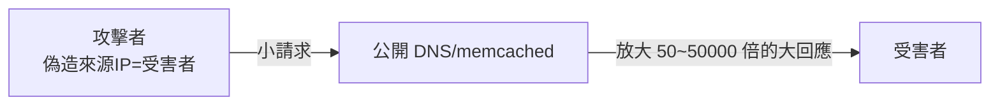
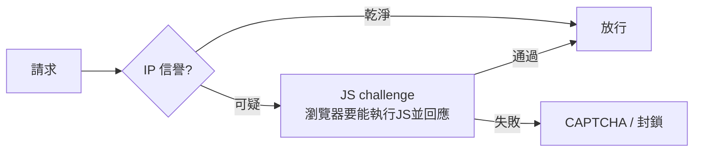
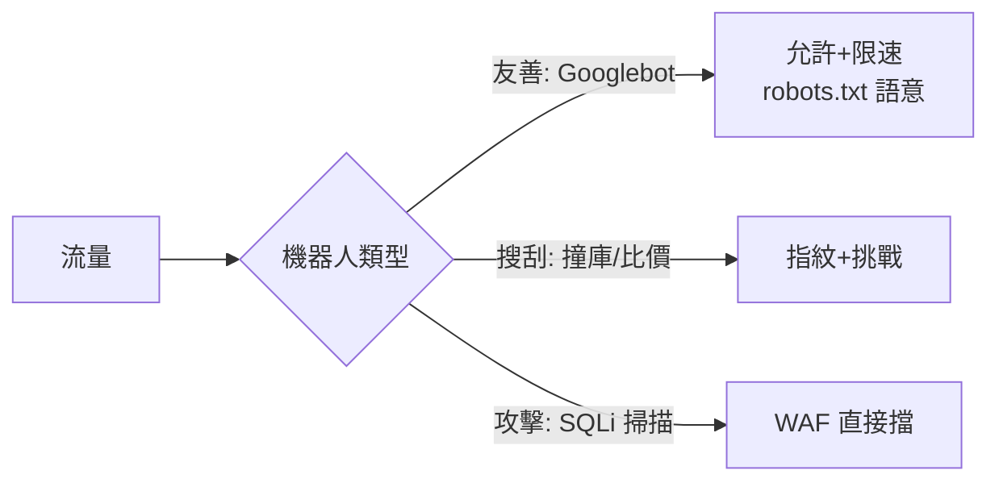

# 4.4 DDoS 與 CDN 防護

## 從單機到分佈式：攻防的不對稱

3.4 節處理的是「應用層、低流量」的資源耗盡。DDoS（Distributed DoS）是另一個量級：

$$\text{DDoS}： N \text{ 台被劫持機器（殭屍網路）同時攻擊} \quad N \approx 10^4 \sim 10^6$$

**不對稱性**：攻擊者租殭屍網路每小時幾十美元；你買同等頻寬防禦每月百萬美元 —— 正面對抗是輸的，唯一解是**把流量丟給比你更大管道的人**。

## 殭屍網路的簡史

| 年代 | 事件 | 特徵 |
|------|------|------|
| 1999 | Trinoo / TFN 首現 | 原型殭屍網路 |
| 2000 | Yahoo/Amazon DDoS | 第一次讓大廠斷線 |
| 2016 | Mirai | 攻擊 IoT（攝影機/路由器預設密碼），1Tbps 量級 Dyn 事件癱瘓半個網路 |
| 2020s | 反射放大攻擊為主流 | DNS/NTP/memcached 放大 |

### 反射放大攻擊：借用別人的頻寬打你



攻擊者發「小問、大答」的協議請求，**偽造來源 IP 為受害者** —— 回應全部湧向受害者。放大倍數（memcached 51,000 倍）讓小管道打出巨浪。防禦：BCP38（來源地址過濾，ISP 責任）—— 這說明 DDoS 是**網路生態問題**，不是單站問題。

## 防禦架構：逐層吸收

```mermaid
flowchart TD
    subgraph L3L4["L3/L4 網路層洪水"]
        ISP[上游 ISP scrubbing] --> CDNF[CDN Anycast 分散吸收]
    end
    subgraph L7["L7 應用層"]
        CDNF --> WAF[WAF 挑戰: JS challenge / CAPTCHA]
        WAF --> RL[限流(3.4)]
        RL --> APP[你的伺服器]
    end
```

### Anycast：用地理分散稀釋攻擊

$$\text{單點}： \text{全部攻擊流量} \to \text{一個 IP}； \quad \text{Anycast}： \text{流量被 BGP 引到全球數百節點}$$

同一 IP 位址在全球數百個邊緣節點同時廣播 —— 攻擊流量被自然分流到最近的節點，單節點壓力 = 總量/節點數。**這是 Cloudflare 等廠商的商業核心**。

### L7 挑戰：區分人與殭屍



DDoS 殭屍多是簡單 HTTP 客戶端（無 JS 引擎）—— 一個「執行 JS 並提交計算結果」的挑戰就過濾大半。現代演進：設備指紋、TLS 指紋（JA3）、行為分析。

## CDN 的安全角色（串連《HTTP 書》2.3）

| CDN 功能 | 防什麼 |
|---------|--------|
| TLS 終結 + 憑證管理 | 4.1 |
| 快取靜態內容 | 源站從不接觸多數流量 |
| Anycast 吸收 | L3/L4 洪水 |
| WAF 規則集 | 已知攻擊 payload（SQLi/XSS 特徵） |
| Bot 管理 | 撞庫、爬蟲、刷票 |
| API 防護 | Schema 驗證、限流 |

**你的源站只接受 CDN 的流量**（防火牆白名單 CDN IP 段）—— 否則攻擊者繞過 CDN 直接打源站 IP（origin exposure），CDN 防禦歸零。

## Bot 管理與爬蟲



網站 40%+ 的流量是機器人。分類管理（放過搜尋引擎、挑戰搜刮、封鎖攻擊）需要**可驗證的身份訊號**：TLS 指紋、行為熵、IP 信譽 —— 是一場持續的貓鼠遊戲。

## 實務清單

- [ ] 域名走 CDN；源站 IP 隱藏 + 防火牆白名單 CDN
- [ ] 開啟 CDN 的 WAF 與 bot 管理
- [ ] 源站保留限流與超時（CDN 是第一道，不是唯一一道）
- [ ] 準備 DDoS 應變手冊：誰打給 CDN 廠商？緊急聯絡人？
- [ ] 監控流量基線（5.3）：沒有基線，攻擊開始時你只會看到「變慢」

## 習題

1. 畫出 memcached 反射攻擊的封包流，計算 1 Gbps 攻擊者在 51000 倍放大下的實際打擊量。
2. 為什麼源站 IP 洩漏會使 CDN 防禦失效？列三條常見洩漏途徑（DNS 歷史記錄、郵件標頭…）。
3. 設計「登入 API 的 bot 分級策略」，覆蓋搜尋引擎、行動 App、撞庫殭屍三種流量。
