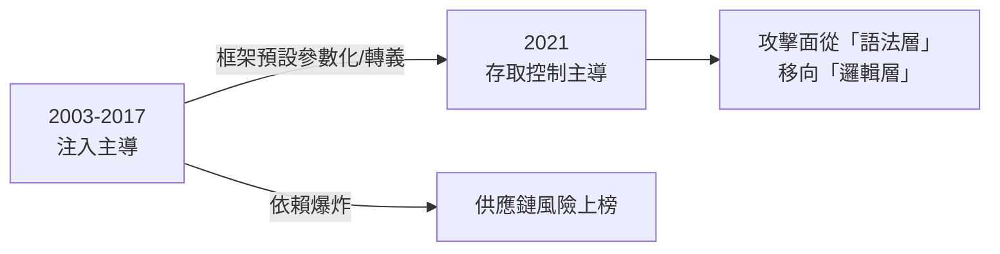
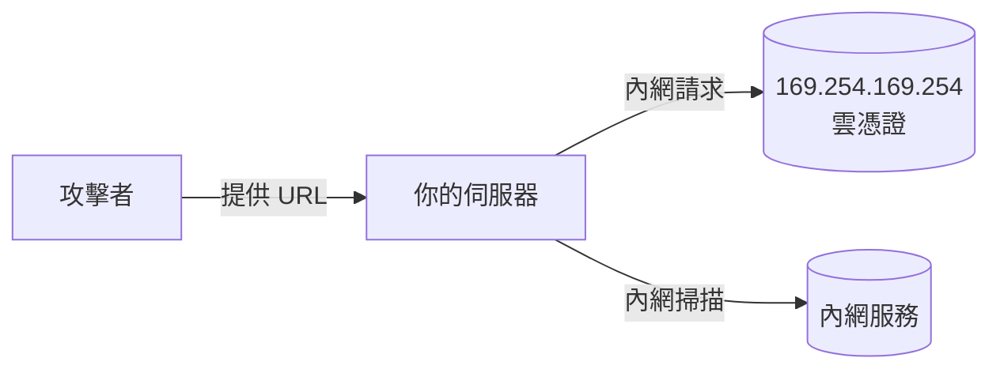

# 5.1 OWASP Top 10 的演化與解讀

## 安全界的共同語言

OWASP（Open Web Application Security Project，2001 年成立）自 2003 年起每 3–4 年發布 Top 10。它的價值不在排名精確，而在**反映攻擊結構的時代變遷** —— 讀懂它的演化史，等於讀懂二十年的 Web 安全史。

## 版本演化與因果

| 版本 | 首位風險 | 時代背景 |
|------|---------|---------|
| 2003 | A1 Unvalidated Input | 注入黃金年代：輸入驗證普遍缺失 |
| 2007 | A2 Injection | SQLi/XSS 大規模爆發 |
| 2010/2013 | A1 Injection | 框架參數化尚未普及 |
| 2017 | **A1 Injection 仍在**，A3 新增 XXE | 微服務時代 XML 解析面擴大 |
| 2021 | **A1 Broken Access Control** | 注入被框架壓制，授權邏輯成為最大缺口 |
| 2021 | A6 新增 Vulnerable/Outdated Components | 供應鏈時代（4.2） |
| 2021 | A8 新增 Software & Data Integrity Failures | SolarWinds 之後，完整性的位置前移 |



**大趨勢**：漏洞從「語法可防」（輸入編碼、參數化，機器可擋）轉向「邏輯難防」（授權、業務流程，需要人理解業務）—— 這正是自動化掃描器對 IDOR/越權束手無策的原因（3.3）。

## 2021 版逐條速覽與本書映射

| # | 風險 | 核心問題 | 本書章節 |
|---|------|---------|---------|
| A01 | Broken Access Control | 該擋的沒擋 | 3.3 |
| A02 | Cryptographic Failures | 該加密沒加密/弱演算法 | 1.3, 1.4, 4.1 |
| A03 | Injection | 注入家族 | 3.1, 2.1 |
| A04 | Insecure Design | **設計即漏洞** | 1.2 |
| A05 | Security Misconfiguration | 預設配置不安全 | 2.4, 4.1 |
| A06 | Vulnerable Components | 舊依賴 | 4.2 |
| A07 | Auth Failures | 認證薄弱 | 3.2, 1.4 |
| A08 | Integrity Failures | 軟體/資料完整性 | 4.2 |
| A09 | Logging & Monitoring Failures | 看不見就防不了 | 5.3 |
| A10 | SSRF | 伺服器代發請求 | 本章下述 |

## A04 Insecure Design：2017 版缺失的覺悟

2017 之前 Top 10 全是「實作缺陷」；2021 把**設計缺陷**放進 A04 —— 因為工程界意識到：寫得再乾淨的程式，錯誤的安全架構仍然致命。

例：「忘記密碼」流程的設計缺陷：

```
錯誤設計：忘記密碼 → 輸入 email → 系統提示「此 email 已註冊」
→ 攻擊者批量探測哪些 email 是會員（用戶枚舉）

正確設計：無論存在與否，回應一致（「若存在，已寄信」）
```

**漏洞不在程式碼，在流程圖** —— 這是 1.2 威脅建模必須在設計階段進行的理由。

## SSRF：雲時代的新晉

SSRF（Server-Side Request Forgery）：誘導**伺服器**發出攻擊者指定的請求：

```
功能：上傳頭像 → 伺服器抓取使用者提供的 URL
攻擊：url=http://169.254.169.254/latest/meta-data/
     → AWS 元資料服務 = 執行個體的 IAM 憑證！
```



雲時代伺服器的內網變得**極高價值**（元資料服務=憑證）。防禦：

- 出站請求白名單域名/拒絕內網 IP 段（解析後驗證，防 DNS rebinding）
- 雲端 IMDSv2：元資料要求 token 標頭（防簡單 SSRF 讀取）
- URL 永遠視為不可信輸入（1.1 公理）

## 如何使用 Top 10

1. **當檢查清單的索引**而非教材本身：每條風險深挖到本書對應章節的實作
2. **當架構評審的議程**：新專案跑一遍 10 條，每條寫下「我的對策是什麼」
3. **當趨勢雷達**：讀版本間的 diff，理解攻擊面遷移方向

## 習題

1. 解釋為什麼 Broken Access Control 取代 Injection 成為第一名。哪些技術變化促成了此排名互換？
2. 為「圖片代理」功能設計 SSRF 防禦（含 DNS rebinding 的處理）。
3. 對你的專案跑一遍 2021 Top 10，寫出十條對策表（或「不適用，因為…」）。
