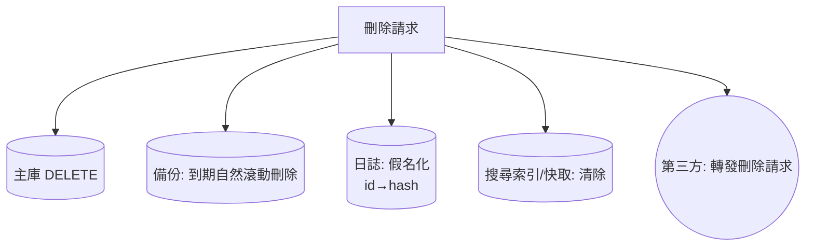

# 5.2 個資保護與法規：GDPR 與個資法

## 安全的另一半：合規

前四章防的是攻擊者；本章防的是**另一種違規**：資料的蒐集與使用違法。兩者常常同向（少收=少漏），但動機不同 —— 安全靠工程，合規靠設計+制度。

## 法規版圖

```mermaid
timeline
    title 隱私法規演化
    1974 : 美國隱私法（公部門）
    1995 : 歐盟指令 95/46
    2012 : 台灣個資法全面施行
    2016 : GDPR 通過（2018 生效）— 全球標竿
    2018 :加州 CCPA
    2020s : 各國立法潮（巴西 LGPD、中國 PIPL…）
```

GDPR 的影響力來自**屬地管轄**：只要處理歐盟居民資料（哪怕伺服器在台北），就適用 GDPR —— 隱私成為全球互聯網的最低公約數。

## 核心原則（GDPR 第 5 條）

| 原則 | 意義 | 工程轉譯 |
|------|------|---------|
| **最小化** | 只收必要的 | 欄位 = 業務必須，多一個都算違規 |
| 目的限定 | 收集時聲明的用途內使用 | 「手機號碼用於通知」不能用於廣告 |
| 儲存限制 | 不無限期保存 | 保留期限 + 自動刪除 job |
| **隱私預設** | 預設最保守 | 新功能預設不公開、不共享 |
| 誠信與保密 | 安全措施 | 本書 1–4 章 |

**「最小化」與安全的同構性**：不收集的資料不會被洩漏 —— 攻擊面管理（1.2）在資料上的翻版。

## 關鍵工程議題

### 1. 同意的技術實現

```html
<!-- Cookie 同意不是裝飾：未同意前，非必要 cookie 一個都不發 -->
<script>
if (!consent.has('analytics')) {
  // 不載入 GA —— 載入了就違規
}
</script>
```

- 同意必須**明確、可撤回、細粒度**（分析/行銷/功能 分開勾選）
- 紀錄「何時同意了什麼版本的政策」—— 可證明性

### 2. 資料主體權利的工程化

| 權利 | 工程任務 |
|------|---------|
| 存取權 | 匯出該用戶全部資料的 API |
| 刪除權（被遺忘權） | **真刪除**（含備份、日誌中的匿名化策略） |
| 可攜權 | 標準格式匯出（JSON/CSV） |
| 反對權 | 停止特定處理的開關 |

**刪除權是工程上最難的**：



**教訓：資料的每個副本都是合規負債** —— 這反過來支持最小化與集中化設計（副本越少，刪除越可行）。

### 3. 假名化與匿名化

$$\text{假名化}： \text{id} \to \text{hash}（可逆，仍屬個資）； \quad \text{匿名化}： \text{統計上無法復原}（脫離個資法定義）$$

常見誤區：把姓名遮掉就叫匿名 —— **手機號碼、裝置 ID、IP 的組合往往足以再識別**（Netflix 競賽去匿名化事件，2008）。真正的匿名化需要 k-匿名性等統計保證。

### 4. 資料洩漏通知義務

GDPR 第 33 條：**72 小時內**通知監管機關。這把 5.3 的偵測能力（「多久知道被駭」）變成法定指標 —— 偵測遲鈍=違法。

## 台灣個資法要點對照

| 議題 | 個資法 | GDPR |
|------|--------|------|
| 法定基礎 | 需特定目的+告知 | 需六種合法基礎之一（同意/契約/正當利益…） |
| 求償 | 每人 500–20000 元，上限 2 億 | 全球營收 4% 或 2000 萬歐元（取高） |
| 當事人權利 | 查詢/複製/補充/停止 | + 刪除、可攜 |

實務上做到 GDPR 級別，通常自動滿足多數法域要求 —— **取最高標準**是跨國網站的最省力路徑。

## 隱私預設（Privacy by Design）檢查清單

- [ ] 每個欄位答得出「為什麼需要」
- [ ] 註冊表單只收最小集
- [ ] 有資料保留期限與刪除 job
- [ ] 有用戶資料匯出與刪除 API
- [ ] Cookie/追蹤有同意管理
- [ ] 日誌不含敏感明文（密碼/卡號/token）
- [ ] 第三方服務清單 + 其資料處理協議（DPA）

## 習題

1. 對你的專案列出「收集的全部個人資料欄位」，逐欄寫出目的與保留期限。
2. 實作「用戶資料匯出 + 刪除」功能，處理日誌與備份中的殘留。
3. 為什麼「匿名化」的證明如此困難？用 Netflix 案說明輔助資料如何擊穿去匿名化。
