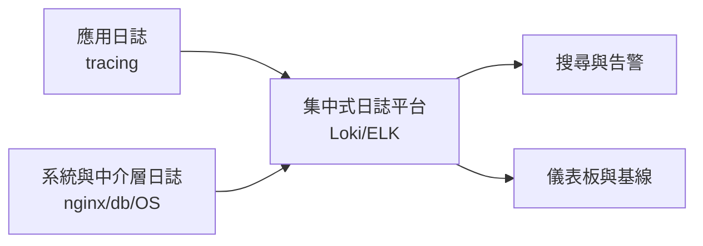
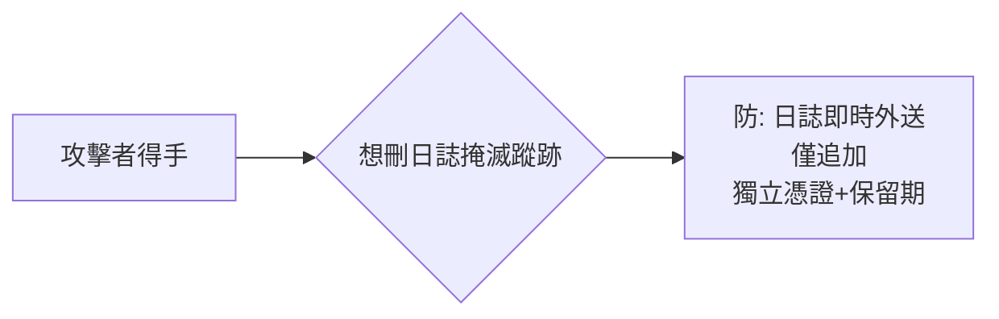

# 5.3 日誌、監控與入侵偵測

## 防禦的「事後之眼」

1–4 章的防禦都是**事前**（擋住攻擊）。但現代安全觀的底線是：

> **假設一定會被攻破，問題是多久之後你會知道。**

$$\text{實際數據}： \text{平均被入侵到發現時間} \approx 200\text{+ 天}$$

入侵者有兩百天在你的網路裡自由行動 —— 缺的不是防禦，是**看見**。這就是 OWASP A09（Logging & Monitoring Failures）上榜的原因。

## 日誌的三個層次



### 應用日誌：記什麼

```rust
// 安全事件的標準記錄（Axum + tracing）
tracing::warn!(
    user_id = %claims.sub,
    ip = %client_ip,
    action = "login_failed",
    attempt = attempt_count,
    "登入失敗"
);
```

必記事件清單：

| 事件 | 為什麼 |
|------|--------|
| 登入成敗（含 IP、帳號） | 撞庫偵測（3.2） |
| 權限拒絕（403） | 越權探測（3.3） |
| 密碼/信箱變更 | 帳號劫持的第一訊號 |
| 匯出/大量查詢 | 資料外洩（內部威脅） |
| 管理操作 | 不可否認性（STRIDE 的 R） |

### 絕不記錄的清單（5.2 合規）

- 密碼（即使雜湊）、卡號、完整 token、session id
- 身分證字號、健康資料等敏感明文
- 日誌本身是資料外洩的高頻源（開發者把 dump 錯到日誌）

## 指標與告警：從基線到異常

### 可用性與安全的統一指標

| 指標 | 正常基線 | 異常訊號 |
|------|---------|---------|
| 登入失敗率 | < 5% | 突增至 50%（撞庫） |
| 4xx 比例 | 穩定 | 掃描器雨（路徑爆破） |
| 403 次數 | 極低 | 單一用戶大量 403（越權探測） |
| 出站流量 | 基線 | 夜間流量尖峰（資料外洩） |
| DB 慢查詢 | 少 | 特定表暴增（盲注？） |

**告警 = 基線的偏離**，而基線要靠平時的度量 —— 沒有正常值，就無法定義異常（4.4 DDoS 偵測同理）。

### 告警的三個品質標準

1. 可行動（收到後知道做什麼）
2. 低噪音（誤報多 → 警報疲勞 → 真警報被忽略）
3. 有情境（附上下文：IP、用戶、相關事件鏈）

## 入侵偵測的技術棧

```mermaid
flowchart TD
    subgraph 網路層
        IDS[IDS/IPS: Suricata\n特徵+異常流量]
    end
    subgraph 主機層
        FIM[檔案完整性\nAIDE/inotify]
        PS[程序與登入審計\nauditd]
    end
    subgraph 應用層
        WAFLOG[WAF 日誌\n攻擊 payload]
        APP[應用安全事件]
    end
    IDS & FIM & PS & WAFLOG & APP --> SIEM[SIEM 聚合關聯分析]
    SIEM --> IR[事件回應(5.4)]
```

**關聯分析**是偵測的靈魂：單一訊號都是噪音，**組合**才是入侵：

$$\text{同一 IP}： \text{掃描}(404\text{ 雨}) \to \text{撞庫}(50\text{ 次失敗}) \to \text{登入成功} \to \text{資料匯出}$$

四個事件各自正常，串起來就是一次入侵 —— SIEM（Security Information and Event Management）的價值在把分散的訊號接成故事。

## Honeypot（蜜罐）：主動偵測

```bash
# 佯裝的管理後台
/admin-2024-backup    → 正常使用者永遠不會來
# 訪問者 = 100% 攻擊者 → 高信度告警、IP 自動封鎖
```

蜜罐的價值：**零誤報的感測器**。連結可以埋在頁面註解、DNS TXT、robots.txt 假路徑（攻擊者掃站必讀）。

## 日誌自身要被保護



- **外送到獨立系統**（攻擊者拿到的 web 伺服器權限摸不到）
- **WORM/僅追加**儲存
- 保留期限滿足 5.2 的法規（同時注意日誌內的個資過期即刪）

## 實務起步組合（小團隊）

1. 應用：structured logging（JSON）+ request id 貫穿
2. 平台：Grafana Loki 或雲端日誌服務 + 5 條核心告警（登入失敗率、4xx 雨量、5xx 率、流量、憑證過期）
3. 基線：先跑一個月收集正常值再調閾值
4. 演練：每季做一次「攻擊自己」→ 確認告警會響（見 6.1 滲透測試）

## 習題

1. 為聊天室設計 5 條安全告警（含閾值與理由）。
2. 實作 request id 追蹤：一個請求從 nginx 到 DB 的全鏈路日誌串聯。
3. 設計三個蜜罐入口（假 admin 路徑、假 .env、假備份檔）並寫出觸發後的自動封鎖邏輯。
