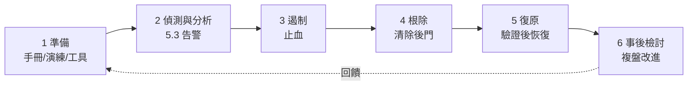
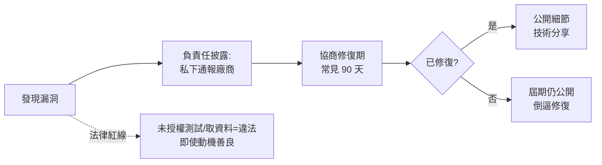

# 5.4 事件回應與漏洞披露

## 事故不是 if 而是 when

前五章把被駭機率壓到最低，本章處理「仍然發生了」的時刻。**回應的品質決定事故的最終代價**：

$$\text{總損害} = \text{初始入侵損害} + \text{持續時間} \times \text{每單位時間損害} + \text{回應不當的額外損害}$$

第三項常被低估：慌亂中「重啟伺服器銷毀證據」、錯誤的公開聲明、不通知受影響用戶 —— 事後代價可能超過入侵本身。

## 事件回應的生命週期（NIST SP 800-61）



### 3 遏制：先止血，別急著找原因

| 動作 | 注意 |
|------|------|
| 隔離受害主機（斷網而非關機） | **關機=銷毀記憶體證據**；斷網保留現場 |
| 撤銷憑證/輪換金鑰（4.3） | 假設所有秘鑰已洩漏 |
| 強制全體登出 + 重置 session | 踢掉攻擊者的活躍 session |
| 評估是否斷電源/下線 | 業務權衡：持續損害 vs 停機損害 |

### 4 根除與 5 復原的核心原則

$$\text{鐵律}： \text{假設攻擊者有持久化機制}（\text{後門、webshell、排程任務、新帳號}）$$

單純「刪惡意檔案」不夠 —— XZ 事件（4.2）等案例顯示攻擊者可潛伏多年。可靠根除：

1. **從乾淨映像重建**，而非「清理」被入侵的機器
2. 找出入口（最初怎麼進來的），否則會再進來
3. 復原時先驗證（5.3 的監控盯緊）再開放流量

### 6 事後檢討：Blameless Postmortem

```markdown
## 事故複盤（範本）
- 時間線：何時入侵 / 何時偵測 / 各動作時間點
- 影響：資料/用戶/營收
- 根因：5 Whys — 表面原因 → 深層流程原因
- 有效之處：哪些防禦/流程發揮了作用
- 行動項：每項有負責人與期限，且「透過測試可驗證」
```

**不指名個人（blameless）的原因**：追責會讓人隱瞞細節，而複盤的價值恰恰在細節。目標是**改系統**而非罰人 —— 與航空業的安全文化同源（無責事故報告讓飛行安全持續進步）。

## 漏洞披露：發現了漏洞該怎麼辦

### 你是發現者（白帽）



**法律紅線**（台灣）：刑法 358–362（無故入侵、竊取、干擾系統）—— 未經授權的「善意測試」也是犯罪。正確管道：廠商的 security.txt、漏洞獎勵計畫（HackerOne、台灣各大廠 SRC）、CVE 通報。

### 你是廠商：security.txt 與獎勵計畫

```
# /.well-known/security.txt
Contact: mailto:security@example.com
Policy: https://example.com/security-policy
Expires: 2027-01-01T00:00:00Z
```

**漏洞獎勵（Bug Bounty）的經濟邏輯**（1.1 攻擊者經濟學的正面應用）：

$$\text{把攻擊者的收益從黑市轉到白市}： \text{獎金} \ge \text{黑市價} \Rightarrow \text{漏洞流向你而非地下市場}$$

### 你是受影響者：通知與溝通

- 法定通知：72 小時（GDPR）內通報監管機關；受影響用戶「無不當延遲」
- 公開聲明三原則：**具體（哪些資料）、行動（用戶該做什麼）、後續（如何賠償/改進）**
- 反例教材：Equifax（2017）——入侵後不修已知漏洞、聲明誤導、高層賣股，最終賠償 7 億美元

## 準備清單（今天就該做的）

- [ ] 寫一頁事故手冊：誰決定、聯絡鏈、雲廠商支援電話
- [ ] 每季演練：拔掉一台機器的備援、輪換全部金鑰、恢復備份
- [ ] 建 security.txt 與通報信箱
- [ ] 備份驗證：**沒還原過的備份=沒有備份**（勒索軟體的第一課）
- [ ] 3-2-1 備份原則：3 份、2 種媒介、1 份離線（防勒索加密連線上的備份）

## 習題

1. 為你的專案寫一頁事故手冊（含 RACI 決策表）。
2. 情境題：發現生產 DB 有陌生管理帳號 —— 列出接下來 6 小時的行動序列。
3. 為什麼「從乾淨映像重建」比「清除惡意檔案」可靠？列出五種持久化機制。
