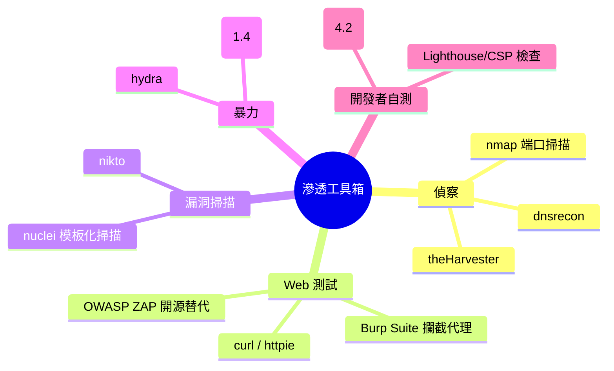
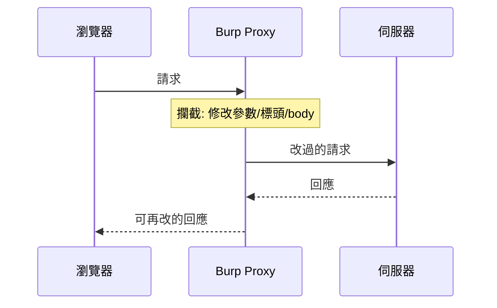

# 6.1 滲透測試與工具入門

## 從讀者到實踐者：合法的攻擊練習

前五章的知識需要**動手驗證**。滲透測試（pentest）是被授權的模擬攻擊 —— 本章建立合法且安全的練習環境與工具地圖。

## 法律與倫理邊界（先於一切）

$$\text{鐵律}： \text{只測試你擁有或書面授權的系統}$$

- 練習環境：本機 Docker、DVWA、專用 VM、*[PortSwigger Web Security Academy](https://portswigger.net/web-security)*（免費官方練習場）
- 授權測試：bug bounty 的 scope 之内（HackerOne 各家政策）
- **絕不**：掃描他人服務、測試非授權站點 —— 刑法 358–362（5.4）

## 工具地圖



## 建立練習環境

```bash
# DVWA：刻意設計成充滿漏洞的練習站
docker run -d -p 80:80 vulnerables/web-dvwa
# http://localhost → admin/password → DVWA Security 設 Low

# NodeGoat / Juice Shop：現代技術棧的漏洞練習場
docker run -d -p 3000:3000 bkimminich/juice-shop
```

## Burp Suite：Web 測試的核心工具

Burp 的本質是**攔截代理**：所有瀏覽器流量經過你，可以看、改、重放 —— 這是理解「伺服器到底信了什麼」的顯微鏡。



實驗（DVWA Low 級）：

1. 反射型 XSS：搜尋框輸入 `<script>alert(1)</script>`
2. SQLi：id 輸入 `1' OR '1'='1`
3. 權限繞過：Low 級的 admin 頁只藏了連結，直接改 URL —— 3.3 的「UI 隱藏≠權限」實證

## 手工測試方法論：Web 檢查流程

對任何端點，按本書章節逐一檢查：

| 步驟 | 檢查 | 對應 |
|------|------|------|
| 1 偵察 | 技術棧、目錄、`robots.txt`、註解 | 1.2 攻擊面 |
| 2 認證 | 弱密碼、無限流、token 存哪 | 3.2, 1.4 |
| 3 會話 | cookie 屬性、逾時、固定 | 3.2, 2.2 |
| 4 輸入 | 注入（SQL/XSS/路徑）、上傳 | 3.1, 2.1 |
| 5 授權 | 改 id、換用戶測越權 | 3.3 |
| 6 業務邏輯 | 負數量購物、跳步驟、重放 | 5.1 A04 |
| 7 配置 | 安全標頭（2.4）、TLS（4.1） | curl -I |

### 自動化與手工的分工

$$\text{掃描器強在}： \text{已知模式}（\text{補丁、標頭、注入特徵}）； \quad \text{人強在}： \text{邏輯}（\text{越權、業務繞過}）$$

A04 Insecure Design（5.1）類漏洞**無法被掃描器發現** —— 這是滲透測試至今無法全自動化的根本原因。

## nuclei：現代模板化掃描

```bash
nuclei -u https://your-site.example -t exposures/ -t misconfiguration/
# 模板化檢查數千種已知問題: 洩漏檔案、預設憑證、錯誤配置
```

自寫模板（把 5.3 的蜜罐檢查變成常規掃描）：

```yaml
id: exposed-dotenv
requests:
  - method: GET
    path: "{{BaseURL}}/.env"
    matchers:
      - type: word
        words: ["DB_PASSWORD"]
```

## 報告：測試的價值在交付

滲透報告的骨架：

1. 摘要（風險等級、一頁結論）
2. 每個發現：**重現步驟**（可被開發者執行）→ 影響 → 修復建議 → CVSS 評分
3. 複測計畫

**重現步驟的可執行性是報告的靈魂** —— 「存在 XSS」沒有價值，「在 `/search?q=<script>...` 輸入框粘貼此字串、回應包含未轉義輸出」才有價值。

## 習題

1. 在 DVWA 完成注入、XSS、命令注入、檔案上傳四關（Low），再切 High 觀察防禦差異。
2. 對自己的專案跑 nuclei + 自寫三個模板（.env、備份檔、預設憑證）。
3. 寫一份完整的滲透報告（含 3 個發現），交給同伴複測你的重現步驟。
