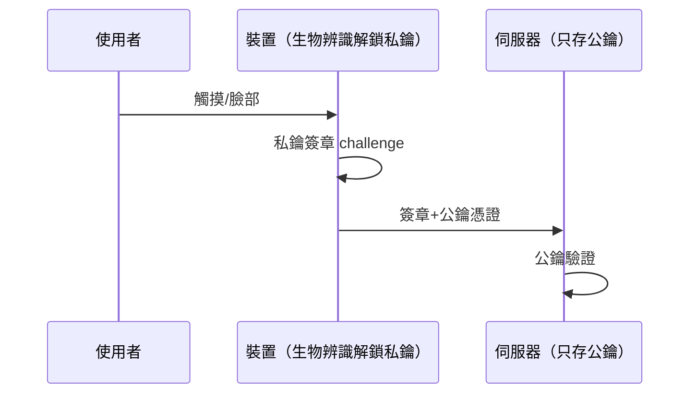

# 6.4 資安趨勢與未來

## 全書收束：因果鏈的總回顧

本書的每一章都是「攻擊誕生 → 防禦回答」的循環。把整條鏈串起來：

```mermaid
flowchart TD
    A[邊界模糊化:\n上雲/SaaS/供應鏈] --> B[從城堡護城河\n到 Zero Trust]
    B --> C[假設被入侵\n→ 偵測與回應(5.3/5.4)]
    C --> D[攻擊面從語法層\n轉向邏輯層(5.1)]
    D --> E[防禦重心:\n設計+流程+文化(6.2)]
```

## 趨勢一：Zero Trust 的全面化

傳統模型：內網可信、外網不可信。但雲端、遠端辦公、供應鏈（4.2 SolarWinds/XZ）讓「內網」這個概念崩塌。

$$\text{Zero Trust 原則}： \text{永不信任，持續驗證} \quad（\text{每個請求都要認證+授權，無論來源}）$$

工程落地：

- **BeyondCorp 模型**（Google，2014 起公開）：以設備+身份+上下文的每請求授權取代 VPN
- 微分段：服務間通信也要 mTLS 與授權（service mesh）
- 短期憑證（4.3 OIDC）成為常態

## 趨勢二：密碼學的世代交替

### 1. Passkeys（FIDO2/WebAuthn）：密碼的終結者



- 伺服器**不再存任何可被暴力破解的秘密**（只有公鑰）—— 1.4 的密碼儲存問題被連根拔除
- 釣魚免疫：簽章綁定 origin，假站拿不到有效簽章（3.2 釣魚的結構性解）
- Apple/Google/微軟 2022 起全線支援 —— **三大平台同時押注，密碼時代進入倒數**

### 2. 後量子密碼學（PQC）

量子電腦對 RSA/ECC 的威脅（Shor 演算法）：

$$\text{風險}： \text{今天被側錄的加密流量，} q \text{ 年後可被量子機解密}（\text{Harvest Now, Decrypt Later}）$$

回應：NIST 2022–2024 定案 ML-KEM（Kyber）、ML-DSA（Dilithium）—— TLS 1.3 已開始混合部署。網站工程師的行動：**關注函式庫更新、避免自有密碼學、設計支援演算法替換**（1.3 的「版本欄位」原則）。

## 趨勢三：AI 進入攻防兩端

| AI 之於攻擊者 | AI 之於防禦者 |
|---------------|---------------|
| 自動化挖掘漏洞、生成釣魚文案（更難辨） | 異常偵測（5.3 基線的語義化升級） |
| 快速迭代惡意軟體繞特徵碼 | 輔助代碼審計（6.2 SAST 的語義化） |
| 社交工程規模化 | 編寫/複盤安全策略 |

**AI 的淨效應是攻防同時提速** —— 防禦的相對優勢來自：自動化基礎（CI 安全檢查）、型別即規格（前書主題：機器可驗證的正確性）、以及文化紀律（6.2）。**能被形式化驗證的部分，AI 時代反而更穩**；靠「細心」的部分最先崩壞。

## 趨勢四：法規與責任的收緊

- **安全責任上移**：EU Cyber Resilience Act（2024）要求產品全生命週期安全義務；美國 SEC 要求重大網安事件 4 天內披露（2023）
- **SBOM（軟體物料清單）**：像食品成分表一樣宣告依賴（4.2 供應鏈的透明化要求）

```bash
cyclonedx-npm --output-file sbom.json   # npm 生成 SBOM
cargo cyclonedx                          # Rust
```

軟體將被要求**可稽核、可追溯、可快速補丁** —— SDL（6.2）從最佳實踐變成法律義務。

## 給網站工程師的終極清單

把全書壓縮成十條永不過期的原則：

1. **不信任任何輸入**（1.1 公理），包括依賴（4.2）與自家配置（4.3）
2. **預設拒絕、最小權限、最小收集**（1.2, 3.3, 5.2）
3. **讓安全成為預設行為**：框架、標頭、CI 檢查（2.1, 2.4, 6.2）
4. **慢下來防暴力**：Argon2、限流、指數退避（1.4, 3.4）
5. **假設洩漏，縮短窗口**：短憑證、可輪換、MFA（3.2, 4.3）
6. **假設入侵，投資看見**：日誌、基線、告警（5.3）
7. **演練回應**：手冊、備份還原、blameless 複盤（5.4）
8. **持續驗證**：自我滲透、audit、演練（6.1）
9. **把錯誤左移**：設計階段建模、開發階段審查（6.2）
10. **追蹤因果，不背清單**：理解每個攻擊的原理，新攻擊出現時自己推導防禦

## 結語

與本系列另外兩本書同一個結論：**技術會過時，設計思想不會**。攻擊手法十年一變，但「信任邊界、最小權限、縱深防禦、把錯誤左移」的原理從 Morris 蠕蟲到 XZ 後門從未改變。擁有因果思維的安全工程師，在每一個新時代都能第一時間畫出自己系統的攻擊面 —— 這比任何工具都可靠。

## 習題

1. 用 Zero Trust 原則重新審視你的系統：列出所有「因為在內網所以信任」的假設並逐一拆除。
2. 為應用設計 Passkey 登入（含密碼作為後備的遷移期方案）。
3. 為你的專案生成 SBOM，並設計「新 CVE 公告 → 多久內完成評估 → 多久內完成修復」的 SLA。
