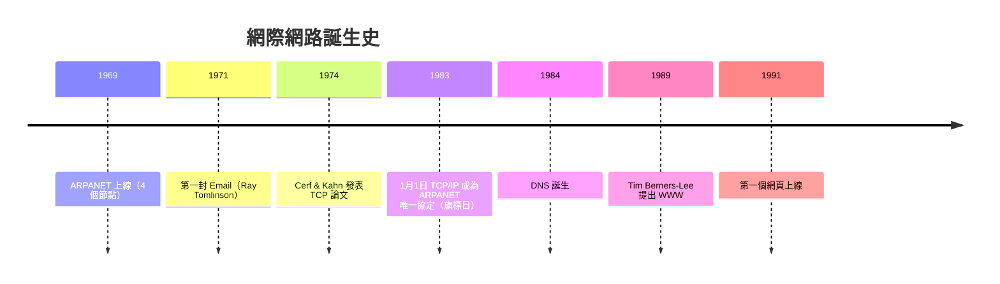
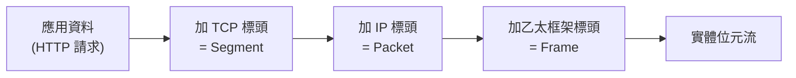

# 1.1 網際網路的誕生：從 ARPANET 到 TCP/IP

## 為什麼要從 1969 年講起

今天你打開網頁只花一秒，但這一秒背後是五十年解決問題的累積。理解「每個協定為何存在」，才能在設計網站時做出正確的取捨。

## 演化時間軸

## 核心問題：如何讓不同的網路互連？

1970 年代的現實：各機構各有自己的網路（ARPANET、NPL、CYCLADES），硬體與協定互不相通。Vint Cerf 與 Bob Kahn（1974）的回答是**封包交換 + 分層**：

1. **切割封包（packet switching）**：資料切成小封包，各自選路，丟失就重傳 —— 這源於 Paul Baran（1964）為美軍設計的「能承受核戰」的分散式通訊架構
2. **分層（layering）**：把「如何傳一個 bit」與「如何傳一份文件」解耦，每層只依賴下層的介面

## OSI 七層 vs TCP/IP 四層

| TCP/IP 層 | OSI 對應 | 本書主題 | 責任 |
|-----------|---------|---------|------|
| 應用層 | 7-6-5 | HTTP、DNS、WebSocket | 資料的語意 |
| 傳輸層 | 4 | TCP、UDP | 端對端可靠/即時 |
| 網路層 | 3 | IP、路由器 | 封包跨網路選路 |
| 連結層 | 2-1 | 乙太網路、Wi-Fi | 同一鏈路上的傳輸 |

**分層的不變式**：每層只與相鄰層對話。換 Wi-Fi 為 5G，網頁程式碼一行都不用改 —— 抽象層隔離了變化，這是整個網際網路能持續演化的根本原因（同樣的思想在 5.2 節 Flexbox/Grid、2.1 節 HTTP 演化中反覆出現）。

## 封裝：資料的洋蔥

每一層在自己的承載資料前加上自己的標頭（encapsulation）；接收端反向逐層剝開。**標頭就是各層之間的協定契約**。

## 分散式與容錯：網際網路的設計哲學

ARPANET 的軍方背景留下三條設計原則，至今支配一切：

1. **無中心**：任何節點失效，網路仍可運作（封包可繞路）
2. **端對端原則（end-to-end principle, Saltzer 1984）**：智慧放在端點，網路核心保持簡單 —— 這就是為什麼 IP 路由器「傻」，而可靠性交給兩端的 TCP
3. **盡力而為（best effort）**：IP 層不保證送達、不保證順序 —— 髒活交給上層

第 3 條直接催生了 1.3 節 TCP 與 UDP 的分流：可靠傳輸（TCP）與即時傳輸（UDP）是對「盡力而為的底層」的兩種不同補償策略。

## 習題

1. 說明「分層」如何讓 Wi-Fi 升級到 5G 時，網頁應用不需修改。
2. 「端對端原則」如何解釋「路由器不負責重傳」？
3. 畫出瀏覽器送出一個 HTTP 請求時的封裝過程，標出每一層加入的資訊。
