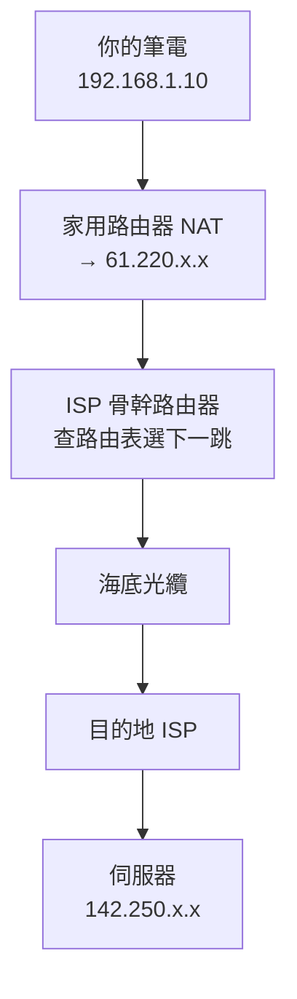

# 1.2 IP 位址與路由：封包的旅程

## 尋址問題：如何在千萬網路中找到一台機器？

郵寄需要地址，網路通訊需要 IP 位址。IP 的設計目標：**全球唯一的邏輯地址 + 分層選路**。

## IPv4：32 位元的地址危機

IPv4 地址是 32 位元，理論上限 $2^{32} \approx 43$ 億個：

```
192.168.1.10  =  11000000.10101000.00000001.00001010
網路部分（子網遮罩決定）       主機部分
```

1980 年代就有人算出：43 億不夠（世界人口就超過了）。演化出的三個補丁，恰好是理解今天網路架構的鑰匙：

### 補丁一：子網與 CIDR（1993）

早期的 A/B/C 分類浪費嚴重，CIDR（Classless Inter-Domain Routing）改為彈性字首：

$$\text{網路大小} = 2^{(32 - \text{前綴長度})} \quad \text{如 } 192.168.1.0/24 \text{ 有 } 256 \text{ 個地址}$$

字首分層讓**路由表可聚合**：骨幹路由器不必記 43 億條，只記幾十萬條聚合前綴 —— 這是「層次化降低複雜度」的又一例證。

### 補丁二：NAT（網路地址轉換）

你家只有一個公網 IP，但十幾台裝置都能上網，靠的是 NAT：路由器把內網地址（192.168.x.x）+ 埠號映射成公網地址 + 埠號。

**NAT 的副作用**：外網無法主動連進你的裝置 —— 這直接造成 3.4 節 WebRTC 需要 STUN/TURN 打洞的複雜性。技術的補丁常常埋下下一代的問題。

### 補丁三：私有地址段

| 段 | 範圍 |
|----|------|
| 10.0.0.0/8 | 10.x.x.x |
| 172.16.0.0/12 | 172.16–31.x.x |
| 192.168.0.0/16 | 192.168.x.x |

## IPv6：128 位元的最終解答

1998 年定案的 IPv6 用 128 位元：$2^{128} \approx 3.4 \times 10^{38}$，地球上每平方米可分 $10^{23}$ 個地址。

```
2001:0db8:85a3:0000:0000:8a2e:0370:7334
```

遷移缓慢的原因：**NAT 已經夠用 + 新舊不相容** —— 技術再好，轉換成本決定採用速度（對照 2.1 節 HTTP/3 的推行困境）。

## 路由：封包如何跨洋



每一跳路由器做的事：查路由表（最長字首匹配）→ TTL 減 1 → 轉發。`tracert` 指令顯示的正是這條路徑：

```bash
traceroute google.com
#  1  192.168.1.1     家用路由器
#  2  10.0.0.1        ISP 閘道
#  3  ...             骨幹節點
```

TTL（Time To Live）的存在是為了防止路由迴圈讓封包永生不死 —— 分散式系統的每個協定都要回答「資料丟了怎麼辦」與「資料繞圈了怎麼辦」。

## 埠號：一台機器上的多個服務

IP 找到機器，埠號找到機器上的**程序**：

| 埠 | 服務 |
|----|------|
| 80 | HTTP |
| 443 | HTTPS |
| 22 | SSH |
| 3000 | 開發用（Node 常用）|

$$\text{完整的通訊端點} = \text{IP 位址} : \text{埠號} \quad \text{（即 Socket，見第 3 章）}$$

## 習題

1. 為什麼 NAT 會阻礙 P2P 連線？這與 WebRTC 的設計有何關聯？
2. 說明 CIDR 如何讓骨幹路由表維持在可管理的規模。
3. 用 traceroute 追蹤一個國外網站，解釋每一跳的 IP 屬於誰。
