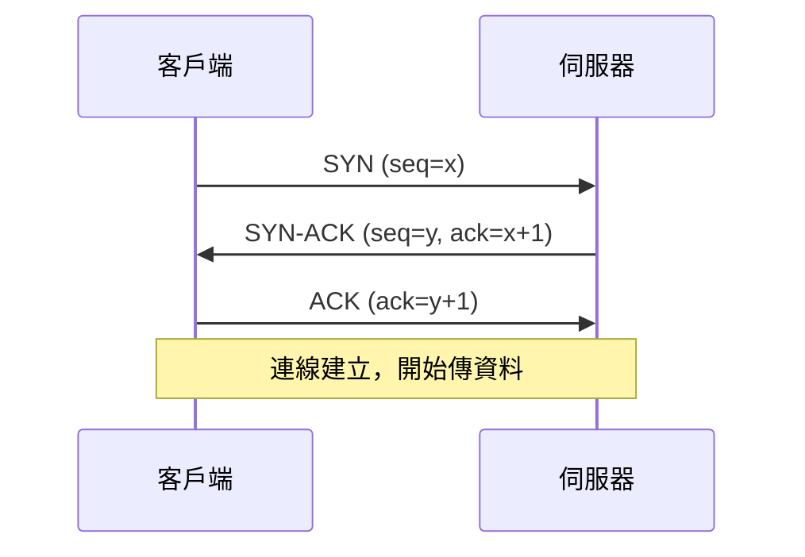
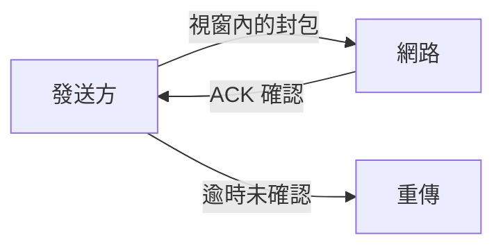
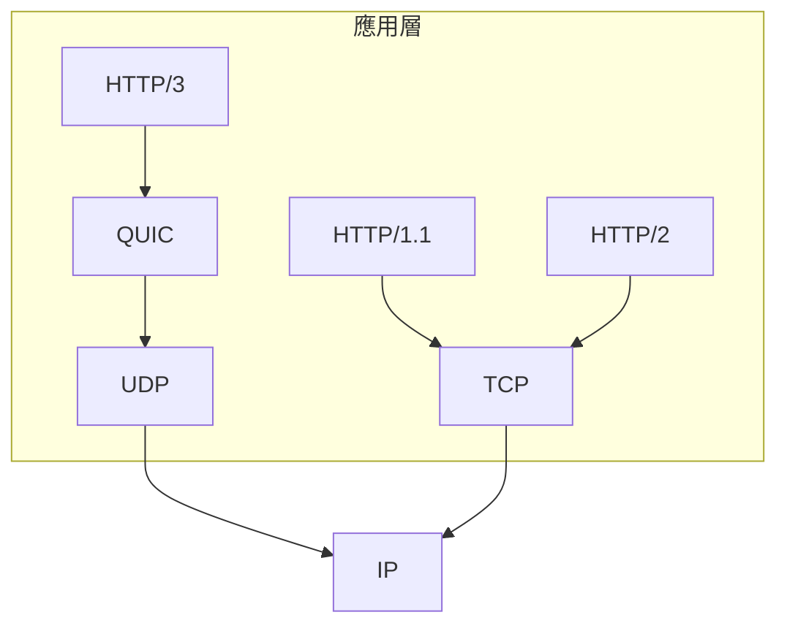

# 1.3 TCP 與 UDP：可靠性與即時性的取捨

## 同一個問題的兩種答案

IP 層盡力而為：封包可能丟失、亂序、重複。傳輸層必須回答：**要可靠，還是要快？**

$$\text{TCP}： \text{可靠、有序、有連線} \quad\quad \text{UDP}： \text{不可靠、無序、無連線}$$

| 特性 | TCP | UDP |
|------|-----|-----|
| 連線 | 需握手（3-way） | 無 |
| 可靠性 | 重傳、確認 | 不保證 |
| 順序 | 保證 | 不保證 |
| 流量控制 | 滑動視窗 | 無 |
| 延遲 | 較高（握手+重傳） | 最低 |
| 適用 | 網頁、檔案、Email | 視訊、遊戲、DNS |

**取捨的本質**：可靠性是有代價的。視訊通話寧願丟一幀（畫面閃一下），也不要為了重傳一幀卡住三秒 —— 延遲本身就是一種不可靠。

## TCP 的核心機制

### 三向交握（3-way handshake）

三次的必要性：雙方都要確認「對方能收也能發」。兩次不夠（歷史的 SYN 無法確認客戶端可收），所以是三不是二。完整代價：

$$T_{\text{連線建立}} = 1 \times RTT \quad\quad T_{\text{HTTPS 首請}} \approx 1\text{RTT(握連線)} + 2\text{RTT(TLS)}$$

這個成本正是 2.1 節 HTTP/1.1 keep-alive、HTTP/2 連線復用、HTTP/3 QUIC 0-RTT 一路演化的驅動力。

### 可靠傳輸：確認 + 重傳 + 滑動視窗

- **累積確認**：ACK n 表示「n 之前全收到」
- **快速重傳**：收到 3 個重複 ACK 就重傳，不等逾時
- **滑動視窗**：允許未確認的資料量，控制「在途」封包數
- **壅塞控制**（Tahoe → Reno → CUBIC → BBR）：丟包/延遲訊號 → 縮窗減速

壅塞控制的哲學：**每個傳送者自律，網路整體穩定** —— 分散式系統用局部規則達成全域秩序的範本。

## UDP：極簡主義

UDP 標頭只有 8 bytes（來源埠、目的埠、長度、校驗和）。它幾乎什麼都不做，正是它的價值：**給應用層最大的自由**。

經典應用：

- **DNS**（1.4 節）：一問一答，重問比重傳划算
- **視訊/遊戲**：舊資料沒有重傳價值
- **QUIC（HTTP/3）**：在 UDP 之上**自己實作**可靠性 —— 這是關鍵轉折：UDP 成為「可程式化的傳輸層地基」

## 對網站設計的實際意義

1. **圖片/JS 載入慢** → 常是 TCP 慢啟動 + 連線數不足 → CDN 與連線復用（2.3 節）
2. **即時功能（聊天/協作）** → WebSocket 走 TCP（2.4 節）；極低延遲才考慮 WebRTC（走 UDP）
3. **串流視訊** → 底層常是 UDP 系協議，但對瀏覽器以 HTTPS 包裝（HLS/DASH）

## 習題

1. 為什麼三向交握不能省成兩次？說明 SYN flood 攻擊如何利用握手狀態。
2. 視訊通話為何選 UDP？若改用 TCP 會發生什麼？
3. QUIC 為何「重新發明」TCP 的可靠機制而不用 TCP 本身？（提示：作業系統核心 vs 使用者空間的升級速度）
