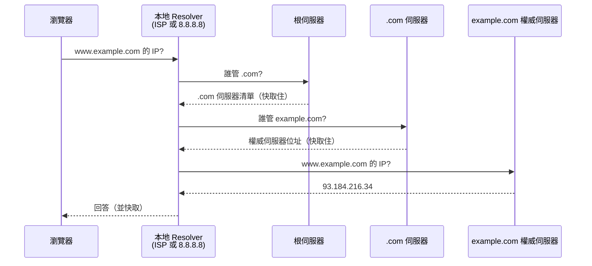
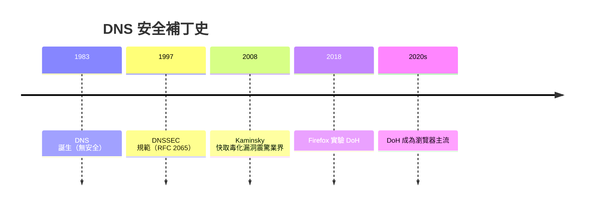

# 1.4 DNS：網際網路的電話簿

## 問題：人記得住 142.250.196.142 嗎？

1983 年之前，主機名稱靠一個**單一檔案** `hosts.txt`（由 Stanford 維護，各機構定期下載）。主機數量成長後，這個中心化方案必然崩潰：單點故障、更新延遲、命名衝突。

DNS（1983，Paul Mockapetris）的答案是**分層的分散式資料庫**：

$$\text{www.example.com}： \text{根 .} \leftarrow \text{com 頂級域} \leftarrow \text{example 權威域} \leftarrow \text{www 主機}$$

## 分層查詢的完整旅程



第一個訪問要 3+ 次往返，之後靠快取瞬間完成 —— **快取是 DNS 的生命線**，也是本書 2.3 節 CDN 快取體系的原型。

## 快取層次與 TTL

$$\text{查詢命中順序}： \text{瀏覽器快取} \to \text{OS 快取} \to \text{Resolver} \to \text{上游}$$

每筆 DNS 記錄有 **TTL**（存留時間），決定快取多久。改 DNS 記錄後「要等 TTL 過期」才全球生效 —— 這是部署時的經典陷阱（低 TTL 提前設定是標準做法）。

## 記錄類型

| 類型 | 用途 | 例 |
|------|------|-----|
| A | 域名 → IPv4 | example.com → 93.184.216.34 |
| AAAA | 域名 → IPv6 | |
| CNAME | 別名 → 另一域名 | www.example.com → example.com |
| MX | 郵件伺服器 | |
| TXT | 任意文字（SPF、網域驗證） | |
| NS | 誰是權威 | |

網站部署實務：CDN（2.3 節）的本質就是**把域名指向 CDN 的 CNAME**，由 CDN 智慧決定回應哪個邊緣節點的 IP。

## DNS 的安全演化

DNS 誕生時的網路是學術圈，**完全沒有防偽設計**。演化出兩條補強線：

1. **DNSSEC**：以數位簽章鏈（根 → TLD → 域）驗證記錄未被竄改
2. **DoH / DoT**（DNS over HTTPS/TLS）：加密查詢本身，防竊聽與劫持



2008 年 Kaminsky 漏洞的教訓：**猜中查詢 ID 即可偽造回應並污染快取** —— 16 位元的交易 ID 太短，攻擊者每秒可猜數萬次。補丁（隨機埠 + DNSSEC）是典型的「安全性設計不足 → 被攻擊 → 打補丁」的演化路徑。

## 網站設計者的 DNS 實務

```bash
dig www.example.com +short     # 查詢解析結果
dig example.com NS +short      # 查詢權威伺服器
```

- **負載平衡**：同一域名回多個 A 記錄，客戶端輪詢
- **地理路由**：依查詢來源地回不同 IP（CDN 的基礎設施）
- **健康檢查切換**：故障時 DNS 自動切到備援機房

## 習題

1. 為什麼單一 hosts.txt 方案必然失敗？DNS 用哪三個機制解決？
2. 解釋 TTL 的取捨：短 TTL 與長 TTL 各付出什麼代價？
3. 用 dig 觀察一個熱門網站的查詢，辨識經過了哪些快取層。
