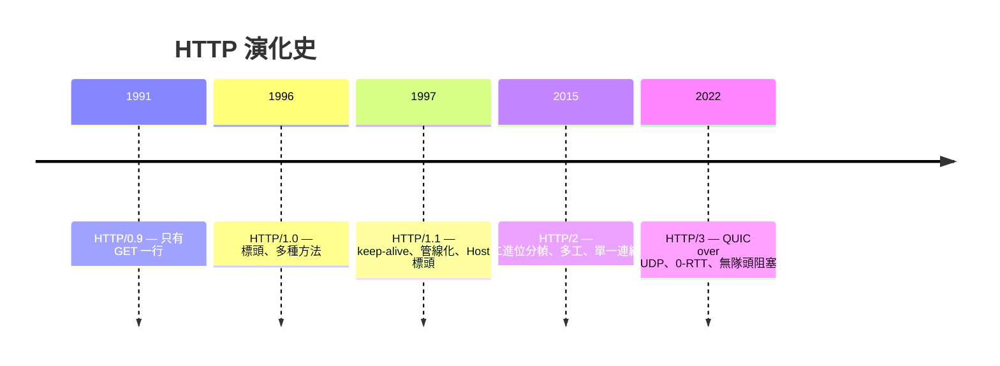
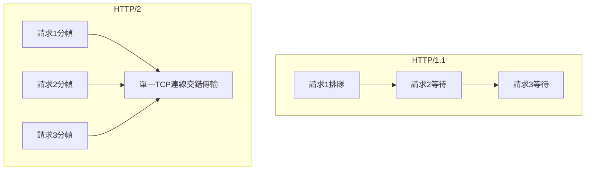
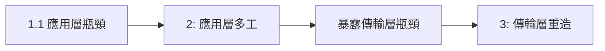

# 2.1 HTTP 的演化：從 0.9 到 HTTP/3

## 一條主線：壓垮 HTTP/1.1 的效能牆

HTTP 每一代的演化都由**上一代的效能瓶頸**驅動。先看瓶頸怎麼形成：

$$\text{頁面資源數} \uparrow（數十張圖 + JS + CSS）\quad \times \quad \text{每資源的連線成本} \uparrow（1.3 節握手 + TLS）$$



## HTTP/0.9 → 1.0：從玩具到協定

0.9 只能：

```
GET /index.html
```

回傳純 HTML，沒有標頭。1.0（1996）加入標頭（Content-Type、Content-Length）、狀態碼、快取 —— 網頁開始能承載圖片與多媒體。

**問題**：每個請求一個新 TCP 連線。頁面 20 張圖 = 20 次握手 + 20 次 TLS。

## HTTP/1.1：連線復用與其殘疾

1997 年的兩大補丁：

1. **Keep-alive**：連線可服務多個請求
2. **管線化（pipelining）**：連續發多個請求不等回應

但管線化有致命傷 —— **隊頭阻塞（head-of-line blocking）**：回應必須按請求順序返回，第一個請求卡住，後面全部陪葬。瀏覽器最終禁用了管線化。

**瀏覽器的 workaround**：每個域名開 6 條平行連線。於是出現了「資源分片」（把圖片散到 img1.example.com…img4.example.com）—— 為了繞過限制而製造更多 TCP 握手，愈補愈忙。

## HTTP/2：二進位多工

2015 年（源自 Google SPDY，2012）：



- **二進位分幀**：請求/回應切成幀（frame），多個請求的幀在同一連線上**交錯**傳輸
- **單一連線多工**：1 條 TCP 連線服務所有資源，握手成本歸一
- **標頭壓縮（HPACK）**：重複的標頭（Cookie、User-Agent）只傳一次
- **伺服器推送**：主動推送 CSS/JS（實務效果不佳，HTTP/3 中已移除）

### 新的殘疾：TCP 層的隊頭阻塞

HTTP/2 消滅了 HTTP 層的隊頭阻塞，但**所有資源仍共用一條 TCP 連線** —— 一個 TCP 封包丟失，**所有串流**都要等重傳。在 1% 丟包率的行動網路上，HTTP/2 可能比 HTTP/1.1 的 6 條連線更慢。

$$\text{HTTP/2 的瓶頸}： \text{單一 TCP 連線的丟包 → 全部串流停擺}$$

## HTTP/3：QUIC 重新發明傳輸層

解法（Google QUIC 2012 → IETF HTTP/3 2022）：把傳輸層搬到**使用者空間，架在 UDP 上**：

- **串流獨立**：某串流丟包只重傳該串流，其他串流不受影響
- **0-RTT / 1-RTT 連線建立**：把 TCP 握手與 TLS 握手合併，重逢的伺服器甚至 0-RTT 發資料
- **連線遷移**：以 **Connection ID** 而非「IP+埠」識別連線 —— 手機從 Wi-Fi 切到 5G，連線不斷（這在 TCP 是不可能的，因為 TCP 用四元組識別）

$$T_{\text{HTTP/1.1+TLS}} \approx 3\text{RTT} \quad\quad T_{\text{HTTP/3 0-RTT}} = 0\text{RTT}$$

### 演化的元教訓



瓶頸的層次隨著解決而**下沉**。而且注意：TCP 在核心空間，改動要等 OS 更新數年；QUIC 在使用者空間，瀏覽器更新即部署 —— **演化的速度取決於程式碼所在的位置**，這是軟體架構的深刻教訓。

## 網站設計者的實務

- 伺服器：Nginx/Caddy 開 HTTP/2；CDN 通常自動啟用 HTTP/3
- HTTP/2 之後**資源合併（concatenation）反而有害**：分幀已解決多工，合併檔案會破壞快取粒度
- 驗證：`curl -I --http2 https://example.com`

## 習題

1. 畫圖比較 HTTP/1.1 管線化、HTTP/2 多工、HTTP/3 獨立串流在「丟一個封包」時的行為。
2. 為什麼 HTTP/2 時代不該再做資源合併？與快取失效策略的關聯？
3. 連線遷移為何在 TCP 上做不到？QUIC 用什麼機制實現？
