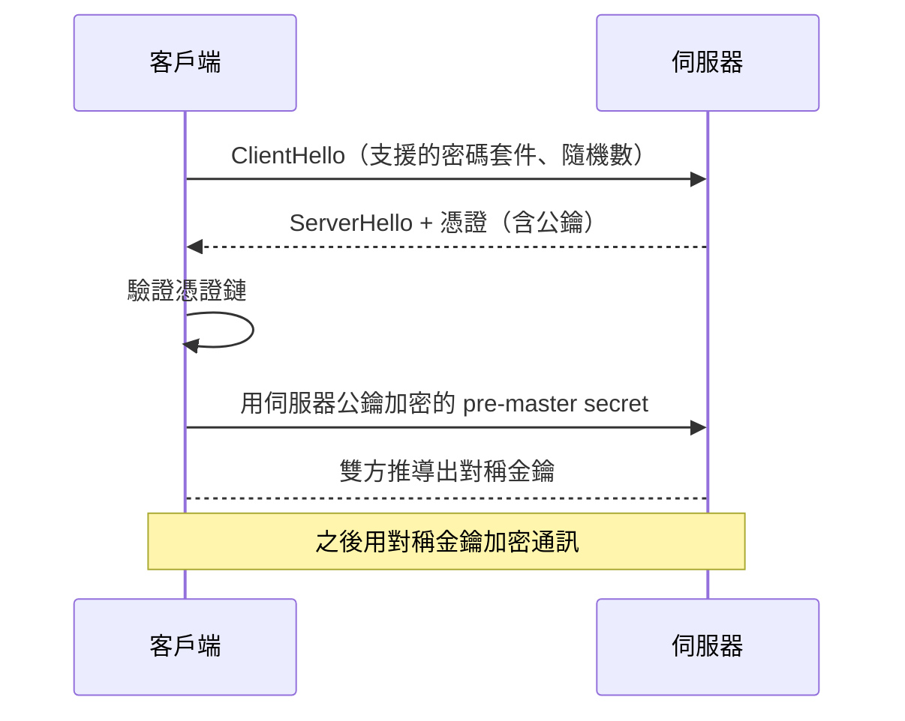
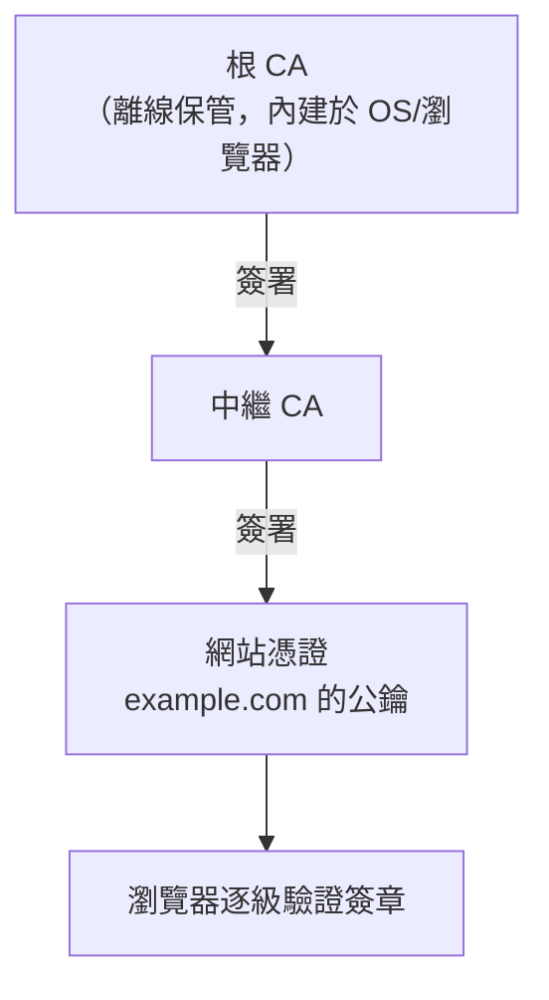

# 2.2 TLS：加密與信任鏈

## 問題：明文網路的三種攻擊

HTTP 的資料在路由器間明文奔流，任何中間人都能：

1. **竊聽（eavesdropping）**：看你傳了什麼
2. **竄改（tampering）**：改你收到的內容（如注入廣告）
3. **冒充（impersonation）**：假裝是你要連的銀行

1995 年 Netscape 推出 SSL，1999 年演進為 TLS（傳輸層安全）。HTTPS = HTTP over TLS。

## TLS 的三個任務

| 任務 | 機制 | 數學基礎 |
|------|------|---------|
| 機密性 | 對稱加密 | AES |
| 完整性 | 訊息認證碼 | HMAC / AEAD |
| 身分驗證 | 憑證鏈 | 非對稱簽章（RSA / ECDSA） |

**為什麼混合兩種加密**：非對稱加密解決「如何在不安全信道上協商金鑰」，但太慢；對稱加密快，但需要共享金鑰。TLS 的答案：用非對稱方法**協商**，用對稱金鑰**傳輸**。

## TLS 1.2 握手（簡化）



成本：2-RTT（1.3 節），這是 HTTP/3 把握手縮到 1-RTT / 0-RTT 的直接動機。

## 信任鏈：誰說這張憑證是真的？

憑證的本質：**CA（憑證授權中心）用簽章擔保「這個公鑰屬於這個域名」**。



驗證過程：瀏覽器從自己的**信任商店**（內建約 150 個根 CA）出發，逐級驗簽、檢查域名與有效期。**你信任瀏覽器廠商 → 廠商信任 CA → CA 擔保網站** —— 這是信任的傳遞，也是單點風險：任何一個 CA 被駭或作惡，都能簽出任意域名的假憑證。

歷史教訓：2011 年 DigiNotar 被駭，簽出 google.com 假憑證，導致該 CA 被全線撤信任而倒閉 —— **CA 業務的根基就是誠信，一次失守即死亡**。

### 補強機制

- **CT（憑證透明化，2013）**：所有簽發的憑證必須公開記錄，任何人可稽核 CA 是否亂簽
- **ACME / Let's Encrypt（2015）**：自動化簽發與續約，把 HTTPS 的成本降到接近零

$$\text{HTTPS 網頁占比}： 2015\ \text{約 } 40\% \xrightarrow{\text{Let's Encrypt}} 2024\ \text{超過 } 90\%$$

**Let's Encrypt 是「降低成本改變世界」的教科書案例**：加密技術早就在，普及卡在「手動簽發貴又麻煩」。

## 全站 HTTPS 的實務

```nginx
server {
    listen 443 ssl http2;
    ssl_certificate     /etc/letsencrypt/live/example.com/fullchain.pem;
    ssl_certificate_key /etc/letsencrypt/live/example.com/privkey.pem;
}
server {
    listen 80;
    return 301 https://$host$request_uri;   # HTTP 一律導向 HTTPS
}
```

安全標頭（搭配 2.3 節 CDN 時同樣有效）：

- `Strict-Transport-Security`：告訴瀏覽器此後永遠走 HTTPS（防降級攻擊）
- `Content-Security-Policy`：限制可載入的資源來源（防 XSS）

## 習題

1. 為什麼 TLS 用「非對稱協商 + 對稱傳輸」的混合模式，而不只用其中一種？
2. 畫出瀏覽器驗證 example.com 憑證的信任鏈，指出鏈上每一環失效的後果。
3. HSTS 防的是什麼攻擊？描述攻擊者如何在沒有 HSTS 時發動降級攻擊。
