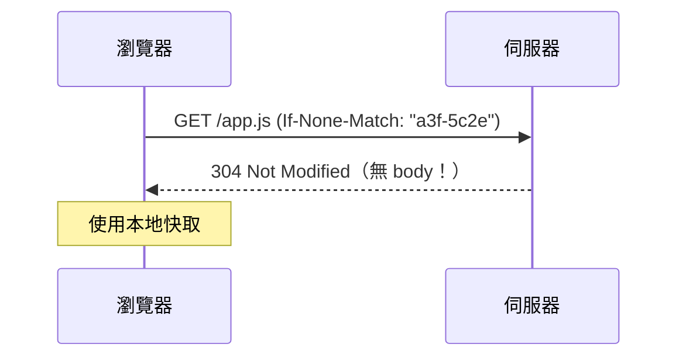
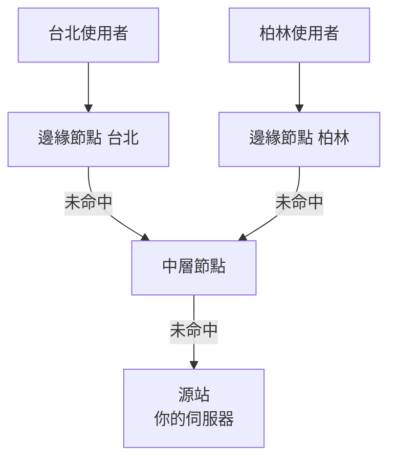

# 2.3 快取與 CDN：內容傳遞網路的原理

## 核心矛盾：光速是天花板

伺服器在美國，使用者在台北，單程 RTT 至少 150ms。TCP 握手 + TLS 就要耗掉 3 RTT（1.3、2.2 節）—— **物理距離無法壓縮，只能縮短**。

$$T_{\text{載入}} \ge N \times RTT \quad\Rightarrow\quad \text{兩條路：減少往返次數 } N， \text{或縮短 } RTT$$

CDN（Content Delivery Network，1998 年 Akamai 創立）同時做兩件事：**把內容搬到離使用者近的地方**（縮短 RTT），以及**盡量不回源站**（減少往返）。

## 快取的理論基礎

### 局部性原理

快取有效的前提是存取具有**局部性**：

- **時間局部性**：剛用過的資料很快會再用（熱門新聞）
- **空間局部性**：用過 A 的人很快會用相鄰的 B（同一頁的資源）

Web 流量高度符合冪律分布：少數熱門內容承載多數流量 —— 這正是快取的甜蜜點。

### HTTP 快取控制

```
Cache-Control: max-age=31536000, immutable    # 帶 hash 的靜態資源：快一年
Cache-Control: no-cache                        # 可快取但每次需重新驗證
Cache-Control: private, max-age=0              # 個人化資料，只快在瀏覽器
ETag: "a3f-5c2e"                               # 內容指紋
```

條件請求（節省頻寬）：



304 的威力：**省下整個 body 的傳輸** —— 只傳元資料做一致性確認。

## CDN 的架構



### 回源與命中率

$$\text{命中率} = \frac{\text{邊緣命中}}{\text{總請求}} \quad\quad \text{源站負載} = (1 - \text{命中率}) \times \text{總流量}$$

命中率 95% 意味著源站壓力降到 1/20 —— CDN 本質上是**用快取置換算力與頻寬成本**。

### 邊緣節點怎麼選？DNS 的二次就業

使用者請求 `cdn.example.com` 時，CDN 的**智慧 DNS** 依查詢來源 IP 判斷地理位置，回應最近邊緣節點的 IP（1.4 節地理路由）—— DNS 從「名字解析」升級為「流量調度器」。

## 靜態與動態內容的分界

| 內容 | 策略 |
|------|------|
| 圖片、字型、帶 hash 的 JS/CSS | `Cache-Control: max-age=31536000, immutable` |
| HTML | `no-cache`（每次驗證）或短 max-age |
| API 回應 | 視資料性質；個人化資料不可共享快取 |
| 動態請求 | 不快取，但 CDN 仍提供 TLS 終結、連線最佳化 |

**快取失效（cache busting）的標準解**：檔名帶內容雜湊 `app.a3f5c2e.js`，內容一改檔名就變 —— **以命名策略繞過失效難題**，而不是去「清除」快取。這是前端建置工具（webpack/Vite）的檔名雜湊功能的由來。

## 「開發快取」與「程式快取」之外： Service Worker

```javascript
// 註冊 Service Worker：把快取控制權交給 JavaScript
navigator.serviceWorker.register('/sw.js');

// sw.js
self.addEventListener('fetch', (event) => {
  event.respondWith(
    caches.match(event.request).then((cached) =>
      cached ?? fetch(event.request).then((res) => {
        const copy = res.clone();
        caches.open('v1').then((c) => c.put(event.request, copy));
        return res;
      })
    )
  );
});
```

Service Worker（2014）把快取策略變成**可程式化的中介層**（cache-first、network-first、stale-while-revalidate），也是 PWA 離線能力的基礎。

## 習題

1. 用「減少 N 或縮短 RTT」框架，解釋 CDN 對兩者的貢獻。
2. 為什麼 HTML 用 `no-cache` 而帶 hash 的 JS 用 `immutable`？如果 HTML 也快一年會發生什麼？
3. 實作一個 stale-while-revalidate 策略的 Service Worker 片段，說明其取捨。
