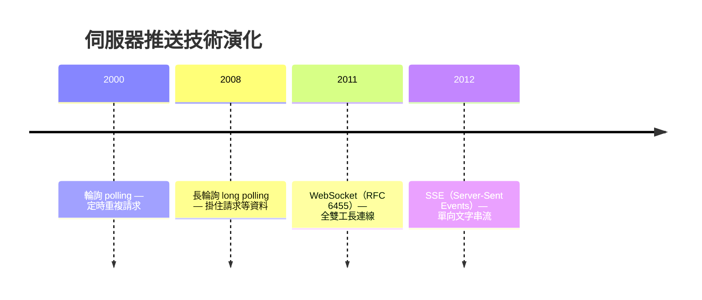
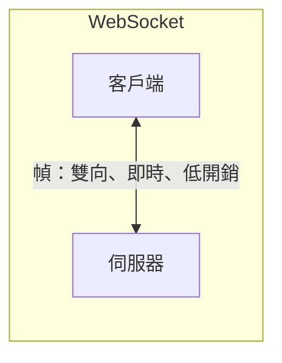

# 2.4 從 HTTP 到 WebSocket：全雙工通訊

## 問題：伺服器不能主動說話

HTTP 的基因是**請求—回應**：客戶端問，伺服器答，然後資料流關閉。但現代應用需要**伺服器主動推送**：聊天訊息、股價、通知、協同編輯。

$$\text{HTTP}： \text{客戶端拉（pull）} \quad\quad \text{需求}： \text{伺服器推（push）}$$

## 演化鏈：四代推技術



### 第一代：輪詢（Polling）

```javascript
setInterval(async () => {
  const msgs = await fetch('/messages').then(r => r.json());
  render(msgs);
}, 3000);
```

問題：**延遲與成本的雙輸**。輪詢間隔 3 秒 → 訊息平均延遲 1.5 秒；而 99% 的請求回應是「沒有新訊息」—— 純浪費。

$$\text{成本} \propto \frac{\text{請求次數}}{\text{時間}} \quad\quad \text{即時性} \propto \frac{1}{\text{輪詢間隔}} \quad \text{兩者不可兼得}$$

### 第二代：長輪詢（Long Polling）

```javascript
async function poll() {
  const msgs = await fetch('/messages?wait=true');  // 伺服器掛住，有訊息才回
  render(msgs);
  poll();                                            // 立刻再掛住
}
```

伺服器「握住」請求直到有資料才回應。即時性接近 push，但每次回應後要**重新走 HTTP**（標頭、解析、甚至重新連線），伺服器要維護大量掛起的請求。

### 第三代：WebSocket（2011）

**在 HTTP 上「升級」成一條持久雙向通道**：

```
GET /chat HTTP/1.1
Upgrade: websocket
Connection: Upgrade
Sec-WebSocket-Key: dGhlIHNhbXBsZSBub25jZQ==

HTTP/1.1 101 Switching Protocols
Sec-WebSocket-Accept: s3pPLMBiTxaQ9kYGzzhZRbK+xOo=
```

之後同一條 TCP 連線上，雙方都可以隨時發幀（frame）：



| 特性 | 輪詢 | 長輪詢 | WebSocket | SSE |
|------|------|--------|-----------|-----|
| 方向 | 拉 | 拉 | **雙向** | 伺服器→客戶端 |
| 每訊息開銷 | 全套 HTTP 標頭 | 全套標頭 | 2-14 bytes 幀頭 | 較小 |
| 即時性 | 差 | 好 | 最好 | 好 |
| 代理伺服器友善 | 是 | 是 | 需支援 Upgrade | 是 |
| 重連 | 天然 | 天然 | **需自己實作** | 內建自動重連 |

### 第四代：SSE 的定位

SSE（見 3.x 與前書 axum 篇）是「單向推送就夠了」時的正解：基於普通 HTTP、自動重連、proxy 友善。**通知、進度條、行情推送用 SSE；聊天、遊戲、協作才用 WebSocket。**

## WebSocket 的設計哲學

1. **借用 HTTP 完成握手**：沿用 80/443 埠、代理與防火牆基建 —— 不重新造輪子，這是它 2011 年能快速普及的政治與工程原因
2. **最小幀協定**：握手之後拋棄 HTTP 開銷，幀頭極小
3. **可靠有序**：架在 TCP 上（1.3 節），訊息不丟不亂序 —— 適合聊天，不適合「舊資料無價」的即時遊戲（那要 3.4 節 WebRTC）

## 應用層的心跳與重連

TCP 連線可能半死（NAT 逾時、行動網路切換），WebSocket **協定本身不偵測**，應用層必須自建：

```javascript
function connect() {
  const ws = new WebSocket('wss://example.com/chat');

  ws.onopen = () => console.log('connected');
  ws.onmessage = (e) => console.log('recv:', e.data);
  ws.onclose = () => setTimeout(connect, 1000 * Math.min(retries++, 30)); // 指數退避
}

// 心跳：每 30 秒 ping
setInterval(() => ws.readyState === WebSocket.OPEN && ws.send('ping'), 30000);
```

**指數退避（exponential backoff）**：重連間隔 $t_n = t_0 \cdot 2^n$ ，避免伺服器恢復瞬間被重連風暴打垮 —— 分散式系統重試的通用法則。

## 習題

1. 畫出輪詢、長輪詢、WebSocket 的訊息時序圖，標出每條訊息的延遲與開銷。
2. 為什麼 WebSocket 握手要用 HTTP 的 Upgrade 而不發明新協定？
3. 什麼情境該用 SSE 而非 WebSocket？列三個判準。
