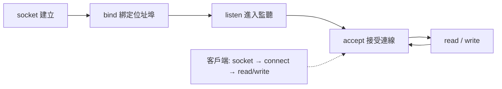
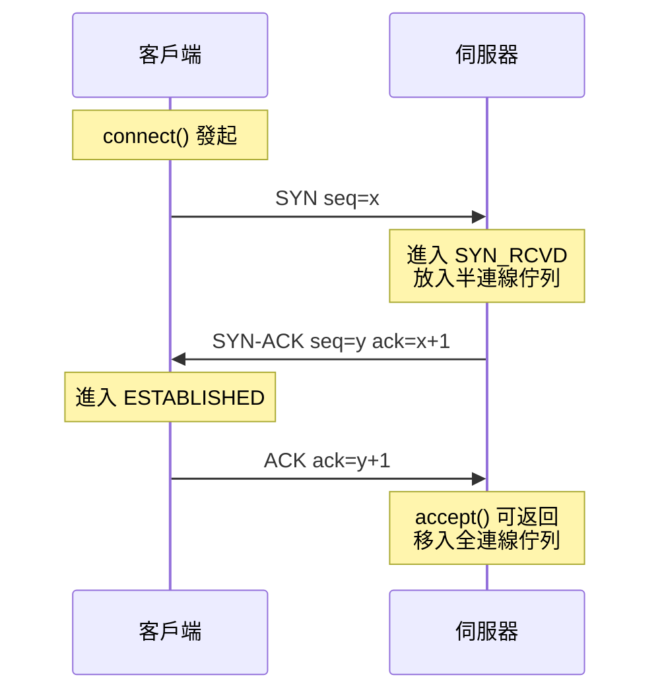
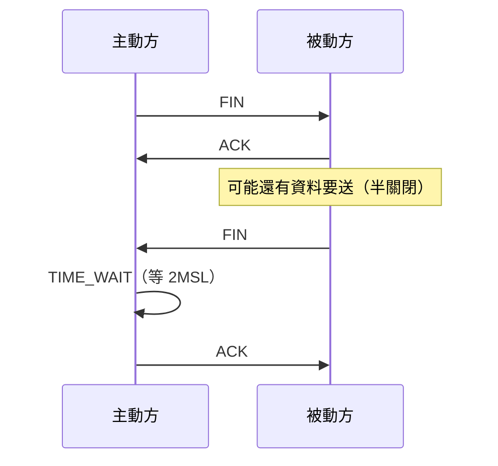

# 3.1 Socket API 與 TCP 三向交握

## Socket：程序的網路插頭

1.2 節說過： $\text{通訊端點} = \text{IP} : \text{埠}$ 。**Socket 就是這個端點在作業系統中的具象**——一個可讀寫的檔案描述子（file descriptor）。Unix 的「一切皆檔案」哲學延伸到網路：讀 socket 像讀檔，寫 socket 像寫檔。

Socket API 誕生於 1983 年 BSD 4.2，四十多年介面幾乎未變 —— **好的抽象可以活過硬體的十次革命**。

## TCP 伺服器的生命週期



| 系統呼叫 | 伺服器 | 客戶端 | 意義 |
|---------|--------|--------|------|
| socket | ✅ | ✅ | 建立端點 |
| bind | ✅ | （可選） | 綁定 IP:port |
| listen | ✅ | — | 標記為被動、建等待佇列 |
| connect | — | ✅ | 發起三次握手 |
| accept | ✅ | — | 從已完成佇列取出連線 |
| read/write | ✅ | ✅ | 收發資料 |
| close | ✅ | ✅ | 四次揮手釋放 |

## 三向交握的兩側視角



兩個佇列（Linux）：

- **半連線佇列**（SYN_RCVD 狀態）：收到 SYN、還沒完成握手 —— SYN flood 攻擊就是灌爆這裡，防禦靠 **SYN cookies**（把狀態編碼進序號，不在記憶體留半連線）
- **全連線佇列**：握手完成等 `accept()` —— 佇列滿了新連線被拒

**`accept()` 之前資料已在路上**：握手由核心完成，accept 只是把「完成的連線」領走 —— 這解釋了為何高併發伺服器的關鍵是「accept 要快」。

## 連線關閉：四次揮手與 TIME_WAIT



**TIME_WAIT 的意義**：主動關閉方要等 2 倍封包最大存活時間，確保網路上殘留的舊封包死亡，不會污染下一條「同四元組」的新連線。高頻短連線伺服器會累積數萬個 TIME_WAIT —— 這又是「用連線池/長連線取代頻繁建連」的理論依據（HTTP keep-alive 的傳輸層原因）。

## 阻塞 vs 非阻塞：C10K 的源頭

```c
// 阻塞模型：一連線一執行緒
while (1) {
    int conn = accept(listen_fd, ...);      // 阻塞到有連線
    pthread_create(worker, conn);           // 每連線開執行緒
    // 1萬連線 = 1萬執行緒 ≈ 8GB 記憶體（預設堆疊）
}
```

| 模型 | 機制 | 規模上限 |
|------|------|---------|
| 執行緒/連線 | 阻塞 I/O | 千級 |
| select/poll | 一次監看多個 fd | 千級（輪詢開銷） |
| **epoll / kqueue** | 核心事件通知，只回報就緒者 | **十萬級** |
| io_uring（2019） | 共享環形佇列，系統呼叫歸零 | 百萬級 |

epoll（2003）是 C10K 問題的 Linux 解答，也是 **Node.js（libuv）、Nginx、Rust Tokio** 的事件循環地基。**你今天寫的每一行非同步網路碼，底下都是 epoll。**

## 習題

1. 為什麼半連線佇列可以用 SYN cookies 完全省略？核心把什麼資訊編碼進了序號？
2. 解釋 TIME_WAIT 為何由主動關閉方承擔，以及它如何防止舊封包污染新連線。
3. 比較「1 萬執行緒」與「epoll 事件循環」在 1 萬連線下的記憶體與 CPU 切換成本。
