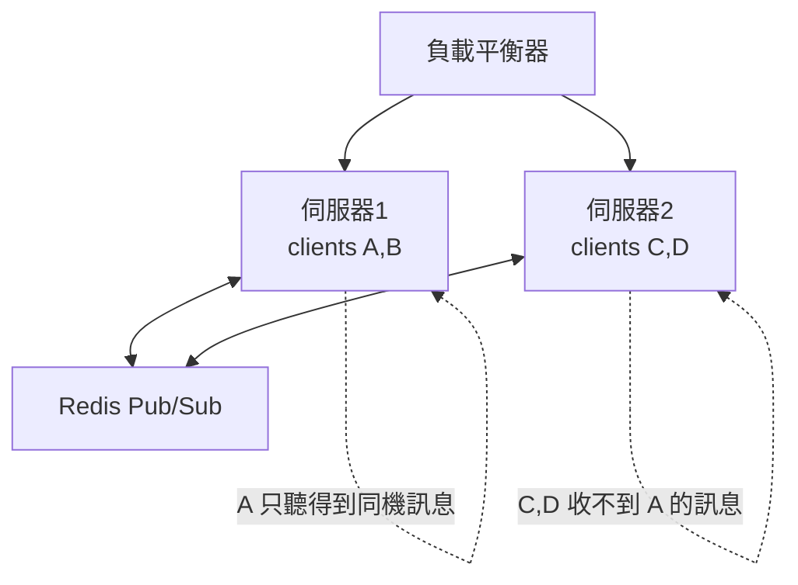

# 3.3 WebSocket 伺服器實作：即時聊天室

## 3.2 節的延伸：從裸 TCP 到 WebSocket

3.2 節的 TCP 聊天室要自己定協議、自己處理幀。WebSocket 把這些**標準化**：握手、幀格式、關閉語意全部由 RFC 6455 規範，瀏覽器原生支援 —— 客戶端從此不需要 nc，直接在網頁裡跑。

## 用 Node.js（ws 套件）實作

```bash
npm install ws
```

```javascript
// ws-server.js
const { WebSocketServer } = require('ws');

const wss = new WebSocketServer({ port: 8080 });
const clients = new Map();   // ws → 暱稱

wss.on('connection', (ws, req) => {
  // 握手已完成（101 Switching Protocols），直接可用
  const name = new URL(req.url, 'http://x').searchParams.get('name')
               ?? `user${clients.size}`;
  clients.set(ws, name);

  ws.send(JSON.stringify({ type: 'welcome', from: 'server', text: `哈囉 ${name}` }));
  broadcast({ type: 'join', from: 'server', text: `${name} 加入` });

  ws.on('message', (buf) => {
    const msg = JSON.parse(buf.toString());
    broadcast({ type: 'chat', from: name, text: String(msg.text).slice(0, 200) });
  });

  ws.on('close', () => {
    clients.delete(ws);
    broadcast({ type: 'leave', from: 'server', text: `${name} 離開` });
  });

  ws.on('pong', () => (ws.isAlive = true));   // 心跳回應
});

// 心跳：清掃半死連線（2.4 節）
setInterval(() => {
  for (const ws of wss.clients) {
    if (ws.isAlive === false) { ws.terminate(); continue; }
    ws.isAlive = false;
    ws.ping();
  }
}, 30000);

function broadcast(obj) {
  const data = JSON.stringify(obj);
  for (const ws of wss.clients)
    if (ws.readyState === 1) ws.send(data);
}

console.log('WebSocket 伺服器: ws://localhost:8080');
```

協議設計要點：**用 JSON 的 `type` 欄位做應用層訊息分派** —— WebSocket 只保證「把位元組送到」，訊息的語意（join/chat/leave）是應用層契約。

## 瀏覽器客戶端

```html
<!-- index.html -->
<input id="name" placeholder="暱稱" />
<input id="input" placeholder="訊息" />
<button onclick="connect()">連線</button>
<ul id="log"></ul>

<script>
let ws;
function connect() {
  const name = encodeURIComponent(document.getElementById('name').value || 'anon');
  ws = new WebSocket(`ws://localhost:8080?name=${name}`);

  ws.onmessage = (e) => {
    const msg = JSON.parse(e.data);
    const li = document.createElement('li');
    li.textContent = msg.from === msg.text ? msg.text : `[${msg.from}] ${msg.text}`;
    document.getElementById('log').append(li);
  };
  ws.onclose = () => setTimeout(connect, 2000);   // 自動重連
}

function send() {
  ws.send(JSON.stringify({ text: document.getElementById('input').value }));
}
</script>
```

## 整合進 HTTP 伺服器：同埠服務

實務上 WebSocket 通常與 HTTP API 同埠（避免跨域與防火牆問題）：

```javascript
const http = require('http');
const { WebSocketServer } = require('ws');

const server = http.createServer((req, res) => {
  res.setHeader('Content-Type', 'text/html');
  res.end(require('fs').readFileSync('index.html'));   // 順便服務網頁
});

const wss = new WebSocketServer({ server });            // 掛在同一個 http server 上
server.listen(8080);
```

原理：握手就是一個**帶 `Upgrade` 標頭的 HTTP 請求**（2.4 節），`WebSocketServer` 攔下這類請求，其餘交給一般 handler。

## 水平擴展：單機的牆



問題：A 連在機器 1，B 連在機器 2，機器 1 的 `for` 迴圈摸不到 B 的 socket。

解法：**Redis Pub/Sub 當廣播匯流排**：

```javascript
const redis = require('redis');
const sub = redis.createClient(), pub = redis.createClient();

sub.subscribe('chat');
sub.on('message', (_ch, data) => {           // 收到其他機器的廣播 → 轉發給本機客戶端
  for (const ws of wss.clients) ws.send(data);
});

ws.on('message', (buf) =>
  pub.publish('chat', buf.toString()));      // 本機訊息 → 發到匯流排
```

模式總結：**連線狀態留在各機器記憶體，訊息走共享匯流排** —— 這是聊天、協作、即時通知系統的標準架構（Slack、Discord 同理，規模更大而已）。

## 安全清單

- **wss://（TLS）**：明文 ws 可被中間人竄改幀
- **Origin 檢查**：握手時驗 `req.headers.origin`，防其他網站借用你的用戶頻寬（CSWSH 攻擊）
- **輸入限制**：訊息長度上限、頻率限制（每秒 N 則）
- **驗證**：握手 URL 帶 token 或用 Sec-WebSocket-Protocol 傳 JWT，驗不過就拒絕升級

## 習題

1. 加入「房間」功能（參考 3.2 節 rooms），並在多機架構下用 Redis channel per room 實現。
2. 實作 Origin 白名單與 JWT 握手驗證。
3. 若單機需要 10 萬連線，Node.js 單行程式夠嗎？查資料並提出方案（cluster / worker_threads / Rust 重寫）。
