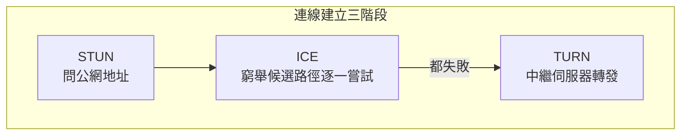
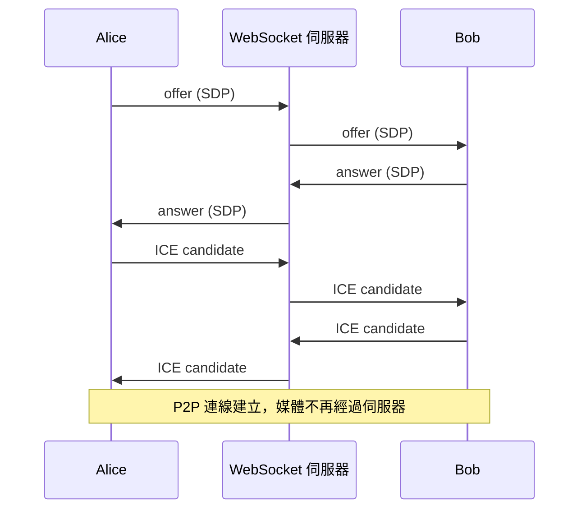

# 3.4 WebRTC 與 P2P 通訊

## 問題：WebSocket 仍要繞伺服器

聊天室的訊息路徑：A → 伺服器 → B。視訊通話若也這樣走，每路視訊都要消耗伺服器頻寬：

$$\text{中繼成本} \propto N^2 \quad（N 人互聊，伺服器承擔所有流量）$$

WebRTC（2011 由 Google 開源，W3C 標準）的目標：**瀏覽器之間直接建立點對點（P2P）連線**，伺服器只負責牽線，不搬運媒體資料。

## WebRTC 的三大組件

| 組件 | 職責 | 底層 |
|------|------|------|
| getUserMedia | 取得麥克風/攝影機 | 瀏覽器權限 API |
| RTCPeerConnection | 建立 P2P 連線、加密傳輸 | **SRTP over UDP**（1.3 節：視訊要 UDP） |
| RTCDataChannel | P2P 資料通道 | SCTP over DTLS（可設定可靠或即時） |

```javascript
// 取得本機媒體
const stream = await navigator.mediaDevices.getUserMedia({ video: true, audio: true });
document.getElementById('me').srcObject = stream;

// 建立 P2P 連線
const pc = new RTCPeerConnection();
stream.getTracks().forEach((t) => pc.addTrack(t, stream));

// 遠端畫面
pc.ontrack = (e) => (document.getElementById('peer').srcObject = e.streams[0]);
```

## 最難的部分：NAT 打洞（見 1.2 節的後果）

兩台裝置都在 NAT 後面，互相不知道對方的公網地址。信號交換（signaling）解決「誰是誰」，但「怎麼連上」需要：



| 服務 | 作用 | 時機 |
|------|------|------|
| **STUN** | 告訴你「你的公網 IP:port 是什麼」 | 免費、輕量，多數情況夠用 |
| **ICE** | 收集所有候選地址（本機/反射/中繼），配對嘗試 | 協調策略 |
| **TURN** | 打洞失敗時的**中繼**（繞伺服器！） | 約 10–20% 的連線需要 |

注意諷刺之處：**WebRTC 打洞失敗時仍回到中繼** —— P2P 是「最佳路徑」，不是「保證路徑」。STUN 是 3.4 節唯一「免費午餐」，TURN 則把成本問題又請了回來（只是頻寬省了大半，且只發生在少數連線）。

## 信號交換（Signaling）：WebRTC 刻意不規範的部分

建立 P2P 連線前，兩端要交換 SDP（描述媒體能力）與 ICE 候選。**WebRTC 規範故意不定義這個通道怎麼做** —— 任何可靠通道都行，最常見的就是 2.4/3.3 節的 WebSocket：



**架構分工之美**：WebSocket（可靠、TCP）負責低頻的控制訊息；WebRTC（UDP）負責高頻的媒體流。兩種傳輸各司其職 —— 可靠性用在「不丟不得」的信令，即時性用在「舊幀無價」的視訊（1.3 節取捨的完美應用）。

## 完整最小範例（呼叫端）

```javascript
const pc = new RTCPeerConnection({
  iceServers: [{ urls: 'stun:stun.l.google.com:19302' }],
});

pc.onicecandidate = (e) => {
  if (e.candidate) ws.send(JSON.stringify({ type: 'ice', data: e.candidate }));
};

// 1. 建立 offer
const offer = await pc.createOffer();
await pc.setLocalDescription(offer);
ws.send(JSON.stringify({ type: 'offer', data: offer }));

// 2. 收到 answer
ws.onmessage = async ({ data }) => {
  const msg = JSON.parse(data);
  if (msg.type === 'answer') await pc.setRemoteDescription(msg.data);
  if (msg.type === 'ice')    await pc.addIceCandidate(msg.data);
};
```

被呼叫端對稱：收到 offer → `setRemoteDescription` → `createAnswer` → 送回。

## 網站設計中的定位

| 需求 | 技術 |
|------|------|
| 聊天室、通知 | WebSocket / SSE |
| 1 對 1 視訊、語音 | WebRTC P2P |
| 多人視訊會議 | WebRTC + SFU（選擇性轉發單元：伺服器只轉發混合後的流） |
| 直播（一對多） | HLS/DASH（HTTP 串流）而非 WebRTC |

**N 人會議的 $N^2$ 問題**：每人要向 N-1 人上傳 → 上行頻寬爆炸 → 所以會議系統用 SFU 架構（每人只上傳一份到伺服器，伺服器分發）。P2P 只在 1 對 1 或少人數時是贏的。

## 習題

1. 畫出「A 在企業 NAT 後、B 在手機 4G 後」的 ICE 嘗試過程，判斷最終走 STUN 還是 TURN。
2. 為什麼信號交換用 WebSocket 而媒體走 WebRTC？兩者的資料特性差在哪？
3. 10 人視訊會議若純 P2P，每人需幾條上傳流？SFU 架構下呢？
