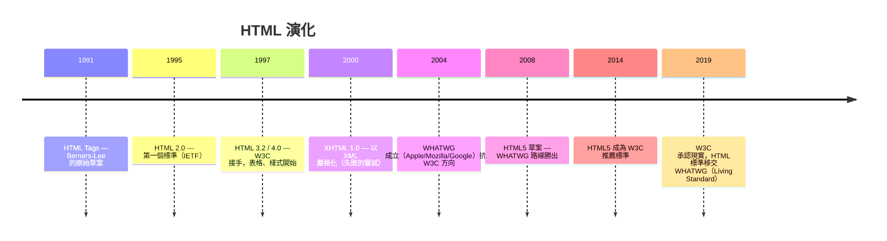
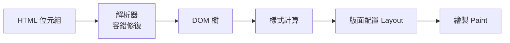

# 4.1 HTML 的歷史與語意化

## HTML 的誕生：一份文件格式統治世界

1989 年，CERN 的 Tim Berners-Lee 為了讓物理學家共享論文，發明了三件套：

1. **HTML**：文件格式（源自 SGML，ISO 1986 的標準標記語言）
2. **HTTP**：傳輸協定（第 2 章）
3. **URL**：統一資源定位

HTML 的核心思想是**標記（markup）**：在文字中嵌入標籤，聲明「這段是標題、那段是連結」：

```html
<h1>論文標題</h1>
<p>正文…參考 <a href="paper2.html">另一篇論文</a></p>
```

`<a>` 的 href（超文本參照）是整個 WWW 的點睛之筆：**文件之間可以互相引用，知識成為圖（graph）而非樹**。

## 版本演化史



### XHTML 教訓：嚴格 vs 寬容的哲學之戰

2000 年代 W3C 想把 HTML 變成嚴格的 XML（標籤必須閉合、屬性必須引號、錯一個字全頁不渲染）。瀏覽器廠商反抗：**網路上 99% 的頁面都有錯，嚴格解析 = 大半網路消失**。

WHATWG 的哲學相反：**解析器必須寬容且可預測**——任何輸入都有確定的渲染結果（規範甚至詳細規定了「遇到錯誤怎麼補救」）。這場戰爭的勝利確立了今日 Web 的演進方式：漸進、向後相容、永不 break 現有頁面。

**這是工程世界觀的分歧**：學院派（先規範後實作，如 XHTML、XSLT）vs 演化派（先實作後標準，如 HTML5、CSS Grid 的先行者實作）。Web 顯然屬於後者。

## 語意化：讓 HTML 說「這是什麼」而不是「長什麼樣」

HTML4 時代的頁面長這樣：

```html
<div class="header">
  <div class="nav">…</div>
</div>
<div class="main">
  <div class="article">
    <div class="title">標題</div>
  </div>
</div>
```

全是 `<div>` —— 機器（搜尋引擎、螢幕閱讀器）完全無法理解結構。HTML5 加入語意元素：

```html
<header>
  <nav>…</nav>
</header>
<main>
  <article>
    <h1>標題</h1>
  </article>
</main>
<aside>側欄</aside>
<footer>頁尾</footer>
```

| 元素 | 語意 |
|------|------|
| `<header>` | 頁/節的開頭區 |
| `<nav>` | 導覽連結群 |
| `<main>` | 主要內容（每頁一個） |
| `<article>` | 獨立可分發的內容（文章、貼文） |
| `<section>` | 主題分節 |
| `<aside>` | 附屬內容（側欄、註解） |
| `<footer>` | 頁尾/出處 |

**語意化的三重回報**：

1. **SEO**：搜尋引擎爬蟲依語意權重理解頁面（`<article>` 裡的 `<h1>` 比埋在 `<div>` 裡的可信）
2. **無障礙**：螢幕閱讀器靠 landmarks 導航（詳見 4.4）
3. **可維護**：半年後回來看，`<nav>` 比 `<div class="top-menu-2">` 可讀得多

## 瀏覽器的解析：寬容的具體實現



解析器自動補救的例子：

```html
<p>第一段
<p>第二段              <!-- 自動閉合上一個 p -->
<table>
  <tr><td>…</td></tr>  <!-- 自動補 <tbody> -->
</table>
```

DOM 樹是後續一切（CSS 5 章、JS 6 章）的基礎 —— HTML 是「輸入」，DOM 是「編譯產物」，瀏覽器是編譯器加直譯器的合體。

## 習題

1. XHTML 為何失敗？「嚴格」與「寬容」各保護了誰的利益？
2. 把你寫過的一個 div 頁面改寫為語意化結構，說明每個元素的語意選擇。
3. 為什麼「永不 break 現有頁面」反而加速了 Web 的演化而非阻礙？
