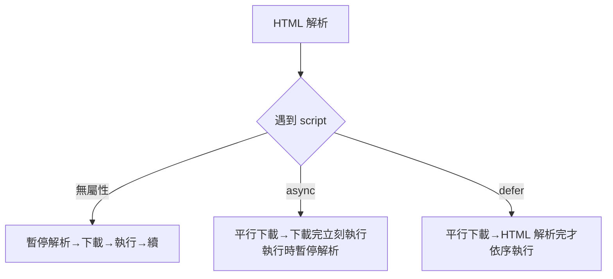

# 4.2 文件結構與常用元素

## 一份標準文件的解剖

```html
<!DOCTYPE html>
<html lang="zh-Hant">
<head>
  <meta charset="UTF-8" />
  <meta name="viewport" content="width=device-width, initial-scale=1.0" />
  <title>頁面標題（分頁與 SEO）</title>
  <meta name="description" content="頁面摘要" />
  <link rel="stylesheet" href="/style.css" />
  <script defer src="/app.js"></script>
</head>
<body>
  <h1>可見內容</h1>
</body>
</html>
```

`<head>` 是「關於文件的資料」（metadata），`<body>` 才是內容。三個必懂項目：

- **`<meta charset>`**：不設的話瀏覽器可能猜錯編碼 → 亂碼
- **`<meta viewport>`**：沒有它，手機以 980px 寬「縮小」渲染桌面版頁面（5.3 節 RWD 的前提）
- **`defer`**：腳本下載不阻塞解析、DOMContentLoaded 前執行（見本節後半）

## 內容元素的層次

```html
<article>
  <h1>文章標題</h1>          <!-- 每頁只有一個 h1 -->
  <h2>章節</h2>
  <p>段落。<strong>重要</strong>、<em>強調</em>、
     <code>程式碼</code>、<mark>高亮</mark>。</p>

  <blockquote cite="https://source.example">
    引用的話
  </blockquote>

  <ul>                        <!-- 無序 -->
    <li>清單項</li>
  </ul>
  <ol start="3">              <!-- 有序，可設起始 -->
    <li value="7">第三項顯示為 7</li>
  </ol>

  <figure>
    
    <figcaption>圖一：銷量趨勢</figcaption>
  </figure>
</article>
```

標題層次（h1–h6）構成文件的**大綱（outline）** —— 螢幕閱讀器與搜尋引擎靠它理解結構。常見錯誤：跳級（h1 直接到 h4）或用標題「縮小字體」（該用 CSS）。

## 連結與 URL

```html
<a href="/about">站內</a>
<a href="https://example.com" target="_blank" rel="noopener">站外新視窗</a>
<a href="#section2">頁內錨點</a>
<a href="mailto:hi@example.com">寄信</a>
```

`rel="noopener"` 不是裝飾：`target="_blank"` 開的新視窗可透過 `window.opener` 操作原頁面（tabnabbing 釣魚攻擊）—— **每個屬性都可能承載安全語意**。

## 圖片的正確寫法

```html

```

- **srcset/sizes**：依裝置寬度下載適當尺寸（手機不必載 1600px 大圖）—— RWD 的圖片面
- **alt**：圖片掛了/螢幕閱讀器的替代文字，也是 SEO 訊號
- **loading="lazy"**：視口外才載入（2.3 節快取/傳輸優化的應用面）

## 腳本載入的三種時序



| 屬性 | 執行時機 | 順序保證 | 適用 |
|------|---------|---------|------|
| （無） | 立即阻塞 | 有 | 依賴 DOM 之前的極少數情況 |
| `async` | 下載完就執行 | **無** | 獨立腳本（分析統計） |
| `defer` | DOM 解析完 | 有（依序） | 應用主程式 |

**預設答案用 `defer`**：既不阻塞渲染，又保證在 DOM 就緒後依序執行。

## inline vs 區塊：內容流的兩種行為

```html
<span>行內：不換行，寬高無效</span>
<div>區塊：獨佔一行</div>
<!-- HTML5 的分類其實更細：sectioning、phrasing、embedded、interactive… -->
```

行內元素不能設 width/height —— 這不是 CSS bug，是內容流模型的語意。需要「可設尺寸的行內」用 `display: inline-block`（5.1 節）。

## `<head>` 中的 SEO 三寶

```html
<title>精準的標題（60 字內）</title>
<meta name="description" content="吸引點擊的摘要（160 字內）" />
<link rel="canonical" href="https://example.com/official-url" />  <!-- 宣告正典 URL，防重複內容 -->
```

## 習題

1. 為什麼行動裝置需要 viewport meta？沒有它會發生什麼？
2. 給一個含 10 張圖的圖庫頁面寫出完整的 srcset/sizes 方案。
3. async 與 defer 混用時的執行順序為何不可預測？什麼場景必須 defer？
