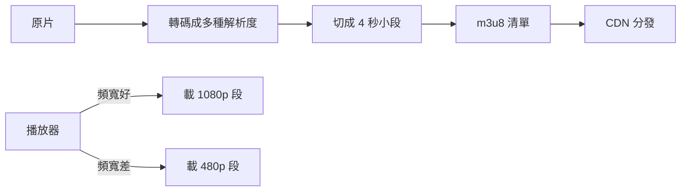

# 4.3 表單與多媒體

## 表單：Web 唯一的內建「寫入」通道

GET 拉資料，**表單是 HTML 送資料回伺服器的原生機制**。沒有表單就沒有登入、購物、貼文 —— Web 是「可寫入」的，表單就是寫入介面。

```html
<form action="/api/signup" method="post">
  <label for="email">Email
    <input type="email" id="email" name="email" required placeholder="a@b.c" />
  </label>

  <label for="pwd">密碼
    <input type="password" id="pwd" name="pwd" minlength="8" required />
  </label>

  <label>年齡 <input type="number" name="age" min="18" max="120" /></label>

  <fieldset>
    <legend>訂閱</legend>
    <label><input type="checkbox" name="news" value="tech" /> 科技新知</label>
    <label><input type="radio" name="plan" value="free" checked /> 免費</label>
    <label><input type="radio" name="plan" value="pro" /> 專業</label>
  </fieldset>

  <label>留言 <textarea name="comment" rows="4" maxlength="500"></textarea></label>

  <button type="submit">送出</button>
</form>
```

### method 的語意（回顧 1.x HTTP 語意）

| method | 編碼 | 限制 | 用途 |
|--------|------|------|------|
| GET | 放在 URL query | 有長度限制、可快取、進瀏覽紀錄 | 搜尋、篩選 |
| POST | 放在 body | 無長度限制、不快取 | 建立資料、密碼 |

**原則：會改變伺服器狀態的操作永遠用 POST**（PUT/DELETE 經由 JS fetch）。用 GET 做登入 → 密碼進 URL → 進伺服器日誌與瀏覽紀錄 —— 事故等級的安全漏洞。

### name 屬性才是鑰匙

送出時瀏覽器發送的是 `name=value` 對。**沒有 name 的欄位不會被送出** —— 新手最常見的「表單收不到資料」的原因。

## HTML5 驗證：把檢查推到最早

```html
<input type="email" required />
<input type="url" pattern="https://.*" title="必須是 https" />
<input type="date" min="2024-01-01" />
```

瀏覽器自動擋下不合規的送出、顯示提示。驗證的三道防線又出現了（對照前書 3.2 節）：

$$\text{瀏覽器內建驗證（體驗）} \to \text{JS 進階驗證（複雜規則）} \to \text{伺服器驗證（不可繞過！）}$$

**瀏覽器驗證只是體驗優化，永遠可以被繞過**（curl、改 DOM）。伺服器驗證是唯一的真相。

## 檔案上傳

```html
<form action="/upload" method="post" enctype="multipart/form-data">
  <input type="file" name="doc" accept="image/*,.pdf" multiple />
  <button>上傳</button>
</form>
```

`enctype="multipart/form-data"` 讓檔案以二進位分段傳送（預設的 urlencoded 編碼無法傳檔案）。伺服器端（如前書 axum 的 Multipart 提取器）按分段解析。前端無感的現代做法是 fetch + FormData：

```javascript
const fd = new FormData();
fd.append('doc', fileInput.files[0]);
await fetch('/upload', { method: 'POST', body: fd });   // 瀏覽器自動設 multipart 標頭
```

## 多媒體：`<video>` 與 `<audio>` 的標準化之戰

2010 年代之前，網頁影片 = Adobe Flash 外掛（效能差、安全性災難、行動裝置不支援）。HTML5（2008–2014）把媒體變成原生元素，**Flash 於 2020 年正式壽終** —— 開放標準取代私有外掛的里程碑。

```html
<video controls width="640" poster="cover.jpg" preload="metadata">
  <source src="movie.webm" type="video/webm" />
  <source src="movie.mp4"  type="video/mp4" />
  您的瀏覽器不支援影片。
</video>

<audio controls loop>
  <source src="song.mp3" type="audio/mpeg" />
</audio>
```

- **多個 `<source>`**：瀏覽器挑第一個支援的格式（webm 較小，mp4 兜底）
- **串流長影片**：原生元素吃不下，需 HLS/DASH —— 把影片切成數秒小段（.ts），以 m3u8 播放清單索引，用戶端依頻寬切換畫質（**ABR，自適應位元率**），底層全部是 2.3 節 CDN 的 HTTP 快取基建



## Canvas 與 SVG：兩種繪圖哲學

| | Canvas | SVG |
|--|--------|-----|
| 模型 | 點陣：JS 逐像素畫 | 向量：XML 描述形狀 |
| 縮放 | 模糊 | 無限清晰 |
| DOM 事件 | 無（全靠自己算座標） | 每個元素可掛事件 |
| 適用 | 遊戲、大量粒子、影像處理 | 圖示、圖表、可縮放插圖 |

```html
<svg viewBox="0 0 100 100" width="100">
  <circle cx="50" cy="50" r="40" fill="steelblue" />
</svg>
<canvas id="c" width="100" height="100"></canvas>
<script>
  const ctx = document.getElementById('c').getContext('2d');
  ctx.fillStyle = 'tomato';
  ctx.arc(50, 50, 40, 0, Math.PI * 2);
  ctx.fill();
</script>
```

**即時模式（Canvas）vs 保留模式（SVG/DOM）**：Canvas 忘了自己畫過什麼，每幀重畫；SVG/DOM 把圖形存成物件樹可個別操作。這正是 React（宣告式、保留模式）與遊戲引擎（命令式、即時模式）的分野。

## 習題

1. 為什麼登入表單不能用 GET？列出三條資料洩漏路徑。
2. 實作一個含完整 HTML5 驗證的註冊表單，並說明伺服器端還要驗什麼。
3. 比較 Canvas 與 SVG 做「10000 個移動點的視覺化」的效能差異原因。
