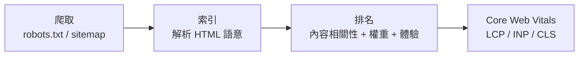

# 4.4 無障礙與 SEO

## 兩種「機器讀者」

HTML 的讀者不只人類：

1. **輔助科技**（螢幕閱讀器 VoiceOver/NVDA）：把頁面念出來給視障者聽
2. **搜尋引擎爬蟲**（Googlebot）：理解頁面以決定排名

兩者都不看視覺渲染，只讀結構 —— 所以**語意化 HTML（4.1）同時是無障礙與 SEO 的地基**。一個只會用 `<div>` 堆頁面的開發者，兩者都做不好。

## 無障礙（Accessibility, a11y）

### 為什麼是義務而非善行

全球約 15% 人口有某種障礙；許多國家/地區已立法（美國 ADA 判例、歐盟 European Accessibility Act 2025）。無障礙設計的四條原則（WCAG 的 POUR）：

| 原則 | 意義 | 範例 |
|------|------|------|
| Perceivable 可感知 | 資訊有多種呈現 | 圖片有 alt、影片有字幕 |
| Operable 可操作 | 不只靠滑鼠 | 全鍵盤可達、焦點可見 |
| Understandable 可理解 | 可預測 | 錯誤訊息具體、表單有 label |
| Robust 健壯 | 與輔助科技相容 | 語意元素、ARIA 正確使用 |

### 鍵盤與焦點：被忽略的交互模型

```html
<!-- 天然可鍵盤操作 -->
<button>送出</button>          <!-- Tab 可達、Enter 可按 -->

<!-- 反模式：div 扮演按鈕 -->
<div onclick="submit()">送出</div>   <!-- 鍵盤無法觸發！螢幕閱讀器不知道這能按 -->
```

**能不用 ARIA 就不用**：原生 `<button>` 自帶鍵盤行為、角色聲明、焦點管理。ARIA（Accessible Rich Internet Applications）是給非語意元素的補丁：

```html
<div role="button" tabindex="0"
     onkeydown="if(event.key==='Enter') submit()"
     onclick="submit()">
  送出
</div>
<!-- 等於手工重造 <button> —— 第一法則：No ARIA is better than bad ARIA -->
```

### 為表單與圖片補上語意

```html
<!-- label 明確關聯（不只視覺上靠近） -->
<label for="user">帳號</label>
<input id="user" name="user" />

<!-- 裝飾性圖片空 alt（念出「裝飾圖」反而干擾） -->


<!-- 有意義的 alt -->

```

### 對比與動效

- 文字對比度 ≥ 4.5:1（WCAG AA）—— 灰字配白底的美學陷阱
- `prefers-reduced-motion`：尊重使用者關閉動畫的系統設定（5.4 節）

```css
@media (prefers-reduced-motion: reduce) {
  * { animation: none !important; transition: none !important; }
}
```

## SEO：讓爬蟲理解並喜歡你

### 排名的輸入訊號



**Core Web Vitals（2020 起）把效能直接編入排名**：

| 指標 | 衡量 | 目標 | 主要因素 |
|------|------|------|---------|
| LCP 最大內容繪製 | 主內容出現時間 | < 2.5s | 伺服器回應、圖片、CDN（2.3） |
| INP 互動延遲 | 回應輸入的速度 | < 200ms | 主執行緒阻塞（6 章 JS） |
| CLS 累積版面偏移 | 畫面跳動程度 | < 0.1 | 未設尺寸的圖片/廣告 |

**技術章節的知識在這裡匯流**：CDN（2.3）壓 LCP、快取壓伺服器回應、CSS 尺寸預留壓 CLS。

### 語意與後設資料實務

```html
<title>咖啡豆烘焙指南 | 咖啡知識庫</title>   <!-- 獨特、含關鍵詞 -->
<meta name="description" content="從生豆到淺焙深焙的完整指南…" />

<h1>咖啡豆烘焙指南</h1>       <!-- 一頁一個，與 title 呼應 -->
<h2>淺焙</h2><h3>花香調</h3>  <!-- 層次不跳級 -->

<link rel="canonical" href="https://example.com/roasting" />
<link rel="alternate" hreflang="en" href="https://example.com/en/roasting" />
```

### robots.txt 與 sitemap

```
# robots.txt
User-agent: *
Disallow: /admin/
Sitemap: https://example.com/sitemap.xml
```

```xml
<urlset xmlns="http://www.sitemaps.org/schemas/sitemap/0.9">
  <url>
    <loc>https://example.com/roasting</loc>
    <lastmod>2026-01-10</lastmod>
    <priority>1.0</priority>
  </url>
</urlset>
```

### 內容式 SEO 的真相

技術 SEO 只是及格線。排名的長期驅動力：

$$\text{權重} \propto \text{外部優質連結} \times \text{內容深度} \times \text{使用者停留/互動}$$

**最好的 SEO 策略是寫出值得被引用的內容** —— 技術手段確保「能被讀懂」，內容決定「值得被讀」。

## 習題

1. 用鍵盤（Tab/Enter/Esc）操作你的網站，列出所有走不到或看不見焦點的元件，逐一修復。
2. 為一個圖表頁面寫出 alt、caption 與文字摘要版，說明這如何同時服務 a11y 與 SEO。
3. 查一個你常去的網站的 LCP 與 CLS（Lighthouse），指出三個可改進點並對應到本書章節。
