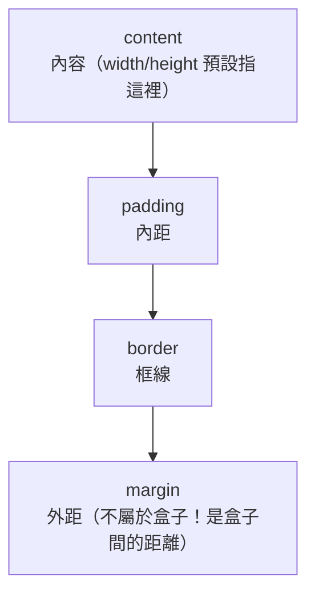

# 5.1 選擇器與盒子模型

## CSS 的定位：表現與結構分離

HTML 描述「這是什麼」（4.1 語意化），CSS 描述「長什麼樣」。這個分離（1996 CSS1，Håkon Wium Lie 的博士論文提案）的深意：**同一份 HTML，可換不同 CSS 呈現給不同裝置/使用者**（螢幕 vs 列印 vs 螢幕閱讀器）。

```css
/* 選擇器 { 屬性: 值 } */
h1 { color: steelblue; font-size: 2rem; }
```

## 選擇器：精確指名目標

```css
h1              { }            /* 標籤 */
.card           { }            /* 類別：最常用 */
#header         { }            /* ID：避免使用 */
li:nth-child(2) { }            /* 結構偽類 */
a:hover         { }            /* 動態偽類 */
.card > h2      { }            /* 直接子代 */
input:checked + label { }      /* 相鄰兄弟 */
```

### 優先級（specificity）：衝突時誰贏

$$\text{優先級} = (ID數,\ 類別/偽類數,\ 標籤數) \text{ 字典序比較}$$

```
#nav .link.active   → (1, 2, 0)
.card .active       → (0, 2, 0)
div.card            → (0, 1, 1)
div                 → (0, 0, 1)
```

規則：後寫的同級者覆蓋先寫；`!important` 跳出比較（**代價是再也蓋不掉**，僅用於工具類或緊急修復）。優先級失控是 CSS「越寫越髒」的頭號原因 —— **紀律：只用單一類別選擇器**（BEM、Tailwind 均源於此）。

### 繼承與層疊

```
樣式來源優先序：瀏覽器預設 < 使用者設定 < 頁面樣式
繼承：color、font 自動傳給子元素；width、margin 不繼承
```

## 盒子模型：一切排版的原子

**每個元素都是一個矩形盒子**，由四層組成：



### box-sizing：一個屬性救全域

```css
* { box-sizing: border-box; }   /* 幾乎所有專案的第一行 */
```

| box-sizing | width 指的是 | 設 width:200px; padding:10px 的總寬 |
|-----------|-------------|--------------------------------------|
| content-box（預設） | 內容 | 200 + 20 + 邊框 = 220+ ❌ 難算 |
| border-box | 內容+內距+框 | **200** ✅ 說多少就是多少 |

W3C 原始設計（content-box）在數學上「純粹」，實務上是災難 —— 佈局時你得心算加總。瀏覽器廠商與開發者用腳投票，border-box 事實統一。

### margin 折疊（collapsing）

相鄰區塊的垂直 margin 取**最大值**而非相加：

```css
h2 { margin-bottom: 30px; }
p  { margin-top: 20px; }
/* h2 與 p 之間 = max(30, 20) = 30px，不是 50px */
```

父子元素的第一個子元素 margin 也會「穿出」父元素。**Flex/Grid 容器內不發生摺疊** —— 這也是新排版工具受歡迎的隱藏原因之一。

## 單位：相對優於絕對

| 單位 | 意義 | 用途 |
|------|------|------|
| px | 絕對像素 | 框線、陰影 |
| % | 相對父元素 | 佈局寬度 |
| **rem** | 相對根字號 | **字級、間距的預設選擇** |
| em | 相對自身字號 | 縮排、行內微調 |
| vw/vh | 視口寬/高 | 滿屏區塊 |
| ch | 字元寬度 | 等寬排版 |

`rem` 的戰略價值：使用者可調整瀏覽器根字號，全站隨之縮放 —— **無障礙（4.4）與可維護性（改一處全站變）的雙贏**。

## 顯示模式與文件流

```css
display: block;      /* 獨佔一行 */
display: inline;     /* 行內，寬高無效 */
display: inline-block; /* 行內但可設寬高 */
display: none;       /* 不渲染（vs visibility:hidden 佔位但不可見） */
```

正常文件流（normal flow）：區塊從上往下、行內從左往右排。**float 與 position:absolute 都是「脫離」或「懸浮」於此流的手段**，2000 年代用 float 排版是時代的權宜之計 —— 5.2 節 Flex/Grid 讓排版回歸宣告式。

## 習題

1. 解釋為什麼 `* { box-sizing: border-box }` 成為業界標配，content-box 的數學問題在哪。
2. 寫出 `.nav ul li a.active` 的優先級三元組，並用單類別原則重構。
3. 用 rem 設計一套字階（12/14/16/20/24/32px，根 16px），說明其可縮放性。
