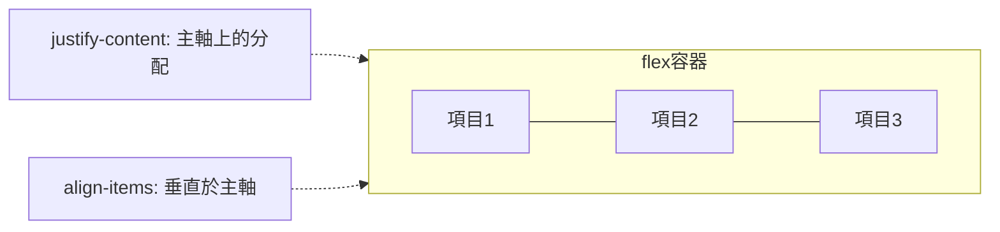
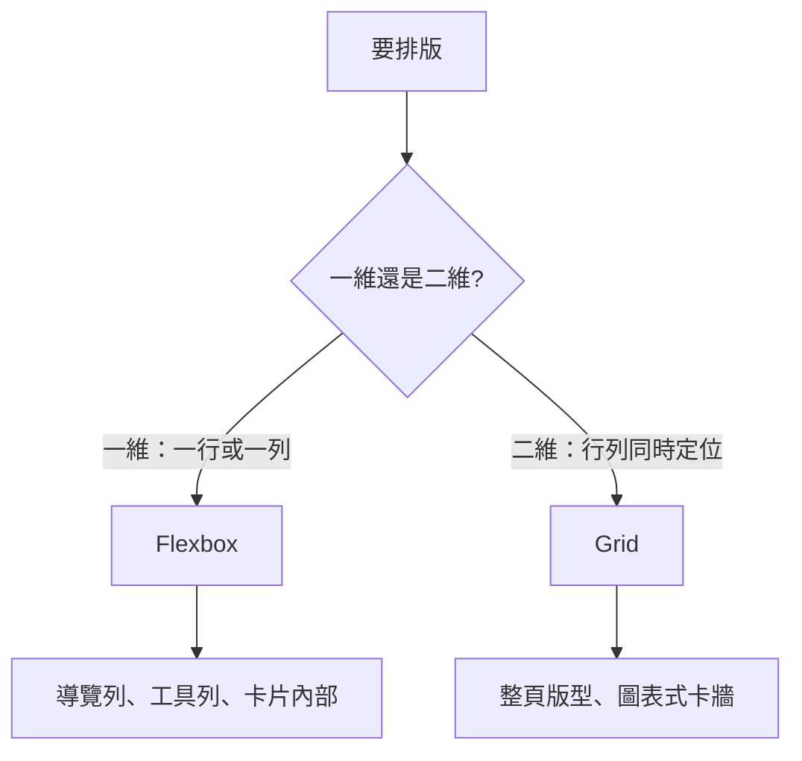

# 5.2 Flexbox 與 Grid 排版

## 排版演化：從 hack 到宣告

| 年代 | 技術 | 本質 |
|------|------|------|
| 1996–2004 | `<table>` 排版 | 濫用資料表格做版面 |
| 2005–2015 | float + clearfix | 濫用「文字繞圖」做欄位 |
| 2009–2012 | position absolute + 負 margin | 手算像素 |
| 2012 | **Flexbox** | 一維宣告式排版 |
| 2017 | **CSS Grid** | 二維宣告式排版 |

`<table>` 與 float 排版是**誤用別的語意解決排版問題** —— 工具不對，就用 hack。Flex/Grid 是瀏覽器第一次提供「排版語意」的原生原語。

## Flexbox：一維排版

```css
.container {
  display: flex;
  flex-direction: row;        /* 主軸方向 */
  justify-content: space-between;  /* 主軸對齊 */
  align-items: center;             /* 交叉軸對齊 */
  gap: 16px;                       /* 間距（現代首選，取代 margin hack） */
}
.item { flex: 1; }   /* grow=1, shrink=1, basis=0 → 均分 */
```



### 對齊三件套

```css
/* 經典的完美置中（2015 年前要用 3 種 hack） */
.center {
  display: flex;
  justify-content: center;   /* 水平置中 */
  align-items: center;       /* 垂直置中 */
}
```

### flex 屬性的分配演算法

```css
.sidebar { flex: 0 0 240px; }   /* 固定寬側欄 */
.content { flex: 1; }            /* 剩餘全給內容 */
```

$$\text{可用空間分配}： \text{剩餘} = \text{容器寬} - \sum \text{basis}； \text{各項依 grow 比例分剩餘}$$

**Flexbox 的強大在於「讓瀏覽器算」，而非開發者算** —— 響應式不是靠媒體查詢堆出來的，是靠彈性公式。

## Grid：二維排版

```css
.page {
  display: grid;
  grid-template-columns: 240px 1fr 300px;   /* 三欄 */
  grid-template-rows: auto 1fr auto;        /* 頭/身/尾 */
  grid-template-areas:
    "header header header"
    "side   main   aside"
    "footer footer footer";
  min-height: 100vh;
}
.header { grid-area: header; }
.side   { grid-area: side; }
```

**Grid 的革命性：佈局與元素分離** —— 容器宣告整個版面（像畫格子），子元素只報名格位。改版面只改容器一處，不用動任何 HTML。

### 重複與響應欄位

```css
/* 12 欄系統 */
.grid-12 { grid-template-columns: repeat(12, 1fr); }
.span-8  { grid-column: span 8; }

/* 不需媒體查詢的響應卡列表 —— auto-fill + minmax */
.cards {
  display: grid;
  grid-template-columns: repeat(auto-fill, minmax(240px, 1fr));
  gap: 16px;
}
```

`auto-fill + minmax` 的意義：**容器有多寬，就自動塞幾欄（每欄至少 240px）** —— 手機 1 欄、平板 2 欄、桌面 4 欄，零媒體查詢。這是「容器內在響應」對「媒體查詢外在響應」的超越（後來的 Container Queries 是此思想的延伸）。

## 取捨法則：Flex vs Grid



實務上**兩者巢狀**：Grid 定頁面大格局，Flex 處理格子內部的細排 —— 各在自己的最佳維度。

## 置中、粘性、漸進增強實戰

```css
/* 粘性標頭：正常流 + 滾動時固定 */
.header { position: sticky; top: 0; }

/* 頁尾永遠在底部（神聖格線） */
body {
  min-height: 100vh;
  display: grid;
  grid-template-rows: auto 1fr auto;   /* 頭 自伸 尾 */
}
```

## 習題

1. 用 float 時代的知識，寫出「三欄等高」需要多少 hack；再用 Grid 重寫。
2. 實作「側欄固定 260px、內容自適應、窄於 700px 時側欄移到頂部」—— 比較 Grid area 重排與 Flex 換向兩種解法。
3. 說明 `auto-fill` 與 `auto-fit` 的差異（提示：空軌道的處理）。
