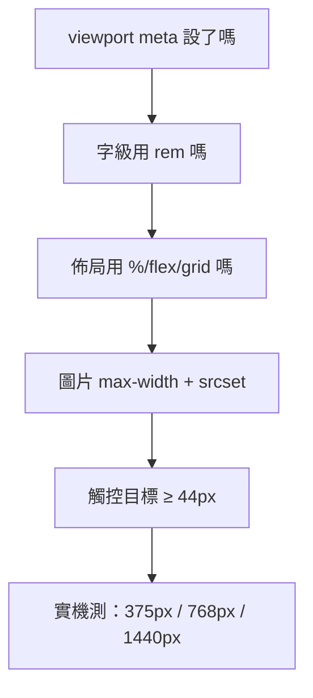

# 5.3 響應式設計與媒體查詢

## 時代轉折：iPhone 與「行動優先」

2007 年 iPhone 問世前，網站=桌面。之後行動流量 2016 年超過桌面（並持續擴大）。2010 年 Ethan Marcotte 提出 **Responsive Web Design（RWD）**三支柱：

1. **流式格線**（fluid grid）—— 相對單位
2. **彈性媒體**（flexible media）—— 圖片隨容器縮放
3. **媒體查詢**（media queries）—— 依裝置條件調整樣式

背後的世界觀轉變：**你不知道使用者的裝置，也不該假設** —— 從「設計一張固定畫布」變成「設計一套會呼吸的規則」。

## Viewport：一切的起點

```html
<meta name="viewport" content="width=device-width, initial-scale=1" />
```

沒有它，手機瀏覽器假設頁面是 980px 寬的桌面頁，然後縮小塞進 390px 螢幕 —— 字如螻蟻。這一行 meta 是行動網頁的前提（4.2 節已提，此處補全因果）。

## 媒體查詢

```css
/* 窄於 768px（含）適用 */
@media (max-width: 768px) {
  .sidebar { display: none; }
}

/* 依裝置能力而非寬度 */
@media (prefers-color-scheme: dark) {   /* 深色模式 */
  body { background: #111; color: #eee; }
}
@media (hover: none) {                   /* 觸控裝置：放大點擊目標 */
  .btn { min-height: 44px; }
}
@media (prefers-reduced-motion: reduce) {  /* 4.4 無障礙 */
  * { animation: none; }
}
```

### 行動優先（mobile first）的寫法

```css
/* 基礎樣式 = 手機（預設最小） */
.container { display: block; }

/* 平板起，逐級增強 */
@media (min-width: 768px) {
  .container { display: grid; grid-template-columns: 1fr 2fr; }
}
```

**為什麼行動優先**：桌面版樣式簡單（手機版 + 增強），反向寫法要不停「撤除」桌面樣式（覆蓋成本高）。這也是效能策略：手機不需要載入桌面專用的規則與資源。

### 斷點的真相

斷點不是「iPhone 的寬度」，而是**你的內容開始破版的寬度**：

$$\text{斷點} = \text{讓內容變形臨界點，而非設備清單}$$

實務用 3–5 個斷點就夠（576 / 768 / 1024 / 1200），其餘靠流式佈局與 5.2 節的 `minmax` 自動處理。

## 彈性媒體

```css
img, video { max-width: 100%; height: auto; }   /* 絕不破容器 */

/* iframe 影片的比例鎖定（避免 CLS，4.4 節） */
.video-wrap {
  aspect-ratio: 16 / 9;   /* 現代解 */
}
```

配合 4.2 節的 `srcset`：寬度響應不只改 CSS，還要換資源 —— **RWD 是全鏈路工程**，不只 CSS。

## 邏輯屬性與容器查詢：RWD 的下一代

### 邏輯屬性：讓佈局支援 RTL

```css
.card {
  margin-inline-start: 16px;   /* 取代 margin-left */
  padding-block: 8px;          /* 取代 padding-top/bottom */
}
```

`left/right` 變成 `inline-start/end`：切換阿拉伯文（右到左）版面時，CSS 不用重寫 —— **抽象方向而非座標**。

### 容器查詢（Container Queries, 2023）

媒體查詢問「**視窗**多寬」，容器查詢問「**我的容器**多寬」：

```css
.card-zone { container-type: inline-size; }

@container (min-width: 480px) {
  .card { display: flex; }    /* 卡片在側欄時直排、拉寬時橫排 */
}
```

革命性：元件**根據自己被放進的容器**自適應 —— 元件真正可攜，不再假設頁面寬度。這把 RWD 從「頁面級」下放到「元件級」，與元件化開發（React 時代）終於對齊。

## 快速響應檢查清單



## 習題

1. 把 5.2 節的三欄頁面改成行動優先：手機單欄、平板雙欄、桌面三欄，數出你用了幾個媒體查詢，並解釋哪些被 minmax 免掉了。
2. 容器查詢與媒體查詢的差別，用「同一個卡片組件放進側欄與主欄」的例子說明。
3. 深色模式除了媒體查詢，還要注意配色對比（4.4）—— 設計一組兩模式都過 4.5:1 的色票。
