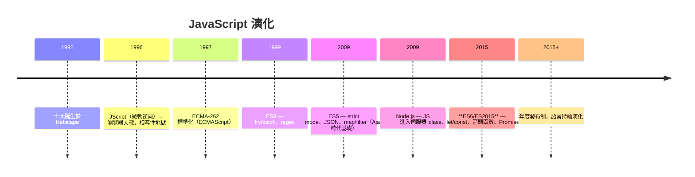
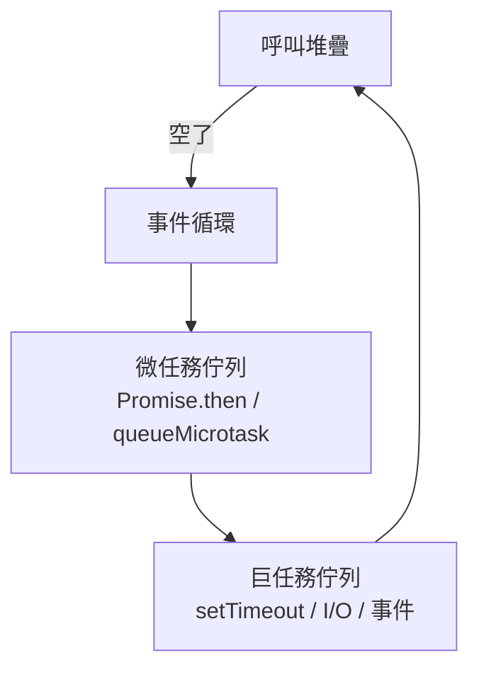

# 6.1 JavaScript 誕生史與語言核心

## 十天寫出的語言（1995）

1995 年 Netscape 要為瀏覽器加腳本能力，Brendan Eich 在**十天**內設計出 Mocha → LiveScript → JavaScript。名字蹭 Java 的熱度（行銷決定），兩者關係如「雷之兄弟」—— 語法像，本質完全不同。



十天設計的遺產（好壞皆是）：

- **原型繼承**（借 Self）而非類別 —— 影響深遠
- **一等函數與閉包**（借 Scheme）—— 幸運的好決定，是 JS 最強的武器
- **動態型別 + 隱式轉換** —— 幸運的壞決定，`[] + {}` 之類的怪相由此而來

## 語言核心：先把 JS 當函數式語言讀

### 函數是一等公民 + 閉包

```javascript
// 函數可以存進變數、當參數、當回傳值
const add = (a) => (b) => a + b;     // 柯里化
add(2)(3);  // 5

// 閉包：函數記住定義當下的詞彙環境
function makeCounter() {
  let count = 0;                     // 被內層函數捕獲，不會消失
  return () => ++count;
}
const c = makeCounter();
c(); c(); c();  // 1, 2, 3 — 私有狀態！
```

閉包是 JS 狀態封裝的根基：模組、Hooks（前書 4.2 的 useEffect 依賴捕獲）、事件處理器全靠它。**stale closure bug 的根源也在此**：函數捕獲的是「變數的引用」而非「當下的值」。

### 原始型別 vs 物件：複製語意

| 原始型別（按值） | 物件（按引用） |
|------------------|----------------|
| number, string, boolean | object, array, function |
| null, undefined, symbol, bigint | |
| `a = b` 複製值 | `a = b` 複製引用（同一物件！） |

```javascript
let a = [1, 2];
let b = a;         // b 與 a 指向同一陣列
b.push(3);
a.length;  // 3 ！（React 不可變更新的原因，前書 4.1）
```

### this：動態綁定的雙面刃

```javascript
const user = {
  name: 'Amy',
  hello()  { console.log(`I am ${this.name}`); },
  hello2: () => console.log(`I am ${this?.name}`),   // 箭頭函數不吃物件的 this
};

user.hello();    // I am Amy
const f = user.hello; f();  // I am undefined（this 丟了！）
```

`this` 由**呼叫方式**決定（動態作用域的殘影），箭頭函數則繼承定義處的 this（詞法 this）。ES6 之後的實務：**能箭頭就箭頭**，把 this 問題縮小到 class 方法。

### 型別轉換的坑與防禦

```javascript
0 == ''          // true（隱式轉換）→ 永遠用 ===
null ?? '預設'   // 只有 null/undefined 才回退（vs || 連 0、'' 都回退）
NaN !== NaN      // true → 判斷用 Number.isNaN()
typeof null      // 'object'（歷史 bug，永遠不修：向後相容鐵律）
```

## ES6 之後的現代語法速覽

```javascript
// 解構
const { name, age = 18, ...rest } = user;
const [first, , third] = list;

// 展開
const merged = { ...defaults, ...options };        // 淺合併
const next = [...todos, newTodo];                   // 不可變更新

// 模板字串
const html = `<li class="${active ? 'on' : ''}">${name}</li>`;

// 可選鏈與空值合併
const city = user?.address?.city ?? '未知';

// Map/Set（鍵可以是任何型別、有序、高效增刪）
const seen = new Set(ids);
const cache = new Map();
```

## 執行模型：單執行緒 + 事件循環（前書 2.3 的 JS 版）



優先級：**同步碼 → 全部微任務 → 一個巨任務 → 全部微任務 → …**

```javascript
console.log('1');
setTimeout(() => console.log('4'));
Promise.resolve().then(() => console.log('3'));
console.log('2');
// 輸出：1 2 3 4
```

單執行緒的含義：**長任務阻塞一切**（包括 UI 回應，4.4 節 INP 指標的敵人）→ 重活用 `Worker`，I/O 永遠非同步（6.3）。

## 習題

1. 解釋為什麼 `const arr = []; arr.push(1)` 合法 —— const 鎖的是什麼？
2. 用閉包寫一個 `once(fn)`：只執行一次、之後回傳快取結果。
3. 畫出這段碼的事件循環時序：兩個 setTimeout(0)、三個 Promise.then、一行同步碼。
