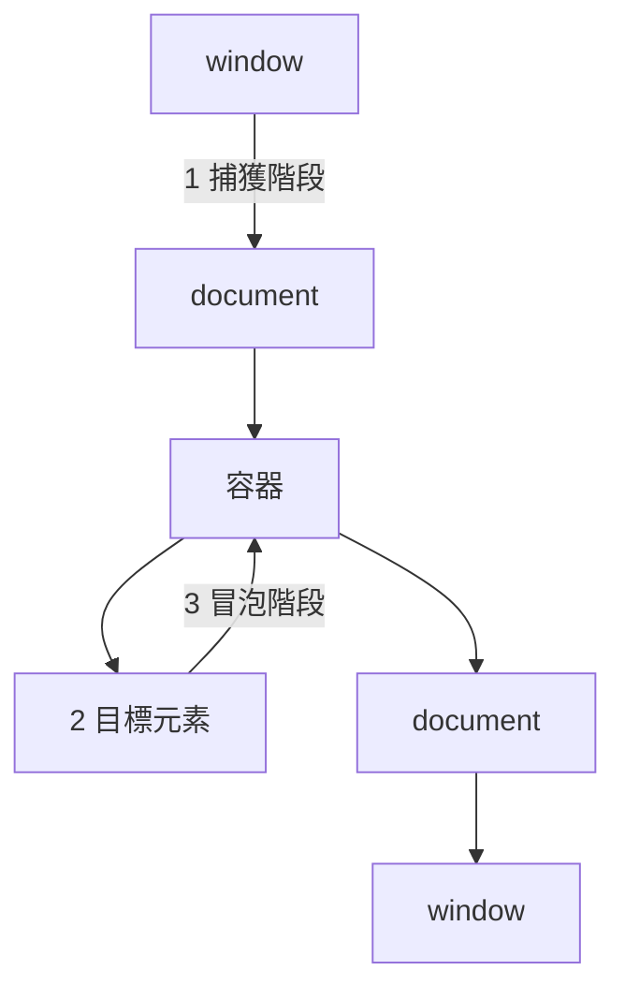

# 6.2 DOM 操作與事件模型

## DOM：HTML 的編譯產物

4.1 節說過：瀏覽器把 HTML 解析成 **DOM（Document Object Model）樹** —— JS 唯一能觸碰的頁面表示。JS 操控網頁 = 操控這棵樹。

```javascript
// 選取
const el = document.querySelector('.card');           // 單個（現代首選）
const els = document.querySelectorAll('li.active');   // NodeList（可 forEach）

// 讀寫
el.textContent = '純文字';         // 安全（自動轉義）
el.innerHTML = '<b>粗體</b>';      // 強大但危險（XSS 入口！）
el.setAttribute('href', '/next');
el.classList.add('open');          // classList 是 class 操作的正解
el.dataset.id = '42';              // data-* 屬性
el.style.transform = 'scale(1.1)';
```

**XSS 的分界線**：`textContent` 把字串當「文字」，`innerHTML` 把字串當「HTML 解析」。使用者輸入進 innerHTML = 攻擊者可注入腳本：

```javascript
// 攻擊者留言：
el.innerHTML = comment;   // ☠️ cookie 被偷
el.textContent = comment; // ✅ 原樣顯示
```

## 修改 DOM 的成本（串起 5.4 節）

```javascript
// ❌ 迴圈裡逐筆插入：每筆觸發 layout/paint
for (const item of items) list.append(buildLi(item));

// ✅ 用 DocumentFragment 批次：只觸發一次渲染
const frag = document.createDocumentFragment();
for (const item of items) frag.append(buildLi(item));
list.append(frag);   // 一次掛上
```

與 5.4 節的讀寫分離同一原理：**把修改打包，減少渲染管線的觸發次數**。

## 事件模型：捕獲、目標、冒泡



```javascript
btn.addEventListener('click', (e) => {
  e.stopPropagation();  // 阻止冒泡（慎用，破壞協作）
  e.preventDefault();   // 阻止預設行為（如表單送出、連結跳轉）
});
```

**冒泡的存在是為了「事件委託」**：

```javascript
// ❌ 給 1000 個 li 各掛一個 handler（1000 個監聽器，新增 li 還要重掛）
lis.forEach((li) => li.addEventListener('click', onSelect));

// ✅ 委託給父元素：1 個監聽器，動態新增的 li 自動生效
list.addEventListener('click', (e) => {
  const li = e.target.closest('li');
  if (li) select(li.dataset.id);
});
```

事件委託 = **在冒泡的上游集中處理** —— 記憶體省、動態內容免重掛，是高效能列表的標配。

## 事件的三個進階主題

### 1. 防抖與節流：控制事件頻率

```javascript
// 防抖 debounce：停止觸發 N ms 後才執行（搜尋輸入）
function debounce(fn, ms) {
  let t;
  return (...args) => {
    clearTimeout(t);
    t = setTimeout(() => fn(...args), ms);
  };
}
input.addEventListener('input', debounce(search, 300));

// 節流 throttle：每 N ms 最多執行一次（滾動、resize）
function throttle(fn, ms) {
  let last = 0;
  return (...args) => {
    const now = Date.now();
    if (now - last >= ms) { last = now; fn(...args); }
  };
}
window.addEventListener('scroll', throttle(updateHeader, 100));
```

scroll 事件每秒可觸發上百次，直接掛 handler 就是 5.4 節的 INP 殺手。

### 2. 自訂事件：解耦的橋

```javascript
// 元件內發布
el.dispatchEvent(new CustomEvent('cart:add', {
  detail: { id: 42 }, bubbles: true,
}));

// 其他模組訂閱 —— 不需要知道彼此存在
document.addEventListener('cart:add', (e) => cart.add(e.detail.id));
```

**發布/訂閱模式**：模組間只依賴「事件名」這個介面 —— 與前書 3.3 節 Redis Pub/Sub 是同一模式在單頁內的縮影。

### 3. 表單事件與受控流程

```javascript
form.addEventListener('submit', (e) => {
  e.preventDefault();                       // 攔下整頁重載
  if (!form.reportValidity()) return;       // 觸發 4.3 的內建驗證 UI
  fetch('/api/signup', { method: 'POST', body: new FormData(form) })
    .then((r) => r.json())
    .then(render, showError);
});
```

## 語意化的 JS 結構：一個小元件的完整寫法

```javascript
function createTabs(root) {
  const tabs = root.querySelectorAll('[role="tab"]');
  const panels = root.querySelectorAll('[role="tabpanel"]');

  root.addEventListener('click', (e) => {              // 委託
    const tab = e.target.closest('[role="tab"]');
    if (!tab) return;
    activate(tab);
  });
  root.addEventListener('keydown', (e) => {            // 4.4 鍵盤無障礙
    if (e.key === 'ArrowRight') activate(nextTab(e.target));
  });

  function activate(tab) {
    tabs.forEach((t) => {
      t.setAttribute('aria-selected', t === tab);
    });
    panels.forEach((p) => p.hidden = p.id !== tab.getAttribute('aria-controls'));
  }
}
```

特徵：封裝（函數即元件）、事件委託、ARIA 同步、鍵盤支援 —— 這是「不依框架」的正確寫法；理解它，才能理解 React 的 useEffect/refs 到底在替代什麼（前書 4.2）。

## 習題

1. 寫一個無限滾動列表：事件委託 + DocumentFragment + throttle 三者缺一不可，說明各自解決什麼。
2. `stopPropagation` 什麼時候是必要的？給一個第三方元件衝突的場景。
3. 把 4.3 的註冊表單接上 JS：攔截送出、前端驗證失敗顯示訊息、成功後 fetch POST。
