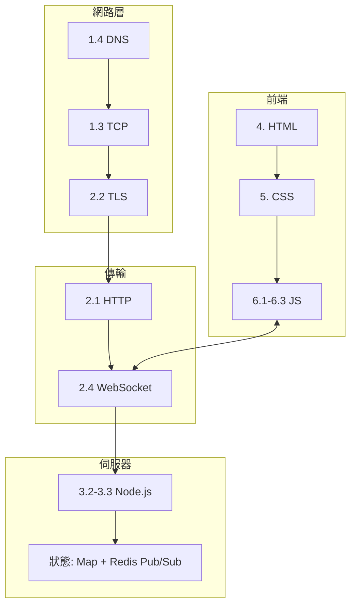

# 6.4 實戰：即時聊天室全端應用

## 全書知識的總匯演

這個聊天室用到本書每一章：



## 專案結構

```
chat/
├── package.json
├── server.js          # HTTP + WebSocket
├── public/
│   ├── index.html     # 4.1-4.3
│   ├── style.css      # 5.1-5.3
│   └── app.js         # 6.1-6.3
└── docker-compose.yml # 5.3（選配）
```

## 伺服器：HTTP 服務靜態檔 + WebSocket 廣播

```javascript
// server.js
const http = require('http');
const fs = require('fs');
const path = require('path');
const { WebSocketServer } = require('ws');

const MIME = {
  '.html': 'text/html; charset=utf-8',
  '.css': 'text/css; charset=utf-8',
  '.js': 'text/javascript; charset=utf-8',
};

const server = http.createServer((req, res) => {
  const file = path.join('public', req.url === '/' ? 'index.html' : req.url);
  fs.readFile(file, (err, data) => {
    if (err) { res.writeHead(404); return res.end('Not Found'); }
    res.writeHead(200, { 'Content-Type': MIME[path.extname(file)] ?? 'application/octet-stream',
                         'Cache-Control': 'no-cache' });
    res.end(data);
  });
});

const wss = new WebSocketServer({ server });   // 同埠：握手走 Upgrade（3.3）
const users = new Map();                        // ws → 昵稱

wss.on('connection', (ws, req) => {
  const name = new URL(req.url, 'http://x').searchParams.get('name')
               ?? `訪客${users.size}`;
  users.set(ws, name);

  send(ws, { type: 'system', text: `歡迎 ${name}，目前在線 ${users.size} 人` });
  broadcast({ type: 'system', text: `${name} 進來了` });

  ws.on('message', (buf) => {
    const text = buf.toString().slice(0, 500);        // 輸入上限（3.3 安全清單）
    broadcast({ type: 'chat', from: name, text, at: Date.now() });
  });

  ws.on('close', () => {
    users.delete(ws);
    broadcast({ type: 'system', text: `${name} 離開了` });
  });
});

const send = (ws, obj) => ws.readyState === 1 && ws.send(JSON.stringify(obj));
const broadcast = (obj) => { for (const ws of wss.clients) send(ws, obj); };

server.listen(8080, () => console.log('http://localhost:8080'));
```

## 前端：HTML（語意 + 無障礙）

```html
<!-- public/index.html -->
<!DOCTYPE html>
<html lang="zh-Hant">
<head>
  <meta charset="UTF-8" />
  <meta name="viewport" content="width=device-width, initial-scale=1" />
  <title>即時聊天室</title>
  <meta name="description" content="用 WebSocket 建構的即時聊天室" />
  <link rel="stylesheet" href="style.css" />
  <script defer src="app.js"></script>   <!-- 4.2：defer 不阻塞渲染 -->
</head>
<body>
  <header class="chat-header">
    <h1>聊天室</h1>
    <span id="status" class="status">離線</span>
  </header>

  <main class="chat-main">
    <ul id="log" role="log" aria-live="polite"></ul>  <!-- 4.4：螢幕閱讀器播報新訊息 -->
  </main>

  <form id="form" class="chat-form">
    <label for="input" class="visually-hidden">訊息</label>
    <input id="input" name="text" autocomplete="off" maxlength="500" required />
    <button type="submit">送出</button>
  </form>
</body>
</html>
```

要點：`role="log"` + `aria-live` 讓新訊息自動被念出（4.4）；`visually-hidden` 標籤服務螢幕閱讀器但不佔視覺。

## 前端：CSS（Grid 版型 + RWD）

```css
/* public/style.css */
* { box-sizing: border-box; }                       /* 5.1 */

body {
  margin: 0;
  height: 100dvh;                                    /* 動態視口高：手機網址列收合也正確 */
  display: grid;
  grid-template-rows: auto 1fr auto;                /* 5.2 神聖格線：頭 訊息區 輸入列 */
  font-family: system-ui;
  background: #f4f6f8;
}

.chat-main { overflow-y: auto; padding: 12px; }

#log {
  display: flex;
  flex-direction: column;                            /* 5.2 一維排版 */
  gap: 8px;
  max-width: 640px;
  margin-inline: auto;                               /* 5.3 邏輯屬性 */
  list-style: none;
  padding: 0;
}

.msg { padding: 8px 12px; border-radius: 12px; background: #fff; width: fit-content; }
.msg.mine { align-self: flex-end; background: #3b82f6; color: #fff; }
.msg.system { align-self: center; font-size: 0.75rem; color: #6b7280; }

.chat-form {
  display: flex; gap: 8px; padding: 12px;
  background: #fff; border-top: 1px solid #e5e7eb;
}
.chat-form input {
  flex: 1;                                            /* 5.2 flex 分配 */
  padding: 12px; border: 1px solid #d1d5db; border-radius: 8px;
  min-height: 44px;                                   /* 5.3 觸控目標 */
}
.chat-form button { padding: 0 20px; border: 0; border-radius: 8px;
  background: #3b82f6; color: #fff; cursor: pointer; }
.chat-form button:hover { transform: translateY(-1px); }   /* 5.4 transform 動畫 */
.chat-form button { transition: transform 0.15s; }

@media (prefers-color-scheme: dark) {                /* 5.3 深色模式 */
  body { background: #111827; }
  .msg { background: #1f2937; color: #e5e7eb; }
}

.visually-hidden {                                    /* 4.4 */
  position: absolute; width: 1px; height: 1px; overflow: hidden; clip: rect(0 0 0 0);
}
```

## 前端：JS（WebSocket + async 全套）

```javascript
// public/app.js
const log = document.getElementById('log');
const form = document.getElementById('form');
const input = document.getElementById('input');
const status = document.getElementById('status');

const myName = localStorage.getItem('chatName') ?? `訪客${Math.floor(Math.random() * 1000)}`;
localStorage.setItem('chatName', myName);

let ws;
let retries = 0;

function connect() {
  ws = new WebSocket(
    `${location.protocol === 'https:' ? 'wss' : 'ws'}://${location.host}?name=${encodeURIComponent(myName)}`
  );

  ws.onopen = () => { status.textContent = '在線'; retries = 0; };
  ws.onclose = () => {
    status.textContent = '重連中…';
    const delay = 1000 * 2 ** Math.min(retries++, 5);   // 2.4 指數退避
    setTimeout(connect, delay);
  };
  ws.onmessage = (e) => {
    const msg = JSON.parse(e.data);
    appendMsg(msg);
  };
}

function appendMsg({ type, from, text }) {
  const li = document.createElement('li');
  li.className = type === 'system' ? 'msg system'
               : from === myName ? 'msg mine' : 'msg';
  li.textContent = type === 'chat' ? `${from}: ${text}` : text;   // 6.2 textContent 防 XSS
  log.append(li);
  li.scrollIntoView({ behavior: 'smooth', block: 'end' });
}

form.addEventListener('submit', (e) => {              // 6.2 攔截預設送出
  e.preventDefault();
  const text = input.value.trim();
  if (!text || ws?.readyState !== 1) return;
  ws.send(text);
  input.value = '';
});

connect();
```

伺服器端接收已改為**純文字**（不用 JSON），客戶端 send 只送字串 —— 訊息協議越簡單，出錯面越小；textContent 確保任何輸入只會被「顯示」而不被「執行」。

## 知識映射總表

| 程式碼位置 | 本書章節 | 理論 |
|-----------|---------|------|
| `WebSocketServer({ server })` | 2.4, 3.3 | HTTP Upgrade 握手、同埠復用 |
| `readyState === 1` 檢查 | 3.3 | 連線生命週期 |
| 指數退避重連 | 2.4 | 分散式重試法則 |
| `textContent` 而非 innerHTML | 6.2 | XSS 防禦 |
| `aria-live` + role=log | 4.4 | POUR 可感知 |
| `grid-template-rows: auto 1fr auto` | 5.2 | 神聖格線 |
| `transform` hover | 5.4 | 合成器動畫 |
| `maxlength` + 伺服器 slice | 4.3/3.3 | 三道防線 |
| `Cache-Control: no-cache` | 2.3 | HTML 的快取策略 |
| Map 管理連線 | 3.2 | 連線狀態與清理 |

## 延伸挑戰

1. **房間**：3.2 節 rooms 模式 + URL 路由 `/room/xxx`
2. **多人伺服器**：Redis Pub/Sub（3.3 節）
3. **表情與圖片**：multipart 上傳（4.3）+ CDN（2.3）
4. **視訊**：WebRTC P2P（3.4）+ WebSocket 信令
5. **部署**：docker-compose + Nginx 反代（記得 `proxy_set_header Upgrade` 讓 WebSocket 穿過反代 —— 2.4 節「代理友善」的實際檢驗）

## 結語

回頭看這 200 行，每一行都踩在前面章節鋪的理論上：從 ARPANET 的分層、TCP 的可靠、TLS 的信任、HTTP 的演化、WebSocket 的升級、到 HTML 的語意、CSS 的盒子、JS 的閉包與事件循環。**技術會更替，但「分層解耦、讓對的層做對的事」的設計思想不會** —— 這是本書最想交給你的東西。

## 習題

1. 部署到 Nginx 反代後端，解決 WebSocket 404 問題，寫出關鍵設定。
2. 加入「誰在線上」側欄（users Map 廣播名單），並處理暱稱衝突。
3. 用 Lighthouse 對聊天頁打分，修到 Accessibility 100。
