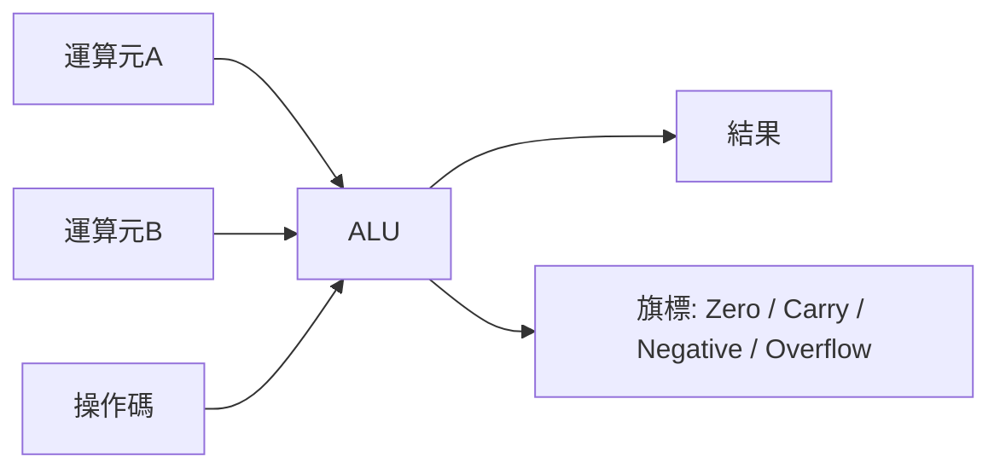

# 1.2 組合電路實作與 ALU

## 學習目標

讀完本節後，你應該能夠：

1. 說明 ALU 在 CPU 資料路徑中的角色與歷史淵源（74181）。
2. 用 Verilog 撰寫支援 add/sub/and/or/slt/shift 的 32 位元 ALU。
3. 理解減法如何透過二補數與進位實現，以及 slt 的比較邏輯。
4. 撰寫自我檢查（self-checking）的 testbench，用任務導向方式驗證 ALU。

---

## 1.2.1 ALU：CPU 的計算心臟

算術邏輯單元（Arithmetic Logic Unit, ALU）是處理器中真正「做計算」的電路：給它兩個運算元和一個操作碼（opcode），它輸出結果與狀態旗標。在單週期 RISC-V 或 MIPS 資料路徑中，ALU 同時服務算術指令、位址計算（`lw` 的 base+offset）與分支比較。

### 歷史：74181 與 ALU 的誕生

1970 年，Texas Instruments 推出 **74181**，這是史上第一顆以單一晶片實現的 4 位元 ALU。在那個還沒有微處理器的年代，設計師用 4 顆 74181 串接成 16 位元 ALU。它支援 16 種算術運算與 16 種邏輯運算，由 4 條選擇線與一條模式線（算術/邏輯）控制。

74181 的歷史意義：**PDP-11、Xerox Alto、乃至早期的 VAX** 都以它為核心。它證明了「ALU 可以模組化」，讓資料路徑設計從客製邏輯走向積木化。今天我們用 Verilog 寫 ALU，本質上是在做 74181 設計師同樣的事——只是抽象層提高了數十倍。



## 1.2.2 減法與二補數：一個加法器走天下

減法 $A - B$ 可以寫成 $A + \overline{B} + 1$。硬體上只需要：

1. 對 $B$ 每位元做反相（`~B`），由控制訊號 `sub` 選擇；
2. 把 `sub` 同時接進加法器的進位輸入（`cin = sub`），正好補上那個 +1。

這就是為什麼 ALU 只需要一個加法器就能同時做加減法——**一顆多工器加一條進位線，就省下一整個減法器**。

**小於則設位（slt）**：RISC-V 的 `slt rd, rs1, rs2` 在 $rs1 < rs2$（有號比較）時輸出 1。硬體做法：計算 $A - B$，若結果為負（符號位為 1）且無溢位，或溢位且結果為正，則 $A < B$。溢位條件：兩運算元同號但結果異號。

## 1.2.3 完整 ALU 實作

以下是支援 add / sub / and / or / slt / sll / srl 的 32 位元 ALU，操作碼對應 RISC-V 的典型編碼：

```verilog
module alu #(
    parameter WIDTH = 32
)(
    input  wire [WIDTH-1:0] a,      // 運算元 A
    input  wire [WIDTH-1:0] b,      // 運算元 B
    input  wire [3:0]       op,     // 操作碼
    output reg  [WIDTH-1:0] y,      // 結果
    output reg              zero,   // 結果為零旗標
    output reg              overflow// 有號溢位旗標
);
    // 操作碼定義（模擬 RISC-V 慣例）
    localparam OP_ADD = 4'b0000;
    localparam OP_SUB = 4'b0001;
    localparam OP_AND = 4'b0010;
    localparam OP_OR  = 4'b0011;
    localparam OP_SLT = 4'b0100;
    localparam OP_SLL = 4'b0101;   // 邏輯左移
    localparam OP_SRL = 4'b0110;   // 邏輯右移

    wire [WIDTH-1:0] b_inv = op == OP_SUB ? ~b : b;
    wire [WIDTH:0]   sum   = {1'b0, a} + {1'b0, b_inv} + (op == OP_SUB);
    wire             sub_mode = (op == OP_SUB) || (op == OP_SLT);
    wire             ovf = (a[WIDTH-1] == b_inv[WIDTH-1]) &&
                           (sum[WIDTH-1] != a[WIDTH-1]);

    always @(*) begin
        case (op)
            OP_ADD:  y = sum[WIDTH-1:0];
            OP_SUB:  y = sum[WIDTH-1:0];
            OP_AND:  y = a & b;
            OP_OR:   y = a | b;
            OP_SLT:  y = (sub_mode && (ovf ?
                        (sum[WIDTH-1] == 1'b0) : (sum[WIDTH-1] == 1'b1)))
                        ? {{(WIDTH-1){1'b0}}, 1'b1} : {WIDTH{1'b0}};
            OP_SLL:  y = a << b[4:0];
            OP_SRL:  y = a >> b[4:0];
            default: y = {WIDTH{1'b0}};
        endcase
        zero     = (y == {WIDTH{1'b0}});
        overflow = ovf;
    end
endmodule
```

幾個設計重點：

- **組合邏輯**：整個 ALU 沒有時脈，輸入一變輸出立即變。`always @(*)` 搭配 `case`，綜合後是一個 32 位元寬的多工器樹。
- **`case` 必須有 default**：否則工具會推論出閂鎖器（latch），這是組合邏輯的大忌。
- **移位量取 `b[4:0]`**：32 位元移位超過 31 位沒有意義，RISC-V 也是取低 5 位。
- **SLT 的溢位修正**：直接看減法結果的符號位在有溢位時會判斷錯誤（例如 $-2^{31} - 1$），所以必須用 `ovf` 修正。

## 1.2.4 Testbench：自動驗證你的硬體

testbench 是包在待測模組（DUT）外面的「虛擬儀器」：產生激勵、比對答案、印出結果。以下用**自我檢查**寫法，不需人工看波形：

```verilog
`timescale 1ns/1ps
module alu_tb;
    reg  [31:0] a, b;
    reg  [3:0]  op;
    wire [31:0] y;
    wire        zero, overflow;

    alu dut(.a(a), .b(b), .op(op), .y(y),
            .zero(zero), .overflow(overflow));

    localparam ADD=4'b0000, SUB=4'b0001, AND=4'b0010,
               OR=4'b0011, SLT=4'b0100, SLL=4'b0101, SRL=4'b0110;

    integer errors = 0;

    task check(input [31:0] ta, tb, input [3:0] top,
               input [31:0] expect_y);
        begin
            a = ta; b = tb; op = top;
            #10;                          // 等待組合邏輯收斂
            if (y !== expect_y) begin
                $display("FAIL: op=%b a=%h b=%h y=%h (expect %h)",
                         top, ta, tb, y, expect_y);
                errors = errors + 1;
            end
        end
    endtask

    initial begin
        // add: 3 + 4 = 7
        check(32'd3, 32'd4, ADD, 32'd7);
        // add 溢位: 0x7FFFFFFF + 1 = 0x80000000, overflow=1
        check(32'h7FFFFFFF, 32'd1, ADD, 32'h80000000);
        // sub: 5 - 8 = -3 = 0xFFFFFFFD
        check(32'd5, 32'd8, SUB, 32'hFFFFFFFD);
        // sub 為零 → zero 旗標
        check(32'd7, 32'd7, SUB, 32'd0);
        // slt: -1 < 1 → 1
        check(-32'd1, 32'd1, SLT, 32'd1);
        // slt: 1 < -1 → 0
        check(32'd1, -32'd1, SLT, 32'd0);
        // shift: 1 << 4 = 16; 0x80000000 >> 31 = 1
        check(32'd1, 32'd4, SLL, 32'd16);
        check(32'h80000000, 32'd31, SRL, 32'd1);

        if (errors == 0) $display("ALL TESTS PASSED");
        else             $display("%0d TESTS FAILED", errors);
        $finish;
    end
endmodule
```

執行方式：

```bash
iverilog -o alu_sim alu_tb.v alu.v
vvp alu_sim
# 預期輸出：ALL TESTS PASSED
```

幾個 testbench 慣例值得記住：

- **`!==` 而非 `!=`**：前者會把 `x`、`z` 也視為不相等，能抓到未初始化的 bug。
- **task 封裝重複動作**：激勵 + 等待 + 檢查寫成一個 task，測試案例就變成一行一行可讀的表格。
- **`#10` 延遲**：組合邏輯需要一點模擬時間讓訊號傳播收斂。
- **統計錯誤數**：最後印 PASS/FAIL，方便接入自動化流程（如 makefile 或 CI）。

## 1.2.5 從 ALU 到資料路徑

這顆 ALU 會在第 2 章的單週期 CPU 中直接使用：`R-type` 指令把 ALUOp 與 funct 欄位譯碼成 `op`；`lw/sw` 用它算位址（`op = ADD`）；`beq` 用 `op = SUB` 加上 `zero` 旗標判斷分支。換句話說，**你在本節寫的 200 行以內程式碼，就是 CPU 真正執行計算的部分**。

## 本章小結

- ALU 是組合邏輯的集大成：多工器選擇加法器、移位器與位元邏輯的輸出。
- 減法 = 反相 + 進位輸入 1；slt 需要溢位修正才算得正確的有號比較。
- 74181 開創了模組化 ALU 的歷史，其「操作碼選擇運算」的介面思想延續至今。
- testbench 應該自我檢查：task 封裝激勵、`!==` 嚴格比對、統計錯誤、印出 PASS/FAIL。

## 實作題

1. 在 ALU 中新增 `XOR`（`4'b0111`）與 `SRA`（算術右移，`4'b1000`，用 `$signed(a) >>> b[4:0]`）兩個操作，並補上對應測試。
2. 擴充 testbench，用 `for` 迴圈產生 1000 組隨機激勵，與軟體模型（用 `integer` 運算）比對 add/sub 結果。
3. 寫一個 4 位元、介面仿 74181 的 ALU（4 位選擇線 + 模式線），至少實作加、減、AND、OR、XOR、NOT 六種功能。
4. 觀察綜合結果：把 `alu.v` 餵給 Yosys（`yosys -p "read_verilog alu.v; synth; stat"`），看看它推論出了哪些 cell。
5. 故意刪掉 `case` 的 `default`，重新模擬並觀察 `y` 是否出現 `x`；解釋為什麼這會推論出閂鎖器。
