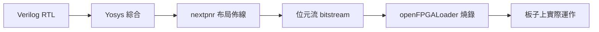

# 1.3 時序電路與模擬工具鏈

## 學習目標

讀完本節後，你應該能夠：

1. 用 Verilog 正確描述 D 型正反器與計數器，理解時脈邊緣觸發的語意。
2. 以**三段式（three-block）風格**撰寫有限狀態機（FSM）。
3. 熟練操作 iverilog + GTKWave 與 Verilator 兩條模擬流程。
4. 認識 FPGA 開發板（Basys3 / Arty A7）與從 RTL 到燒錄的完整流程。

---

## 1.3.1 時序電路：讓電路擁有記憶

組合電路的輸出只由當前輸入決定；時序電路（sequential circuit）則多了一個要素——**狀態**，由正反器（flip-flop）保存。狀態在時脈邊緣更新，這就是「同步設計」的基礎：

```verilog
module dff (
    input  wire clk, rst, d,
    output reg  q
);
    always @(posedge clk or posedge rst) begin
        if (rst) q <= 1'b0;   // 非同步重置
        else     q <= d;      // 時脈上升緣取樣
    end
endmodule
```

三個語意重點：

- **`@(posedge clk)`**：只在 clk 由 0 變 1 的瞬間執行，對應正反器的邊緣觸發。
- **`posedge rst`**：非同步重置，rst 一拉高立刻歸零，不等時脈。同步重置則寫成 `always @(posedge clk) if (rst) ...`。
- **non-blocking `<=`**：確保所有正反器在同一拍都取「舊值」，行為與實體暫存器一致。

把正反器串起來就得到計數器：

```verilog
module counter #(
    parameter WIDTH = 8
)(
    input  wire clk, rst, en,
    output reg  [WIDTH-1:0] cnt
);
    always @(posedge clk or posedge rst) begin
        if (rst)     cnt <= {WIDTH{1'b0}};
        else if (en) cnt <= cnt + 1'b1;
        // en == 0 時保持原值 → 暫存器保留，綜合出 enable 型正反器
    end
endmodule
```

注意 `cnt + 1'b1` 而非 `cnt + 1`：`1` 是 32 位元常數，雖然結果通常正確，但位寬語意較混亂，養成明確位寬的習慣。

## 1.3.2 有限狀態機與三段式寫法

FSM 是控制電路的通用模型，CPU 的取指/譯碼/執行控制單元本質上就是一個大 FSM。**三段式寫法**把 FSM 拆成三個 `always` 區塊，各司其職：

```mermaid
flowchart LR
    A[狀態暫存器<br/>always @(posedge clk)] --> B[次態邏輯<br/>always @*]
    B --> A
    A --> C[輸出邏輯<br/>always @* 或時序]
```

以下是一個辨識序列 `101` 的 Mealy FSM 範例：

```verilog
module seq_det (
    input  wire clk, rst, din,
    output wire found
);
    // 狀態編碼：用 localparam 而非 define
    localparam S0 = 2'b00,  // 初始（未看到任何 1）
               S1 = 2'b01,  // 已看到 1
               S2 = 2'b10;  // 已看到 10

    reg [1:0] state, next;

    // 第 1 段：狀態暫存器（時序）
    always @(posedge clk or posedge rst) begin
        if (rst) state <= S0;
        else     state <= next;
    end

    // 第 2 段：次態邏輯（組合）
    always @(*) begin
        case (state)
            S0: next = din ? S1 : S0;
            S1: next = din ? S1 : S2;
            S2: next = din ? S1 : S0;
            default: next = S0;
        endcase
    end

    // 第 3 段：輸出邏輯（組合，Mealy：依賴 state 與 din）
    assign found = (state == S2) && din;
endmodule
```

三段式的好處：

1. **狀態暫存器**固定不變，任何 FSM 長得一樣，可讀性高。
2. **次態邏輯**純組合，畫狀態轉移圖時可直接對照。
3. **輸出邏輯**獨立，想從 Mealy 改 Moore 只動第三段。
4. 綜合工具對這種風格的推論最穩定，錯誤訊息也較清楚。

編碼要點：`case` 一定要有 `default`（防止閂鎖器與非法狀態）；次態邏輯中不要對 `next` 做時序操作；不要在多個區塊指定同一訊號。

## 1.3.3 工具鏈實務：iverilog + GTKWave

Icarus Verilog 是事件驅動模擬器，適合小中型設計與 testbench。標準流程：

```bash
# 1. 編譯（可一次給多個原始檔）
iverilog -g2012 -o sim fsm_tb.v seq_det.v

# 2. 執行模擬（testbench 內需有 $dumpfile/$dumpvars 產生 VCD）
vvp sim

# 3. 檢視波形
gtkwave fsm.vcd
```

testbench 中要加上波形傾印：

```verilog
initial begin
    $dumpfile("fsm.vcd");
    $dumpvars(0, seq_det);   // 0 表示傾印 seq_det 底下整個階層
end
```

`-g2012` 啟用 SystemVerilog 子集（`logic`、`always_ff`、列舉型別等），本書示例皆相容。

在 GTKWave 中，左邊階層樹點開模組，把訊號拖到右邊波形區；對 FSM 的 `state` 訊號可以設 Format → Analog 之外，更實用的是自訂顏色與加入 `clk` 作為對齊參考。除錯心法：**先看時脈邊緣，再看狀態轉移是否符合狀態圖**。

### Verilator：快百倍的高速模擬

Verilator 不是模擬器，而是把 Verilog **編譯成 C++** 的工具。設計一大，iverilog 會慢到受不了，Verilator 是業界開源專案（如 Rocket Chip、BOOM）的標準配備。最基本的 lint 用法一行就能抓 bug：

```bash
verilator --lint-only -Wall seq_det.v
```

`-Wall` 會抓出位寬不匹配、未驅動訊號、閂鎖器推論等問題——**先把 lint 清乾淨再寫 testbench**，能省下大量除錯時間。

C++ 測試平台流程：

```bash
verilator --cc seq_det.v --exe sim_main.cpp --top-module seq_det
make -C obj_dir -f Vseq_det.mk Vseq_det
./obj_dir/Vseq_det
```

對應的 `sim_main.cpp` 骨架：

```cpp
#include "Vseq_det.h"
#include "verilated.h"
#include <cstdio>

int main(int argc, char** argv) {
    Verilated::commandArgs(argc, argv);
    Vseq_det* dut = new Vseq_det;
    dut->rst = 1; dut->clk = 0; dut->eval();
    dut->rst = 0;
    for (int i = 0; i < 20; i++) {
        dut->din  = (i % 3 == 0);   // 隨便一個測試序列
        dut->clk  = 1; dut->eval();  // 上升緣
        dut->clk  = 0; dut->eval();
        if (dut->found) printf("found @ cycle %d\n", i);
    }
    delete dut;
    return 0;
}
```

`eval()` 的語意是「把所有組合邏輯與事件推進到收斂」，手動翻轉 clk 就是在軟體中模擬時脈。Verilator 也能用 `--trace` 產生 VCD/FST 波形，與 GTKWave 搭配。

兩條路徑的取捨：**開發除錯期用 iverilog（簡單、直接跑 testbench），驗證加速與大型設計用 Verilator**。兩者都跑、結果一致，也是一種交叉驗證。

## 1.3.4 FPGA 開發板：讓程式碼變成真電路

模擬通過只是第一步。FPGA（現場可編程閘陣列）由大量可配置的查找表（LUT）、正反器與可編程連線組成，你的 RTL 會被綜合、佈局佈線後「變成」實際電路。

本書推薦兩款入門板（皆為 Xilinx Artix-7 系列，有開源工具鏈支援）：

| 板子 | 特色 | 適合 |
|------|------|------|
| **Basys3** | 16 顆按鍵/開關、16 顆 LED、4 位七段顯示器、VGA | 邏輯課實驗、看得見的狀態 |
| **Arty A7** | Arduino/Pmod 接腳、100MHz 時脈、DDR、乙太網路（A7-100） | 接 CPU 與周邊、做 SoC |

從 RTL 到板子的流程（以開源工具為例，Vivado 流程相同只是換指令）：



經典的第一個 FPGA 程式是「呼吸燈」：用本節的計數器分頻，讓 LED 以人眼可見的頻率閃爍。重點體會一件事——**板子上的時脈是 100MHz，你的計數器每一拍真的都在動**，模擬中「看不見」的長時間行為（如 10 秒的閃爍）必須靠參數化與縮短模擬時間來驗證。

設計習慣上也有些新課題：按鍵需要**彈跳消除**（debounce，用計數器實作）、跨時脈域訊號需要同步器（兩級正反器）、重置策略要全板一致。這些議題會在第 5 章把 CPU 燒上板子時一一遇到。

## 本章小結

- `always @(posedge clk)` 描述邊緣觸發正反器，是非同步重置/同步設計的基本型。
- 計數器 = 暫存器 + 加法器 + enable；FSM 三段式 = 狀態暫存器 + 次態組合邏輯 + 輸出邏輯。
- iverilog + GTKWave 是輕量除錯組合；Verilator 提供 lint 與百倍速度的 C++ 模擬，兩者互补。
- FPGA 流程：綜合 → 布局佈線 → 位元流 → 燒錄；Basys3 適合入門實驗，Arty 適合 SoC 實作。
- 模擬與實體有落差（時脈速度、彈跳、時脈域），燒板前要養成 lint 全綠、模擬全過的紀律。

## 實作題

1. 把 1.3.2 的序列偵測器改為 Moore 機（輸出只依賴狀態），重畫狀態圖並修改第三段，用同一個 testbench 驗證。
2. 寫一個可載入初值、可上/下數的 8 位元計數器（輸入 `load, ld_val, up`），並撰寫 testbench 覆蓋所有控制組合。
3. 用 GTKWave 觀察 FSM 的 `state` 訊號，截圖並對照狀態轉移圖，標出每個轉移發生的時脈邊緣。
4. 對你的 ALU（1.2 的程式碼）跑 `verilator --lint-only -Wall`，修正所有警告；把修改前後的警告數記錄下來。
5. 若手上有 Basys3：用 100MHz 時脈與 26 位元計數器實作 1Hz LED 閃爍，先在模擬中把參數調小驗證行為，再燒錄到板子。
