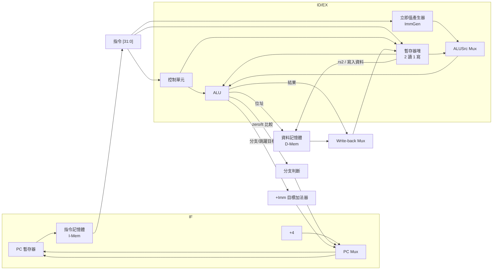

# 2.1 RISC-V 指令編碼與資料路徑

## 學習目標

1. 熟悉 RV32I 六種指令格式（R、I、S、B、U、J）的欄位編碼方式。
2. 理解立即值在各種格式中的分散位置，以及硬體解碼電路的設計考量。
3. 掌握單週期處理器的資料路徑（datapath）結構。
4. 能列出每種指令所需控制訊號的取值，並說明其由 opcode 決定的因果關係。

---

## 2.1.1 為什麼 RISC-V 選擇這些編碼格式

在設計處理器之前，指令集架構（ISA）的編碼格式決定了整條資料路徑的長相。RISC-V 的設計哲學是「正交、規則、易於硬體解碼」，其 RV32I 基礎指令集將所有指令壓縮成 32 位元固定長度，並且刻意讓**opcode 固定在 [6:0]、rd 固定在 [11:7]、rs1 固定在 [19:15]、rs2 固定在 [24:20]、 funct3 在 [14:12]**。這樣的安排使得解碼器不需要位移器或可變位置的選擇器，直接把固定位元切片接到對應的硬體單元即可，這正是單週期 CPU 能在一個週期內完成「取指 → 解碼 → 執行 → 寫回」的關鍵。

回想 CISC 架構（如 x86）採用可變長度指令，解碼器必須先判斷指令長度再切出欄位，硬體複雜且難以管線化。RISC-V 雖然有壓縮副集 RVC（16 位元），但 RV32I 本身永遠是 4 位元組對齊，PC 每次加 4，硬體非常單純。

## 2.1.2 六種指令格式

RISC-V 以「立即值放哪、需要幾個暫存器」來區分格式。下表列出六種格式與其用途：

| 格式 | 用途 | 欄位（由高位到低位） | 代表指令 |
|------|------|----------------------|----------|
| R 型 | 暫存器對暫存器運算 | `funct7[31:25] rs2[24:20] rs1[19:15] funct3[14:12] rd[11:7] opcode[6:0]` | `add sub and or slt` |
| I 型 | 立即值運算、載入、JALR | `imm[31:20] rs1[19:15] funct3[14:12] rd[11:7] opcode[6:0]` | `addi lw jalr` |
| S 型 | 存回記憶體 | `imm[31:25] rs2[24:20] rs1[19:15] funct3[14:12] imm[11:7] opcode[6:0]` | `sw sh sb` |
| B 型 | 條件分支 | `imm[12|10:5] rs2[24:20] rs1[19:15] funct3[14:12] imm[4:1|11] opcode[6:0]` | `beq bne blt bge` |
| U 型 | 上半立即值 | `imm[31:12] rd[11:7] opcode[6:0]` | `lui auipc` |
| J 型 | 無條件跳躍 | `imm[20|10:1|11|19:12] rd[11:7] opcode[6:0]` | `jal` |

以下用 LaTeX 排版各格式的位元圖，先從 R 型開始：

$$
\begin{array}{|c|c|c|c|c|c|}
\hline
\text{funct7 (7)} & \text{rs2 (5)} & \text{rs1 (5)} & \text{funct3 (3)} & \text{rd (5)} & \text{opcode (7)} \\
\hline
31\text{:}25 & 24\text{:}20 & 19\text{:}15 & 14\text{:}12 & 11\text{:}7 & 6\text{:}0 \\
\hline
\end{array}
$$

I 型則是：

$$
\begin{array}{|c|c|c|c|c|}
\hline
\text{imm[11:0] (12)} & \text{rs1 (5)} & \text{funct3 (3)} & \text{rd (5)} & \text{opcode (7)} \\
\hline
31\text{:}20 & 19\text{:}15 & 14\text{:}12 & 11\text{:}7 & 6\text{:}0 \\
\hline
\end{array}
$$

B 型與 J 型的立即值是初學者最容易搞錯的部分。RISC-V 立即值採**符號擴充至 32 位元**的設計，並且把立即值位元「打散」到固定位置，目的是讓 opcode、rs1、rs2、rd 這些必須固定不動的欄位永遠在相同位置。B 型分支的立即值單位是 2 位元組（最低位恆為 0，不編碼），位元配置為：

- `imm[12]` → instruction bit 31
- `imm[10:5]` → bits 30:25
- `imm[4:1]` → bits 11:8
- `imm[11]` → bit 7

J 型跳躍立即值同樣以 2 位元組為單位，配置為：

- `imm[20]` → bit 31
- `imm[10:1]` → bits 30:21
- `imm[11]` → bit 20
- `imm[19:12]` → bits 19:12

為什麼要這樣打散？因為把符號位集中放在 bit 31，解碼電路可以**只對符號位做一次反相與複製**，節省加法器的符號擴充邏輯；而中間位元按「高位在上、低位在下」的規則排列，降低了繞線的混亂程度。

## 2.1.3 單週期資料路徑

單週期處理器在一個時脈週期內完成所有動作：PC 提供指令位址 → 指令記憶體取出指令 → 解碼出控制訊號與立即值 → 讀暫存器堆 → ALU 運算或計算記憶體位址 → 必要時讀寫資料記憶體 → 結果寫回暫存器堆 → 同時決定下一個 PC。所有路徑都串聯成一條組合邏輯長鏈，時脈週期必須長到能容納最慢的那條路徑（通常是 load 指令：IF → ID → ALU 位址計算 → D-Mem 讀取 → 寫回）。

幾個重點：

1. **兩個加法器**：一個永遠計算 `PC + 4`；另一個計算分支/跳躍目標 `PC + imm`。兩者獨立，是為了讓分支判斷可以與加 4 並行。
2. **兩個主要 Mux**：`ALUSrc` 選擇 ALU 第二個運算元是 rs2 還是立即值；`Write-back`（MemToReg）選擇寫回資料是 ALU 結果、記憶體讀值、PC+4（JAL/JALR）或 `pc + imm`（AUIPC）。
3. **分支目標加法器**的輸入是 `PC`（此處以 PC 為基準）與 ImmGen 輸出，配合 ALU 的比較結果由 `Branch`、`Jump` 控制訊號決定 PC Mux。

## 2.1.4 控制訊號表

控制單元輸入 opcode 與 funct3/funct7，輸出下列控制訊號。下表整理 RV32I 核心指令的控制取值（`x` 代表不必理會）：

| 指令 | opcode | ALUSrc | MemRead | MemWrite | RegWrite | MemToReg | Branch | Jump | ALUOp |
|------|--------|--------|---------|----------|----------|----------|--------|------|-------|
| R 型（add/sub/...） | `0110011` | 0 | 0 | 0 | 1 | 0 | 0 | 0 | 10 |
| `lw` | `0000011` | 1 | 1 | 0 | 1 | 1 | 0 | 0 | 00 |
| `sw` | `0100011` | 1 | 0 | 1 | 0 | x | 0 | 0 | 00 |
| `beq` 等分支 | `1100011` | 0 | 0 | 0 | 0 | x | 1 | 0 | 01 |
| `lui` | `0110111` | 1 | 0 | 0 | 1 | 0 | 0 | 0 | 11 |
| `auipc` | `0010111` | 1 | 0 | 0 | 1 | 0 | 0 | 0 | 11 |
| `jal` | `1101111` | x | 0 | 0 | 1 | 2 | 0 | 1 | 11 |
| `jalr` | `1100111` | 1 | 0 | 0 | 1 | 2 | 0 | 1 | 00 |

說明幾個設計慣例：

- **ALUOp（2 位元）**：`10` 表示 R 型，需再由 funct3/funct7 決定確切運算；`00` 表示加法（lw/sw 位址計算、jalr）；`01` 表示減法（分支比較）；`11` 表示「直接輸出運算元 B」或特殊用途（lui/auipc/jal 時 ALU 結果不是最終寫回值）。
- **MemToReg 用 2 位元**：0 = ALU 結果；1 = 記憶體讀值；2 = PC+4（jal/jalr 的回傳位址）；3 = `pc + imm`（auipc 的寫回值）。也可以另外拉一條控制訊號，本書採用 2 位元編碼以求精簡。
- **分支判斷**：`Branch & ALU比較成立` 與 `Jump` 共同決定 PC Mux。比較本身由 funct3 決定是 `beq/bne/blt/bge/bltu/bgeu`。

## 2.1.5 立即值產生器（ImmGen）的設計

ImmGen 輸入 32 位元指令，輸出 32 位元符號擴充立即值。Verilog 實作時根據 opcode 分六路拼接：

- I 型：`{{20{instr[31]}}, instr[31:20]}`
- S 型：`{{20{instr[31]}}, instr[31:25], instr[11:7]}`
- B 型：`{{19{instr[31]}}, instr[31], instr[7], instr[30:25], instr[11:8], 1'b0}`
- U 型：`{instr[31:12], 12'b0}`
- J 型：`{{11{instr[31]}}, instr[31], instr[19:12], instr[20], instr[30:21], 1'b0}`

注意 B 型與 J 型輸出都**直接補最低位的 0**，這樣「立即值 ×2」在硬體上是免費的，後續目標加法器直接相加即可。

---

## 本章小結

- RV32I 以六種格式（R/I/S/B/U/J）覆蓋所有基礎指令，opcode/rd/rs1/rs2/funct3 位置固定，解碼簡單。
- B 型、J 型立即值位元打散且以 2 位元組為單位，符號位固定在 bit 31，便於硬體拼接。
- 單週期資料路徑由 PC、兩個記憶體、暫存器堆、ALU、ImmGen、兩個加法器與三組 Mux 構成，所有動作在一個週期內完成。
- 控制訊號完全由 opcode（輔以 funct3/funct7）決定，下一節我們把這張控制表寫成 Verilog。

## 實作題

1. 手動把指令 `add x5, x6, x7`（funct7=0, funct3=0, opcode=0110011）編碼成 32 位元機器碼，以二進位與十六進位各寫一次。
2. 指令 `0xFF010113` 是哪一種格式？請解出 opcode、rd、rs1 與立即值（十進位）。
3. 寫一個 Verilog module `immgen`，輸入 `instr[31:0]`，輸出 `imm[31:0]`，涵蓋六種格式，並寫 6 個 testbench 測試各驗證一種格式。
4. 若把分支目標加法器的第一個輸入從 PC 改成「PC+4」（如同某些教科書的錯誤畫法），`beq x1, x2, 8` 的行為會如何改變？請說明並提出修正方式。
5. 說明為什麼單週期處理器的時脈週期由 `lw` 指令決定，並估算 IF → ID → EX → MEM → WB 各級組合邏輯延遲的疊加式子。
