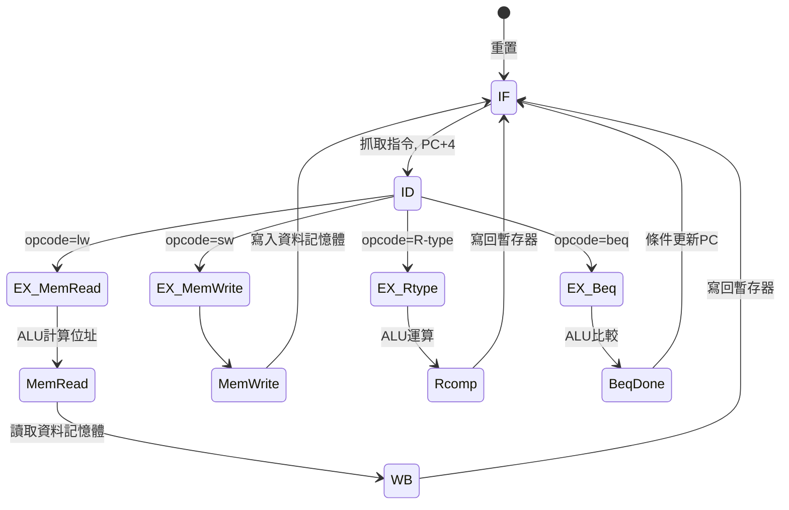

# 03.1 多週期 CPU 與有限狀態機控制

## 學習目標

1. 理解單週期 CPU 在時脈頻率上的根本限制，以及多週期設計的動機。
2. 能畫出多週期 CPU 的有限狀態機（FSM）狀態圖，並說明每個狀態對應的資料路徑動作。
3. 了解微程式控制與硬體線控（hardwired control）的取捨。
4. 能以 Verilog 實作多週期控制單元，並分析面積與頻率之間的取捨。

---

## 3.1.1 為什麼需要多週期？

在第 2 章的單週期 CPU 中，每一道指令必須在一個時脈週期內完成「抓取（IF）→ 解碼（ID）→ 執行（EX）→ 記憶體存取（MEM）→ 寫回（WB）」全部五個步驟。這代表時脈週期必須容納最長的路徑：

$$T_{clk} \ge T_{pc} + T_{mem(read)} + T_{reg(read)} + T_{alu} + T_{mem(write)} + T_{reg(write\_setup)}$$

其中記憶體存取通常是最慢的元件。以一個簡單的估計來說，若指令記憶體讀取需要 2 ns、ALU 需要 1.5 ns、資料記憶體需要 2 ns，加上暫存器與多工器的延遲，單週期的關鍵路徑可能長達 6 ns，也就是時脈頻率上限約 166 MHz。

問題在於：**大多數指令根本用不到這麼長的路徑**。`add` 指令不需要存取資料記憶體，`beq` 也不需要寫回暫存器。讓所有指令都付出最慢指令的代價，是非常沒有效率的。

多週期設計的核心想法是：**把指令執行切成多個較短的步驟，每個時脈週期只做一步，並在步驟之間用暫存器保存中間結果**。如此每個週期只需容納「一個記憶體存取或一次 ALU 運算」，時脈可以快很多。

多週期的另一個重要特色是：**指令記憶體與資料記憶體可以共用同一塊記憶體**。因為 IF 與 MEM 發生在不同的週期，單一記憶體埠在一個週期只服務一種需求。這在早期資源昂貴的年代是巨大的面積節省。

## 3.1.2 多週期的 CPI 分析

在多週期設計中，不同指令使用的週期數不同：

| 指令類型 | 週期數 |
|---|---|
| R-type（add、sub…） | 4 |
| lw | 5 |
| sw | 4 |
| beq | 3 |
| jal、jump | 3 |

整體效能以平均 CPI（Cycles Per Instruction）衡量：

$$CPI = \sum_i CPI_i \times F_i$$

其中 $F_i$ 是第 $i$ 類指令在程式中的動態頻率。假設 lw 佔 25%、sw 佔 10%、R-type 佔 45%、beq 佔 15%、jump 佔 5%：

$$CPI = 5(0.25) + 4(0.10) + 4(0.45) + 3(0.15) + 3(0.05) = 4.0$$

效能比較要看每指令時間 $T_{clk} \times CPI$。若多週期把關鍵路徑從 6 ns 縮短到 2 ns，則：

- 單週期：$6 \text{ ns} \times 1 = 6$ ns／指令
- 多週期：$2 \text{ ns} \times 4 = 8$ ns／指令

這個例子中多週期反而更慢！原因是指令執行被切成 4~5 步，每步之間都有暫存器 setup 與 clock skew 的固定開銷。**多週期的優勢在於時脈可以縮短，但代價是 CPI 上升，實際誰快誰慢取決於電路的延遲分布**。在現代流程中，多週期設計通常不會比單週期快，但它是通往流水線的必經之路——流水線正是「多個指令的多週期重疊執行」。

## 3.1.3 有限狀態機控制單元

多週期的控制單元本質上是一台有限狀態機。每個狀態對應一個時脈週期，並輸出該週期所有需要的控制訊號（`PCWrite`、`MemRead`、`ALUOp`、`RegWrite` 等）。狀態之間的轉移由指令的 opcode 與 ALU 的零旗標決定。

以下是用 mermaid 畫出的簡化狀態圖（MIPS 風格）：



值得注意的細節：

1. **ID 狀態同時讀取兩個來源暫存器**，並根據 opcode 決定下一個狀態——這是控制分歧點。
2. **lw 需要 5 個狀態**（IF、ID、位址計算、記憶體讀取、寫回），而 beq 只需要 3 個。
3. 在某些狀態下（例如 R-type 的 EX 階段），需要先進入一個「等 ALU 完成」的中間狀態，才能根據 zero 旗標分支。

### Verilog 實作

控制 FSM 可以用兩段式（two always blocks）寫法清晰表達：

```verilog
typedef enum logic [3:0] {
    S_IF, S_ID, S_EX_MEM, S_EX_WB, S_EX_R,
    S_MEM_R, S_MEM_W, S_WB, S_BEQ
} state_t;

state_t state, next_state;

// 次態邏輯
always_comb begin
    next_state = S_IF;
    unique case (state)
        S_IF:    next_state = S_ID;
        S_ID: case (opcode)
            OP_LW:  next_state = S_EX_MEM;
            OP_SW:  next_state = S_EX_MEM;
            OP_R:   next_state = S_EX_R;
            OP_BEQ: next_state = S_BEQ;
        endcase
        S_EX_MEM: next_state = opcode == OP_LW ? S_MEM_R : S_MEM_W;
        S_MEM_R:  next_state = S_WB;
        S_WB, S_MEM_W, S_EX_R, S_BEQ: next_state = S_IF;
        default:  next_state = S_IF;
    endcase
end

// 輸出與資料路徑更新
always_ff @(posedge clk or posedge rst) begin
    if (rst) begin
        state <= S_IF;
        pc    <= '0;
    end else begin
        state <= next_state;
        if (state == S_IF) pc <= pc + 4;
        if (state == S_BEQ && zero) pc <= branch_target;
    end
end
```

每個狀態的輸出可以直接用組合邏輯解碼：

```verilog
always_comb begin
    {pc_write, mem_read, mem_write, reg_write, alu_src_b} = '0;
    unique case (state)
        S_IF:    pc_write  = 1;
        S_MEM_R: mem_read  = 1;
        S_MEM_W: mem_write = 1;
        S_WB:    reg_write = 1;
        default: ;
    endcase
end
```

## 3.1.4 微程式控制的概念

1970 年代的設計者面對另一個問題：指令集越複雜，狀態圖越龐大，硬體線控的邏輯網路變得難以驗證。微程式（microprogramming）的解法是：**把每個狀態的輸出控制訊號編碼成一條「微指令」（microinstruction），存在稱為控制記憶體（control store）的 ROM 中**。控制單元變成一台「執行微程式的小電腦」：微程式計數器（μPC）指向下一條微指令，微指令中帶有分支條件與分支位址。

一條典型的微指令格式：

| 欄位 | 位元數 | 意義 |
|---|---|---|
| ALU 控制 | 3 | ALU 要做什麼運算 |
| SRC1 / SRC2 | 2 + 2 | ALU 來源選擇 |
| 讀/寫記憶體 | 2 | MemRead / MemWrite |
| 寫回目標 | 3 | RegWrite 目標選擇 |
| PC 更新 | 3 | PCSrc 選擇 |
| 分支條件 | 2 | 無條件 / 依 zero 依 opcode |
| 分支位址 | 8 | 微程式目標位址 |

微程式與硬體線控的取捨：

| 特性 | 硬體線控 | 微程式 |
|---|---|---|
| 速度 | 快（邏輯直達） | 慢（多一層 ROM 存取） |
| 修改 ISA | 需重畫狀態圖 | 改微碼即可 |
| 面積 | 邏輯閘 | ROM（複雜 ISA 時較小） |
| 適用 | 簡單規律的 ISA（MIPS、RISC-V） | 複雜多變的 ISA（x86、VAX） |

經典的 RISC 論述（Patterson & Hennessy）正是主張：如果 ISA 設計得夠規律，硬體線控並不會太複雜，微程式的彈性反而是不必要的負擔。本書的 Verilog 實作採用硬體線控，但理解微程式能幫助你了解 x86 內部為何需要「把複雜指令拆成微操作（μops）」。

## 3.1.5 面積與頻率的取捨

多週期設計在晶片實現上呈現明確的取捨：

**優點**
1. 時脈週期短，單一狀態的路徑只有一兩個主要元件。
2. 記憶體與 ALU 可以在不同狀態間共用，多工器取代了部分獨立硬體，控制邏輯集中於 FSM。
3. 是理解流水線的最佳跳板：流水線的每一級正是多週期的一個狀態。

**缺點**
1. CPI 顯著上升（4~5 vs 單週期的 1）。
2. 每個步驟之間需要暫存器（IR、MDR、A、B、ALUOut），增加觸發器數量。
3. 組合邏輯中多了多工器，其延遲在先進製程中並不便宜。

實際數字（以本書第 3 章的 FPGA 實驗為參考）：單週期在 Artix-7 上約可跑到 90~120 MHz、使用約 600 LUT；多週期可跑到 200~250 MHz、使用約 550 LUT（含多工器），但 CPI 為 4，每指令時間反而略長。**結論：多週期不是為了更快，而是為了結構化與鋪路**。真正的速度革命來自第 3.2 節的流水線——把多週期的每一級交給不同的指令同時使用。

## 本章小結

- 單週期的關鍵路徑受最慢指令束縛；多週期把執行切成多步，縮短時脈但提高 CPI。
- 多週期允許指令與資料共用單一記憶體，是重要的面積節省。
- 控制單元是一台 FSM，每個狀態輸出一組控制訊號；Verilog 以 two-always-blocks 風格實作最清晰。
- 微程式把控制訊號存成 ROM 中的微指令，適合複雜 ISA；RISC 靠規律性讓硬體線控夠簡單。
- 多週期的價值在結構化與鋪路，效能上不必然勝過單週期。

## 實作題

1. 修改 3.1.3 節的 FSM，加入 `jal` 指令支援（3 個狀態：需將 PC+4 寫入 `$ra` 並跳至目標）。畫出新的狀態圖並列出每個狀態的輸出訊號。
2. 依 3.1.2 節的指令頻率（lw 20%、sw 15%、R-type 50%、beq 15%），重新計算多週期 CPI，並與單週期比較每指令時間。假設各階段延遲：記憶體 2 ns、ALU 1.5 ns、暫存器堆 1 ns、多工器 0.3 ns。
3. 用 testbench 驅動 3.1.3 節的 FSM，執行一段包含 `lw`、`add`、`sw`、`beq` 的程式，用波形驗證每道指令確實使用了正確的狀態數。
4. 將控制 FSM 的輸出改為以 ROM（case → 常數陣列）儲存的微碼形式，比較綜合後的 LUT 使用量與 Fmax，撰寫 200 字分析報告。
5. 說明為什麼多週期設計中 `beq` 的目標位址必須在 ID 狀態就計算好，而不能等到 beq 的最後狀態才用 ALU 計算。（提示：ALU 此時正在比較。）
