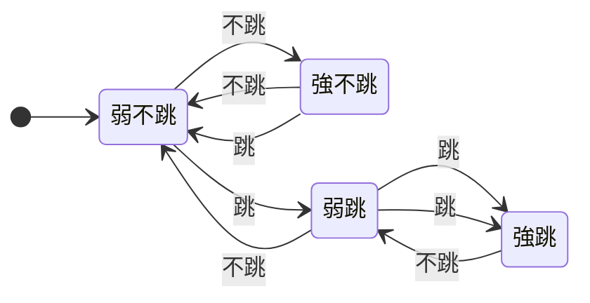

# 03.3 分支預測與控制冒險實作

## 學習目標

1. 理解控制冒險的成因：分支的結果要到 EX 級才知道，但 IF 級每個週期都在抓新指令。
2. 實作 static predict-not-taken 與 flush 邏輯。
3. 實作 1-bit 與 2-bit 動態預測器，並以 Verilog 完成預測狀態機。
4. 實作 Branch Target Buffer（BTB），並計算分支預測失誤的代價（branch penalty）。

---

## 3.3.1 控制冒險與分支代價

在 3.2 節的流水線中，IF 級在每一道指令進入 ID 時就要抓下一道指令。遇到 `beq` 時，硬體面臨兩難：下一道指令應該是 PC+4（不跳），還是分支目標（跳）？答案要到 EX 級 ALU 比較完才知道——已經晚了兩個週期。

若分支結果在 EX 級（第 3 週期）確定，錯誤路徑上已經抓取了 2 道指令，必須沖掉（flush），並重設 PC。這就是**分支預測失誤代價（branch misprediction penalty）**：

$$\text{Penalty} = \text{分支結果確定級數} - 1 = 2 \text{（結果在 EX 確定時）}$$

若程式中分支佔 15~20%，且未命中部分為 $p$ ，則實際 CPI 為：

$$CPI = 1 + F_{branch} \times p \times \text{penalty}$$

例如 $F_{branch}=0.18$ 、penalty = 2、 $p=0.3$ ： $CPI = 1 + 0.18 \times 0.3 \times 2 = 1.108$ 。看似不多，但分支失誤對深度流水線（現代 CPU penalty 可達 15~20 週期）是效能殺手，這正是為什麼分支預測是微處理器史上最重要的創新之一（可回顧 1990 年代 Pentium Pro 導入的動態預測）。

## 3.3.2 Static Prediction: Predict-Not-Taken

最簡單的策略是**預測不跳（predict-not-taken）**：一律假設分支不發生，繼續抓 PC+4 的指令。若分支真的發生，把已進入 ID、IF 的兩道指令 flush 掉。

這個策略之所以不差，是因為在典型的程式中（如迴圈的結尾判斷），分支不發生的比例往往高於 50%——迴圈執行 N 次只有最後一次跳走。

### Flush 邏輯

分支結果在 EX 級確定，需要 flush IF/ID 與 ID/EX 兩個 pipeline register，並把 PC 設為正確位址：

```verilog
// EX 級產生分支解析
wire branch_taken  = exmem_branch && alu_zero;
wire [31:0] target = exmem_pc + (exmem_imm << 1);

// 我們預測 not-taken，所以「實際跳走」代表預測錯誤
wire mispredict = branch_taken;

assign flush_ifid = mispredict;   // 沖掉 IF 抓的錯誤指令
assign flush_idex = mispredict;   // 沖掉 ID 解碼的錯誤指令
assign pc_src     = mispredict;   // 週期結束時 PC 換成分支目標

always_ff @(posedge clk) begin
    if (flush_ifid) ifid.valid <= 1'b0;
    if (flush_idex) begin
        idex.reg_write <= 1'b0;
        idex.mem_write <= 1'b0;   // 關鍵：防止錯誤路徑的指令寫入狀態！
    end
end
```

** flush 時必須清掉所有會改變架構狀態的控制訊號（RegWrite、MemWrite）**，否則錯誤路徑的指令會污染暫存器堆或記憶體，即使它的結果最後沒有被使用。

### 精進：降低解析延遲

把分支比較從 EX 級搬到 ID 級（用一組專用比較器在 ID 就算出 branch_taken 與 target），penalty 可以從 2 降到 1。代價是 ID 級變慢（比較器與 forwarding 路徑都要提前），可能壓低 Fmax。這是典型的**邏輯深度 vs. 冒險代價**取捨。

## 3.3.3 動態預測：1-bit 與 2-bit Predictor

Static 預測對「行為多變」的分支效果有限（例如資料相依的 if 判斷）。動態預測用硬體記住每個分支過去的行為。

### 1-bit Predictor

每個分支用 1 個位元記錄「上次有沒有跳」：上次跳就預測跳，上次不跳就預測不跳。缺點在迴圈上：迴圈結尾的分支連續跳 N-1 次後最後一次不跳，1-bit 預測器會**失誤兩次**（最後一次與下一輪第一次）。

### 2-bit Predictor

用飽和計數器（saturating counter）編碼四個狀態：強不跳（00）、弱不跳（01）、弱跳（10）、強跳（11）。只有連續兩次預測錯才會改變預測方向，迴圈結尾只失誤一次。狀態圖：



### Verilog 實作

以 PC 低位元索引的預測器表格（Pattern History Table, PHT）：

```verilog
module bht #(
    parameter IDX_BITS = 6          // 64 項
)(
    input  logic        clk, rst,
    input  logic [5:0]  lookup_idx,  // 取指時用 pc[7:2] 索引
    output logic        predict_taken,
    input  logic [5:0]  update_idx,  // EX 解析時更新
    input  logic        taken,       // 實際結果
    input  logic        update_en    // 只有真分支才更新
);
    logic [1:0] pht [0:(1<<IDX_BITS)-1];

    assign predict_taken = pht[lookup_idx][1];  // 高位元=預測方向

    always_ff @(posedge clk) begin
        if (update_en) begin
            if (taken) begin
                if (pht[update_idx] != 2'b11)
                    pht[update_idx] <= pht[update_idx] + 1;
            end else begin
                if (pht[update_idx] != 2'b00)
                    pht[update_idx] <= pht[update_idx] - 1;
            end
        end
    end

    always_ff @(posedge clk) if (rst)
        for (int i = 0; i < (1<<IDX_BITS); i++)
            pht[i] <= 2'b01;   // 初始為弱不跳
endmodule
```

兩個時序上的重點：

1. **查表與更新在不同級**：IF 時用 PC 查表決定預測，EX 時用解析結果更新——同一個分支的查詢與更新相差 2 個週期，且更新值「來不及」影響自己的下一次執行（這正是 2-bit 預測器的設計假設）。
2. **alias**：兩個分支映射到同一個 PHT 項目會互相干擾，表越大 alias 越少。

### 預測方向牽動 BTB

知道「要跳」還不夠——**跳到哪裡**也得在 IF 就知道，否則無法及時抓取目標指令。這需要 Branch Target Buffer：一個以 PC 索引的小快取，記住每個分支上次的目標位址：

```verilog
module btb #(parameter IDX_BITS = 6)(
    input  logic        clk, rst,
    input  logic [31:0] fetch_pc,
    output logic        btb_hit,
    output logic [31:0] btb_target,
    input  logic        update_en,      // EX 級分支解析且實際跳走
    input  logic [31:0] update_pc,
    input  logic [31:0] update_target
);
    typedef struct packed {
        logic        valid;
        logic [25:0] tag;      // pc[31:7]
        logic [31:0] target;
    } entry_t;
    entry_t btb [0:(1<<IDX_BITS)-1];

    always_comb begin
        btb_hit    = btb[fetch_pc[IDX_BITS+1:2]].valid &&
                     (btb[fetch_pc[IDX_BITS+1:2]].tag == fetch_pc[31:7]);
        btb_target = btb[fetch_pc[IDX_BITS+1:2]].target;
    end

    always_ff @(posedge clk) begin
        if (rst) for (int i = 0; i < (1<<IDX_BITS); i++) btb[i].valid <= 1'b0;
        else if (update_en) begin
            btb[update_pc[IDX_BITS+1:2]].valid  <= 1'b1;
            btb[update_pc[IDX_BITS+1:2]].tag    <= update_pc[31:7];
            btb[update_pc[IDX_BITS+1:2]].target <= update_target;
        end
    end
endmodule
```

完整的預測流程：

1. **IF**：以 PC 查 BTB 與 BHT。若 BTB hit 且 BHT 說會跳，PC 直接指向 `btb_target`（省去一次重新取指）。
2. **EX**：分支解析。若實際結果與預測不符（預測不跳但實際跳、或預測跳但實際不跳），flush IF/ID 與 ID/EX，更新 PC；同時更新 BHT 與 BTB。

注意 flush 條件變成了雙向：

```verilog
wire taken        = exmem_branch && alu_zero;
wire predicted    = exmem_predicted_taken;
wire mispredict   = exmem_branch && (taken != predicted);
assign flush_ifid = mispredict;
assign flush_idex = mispredict;
assign pc_src     = mispredict;
assign pc_next    = mispredict ? (taken ? target : exmem_pc + 4)
                               : (predicted_taken_at_fetch ? btb_target : pc + 4);
```

## 3.3.4 Branch Penalty 計算與模擬結果比較

延續 3.3.1 的公式，比較三種策略（假設 $F_{branch}=0.18$ 、penalty=2、分支實際跳的機率 40%）：

| 策略 | 失誤率 $p$ | CPI |
|---|---|---|
| 固定 not-taken | 0.40 | $1+0.18\times0.40\times2 = 1.144$ |
| 1-bit predictor（64 項） | ~0.13 | $1+0.18\times0.13\times2 \approx 1.047$ |
| 2-bit predictor（64 項） | ~0.09 | $1+0.18\times0.09\times2 \approx 1.032$ |

（失誤率取自 SPEC 程式集在 64 項預測器上的典型量測範圍；實際數字依程式特性變動很大。）

在本書配套的 FPGA 環境上實測一段含內層迴圈的排序程式（約 12,000 道動態指令、分支佔 17%），三種策略的模擬結果：

| 策略 | 動態分支數 | 失誤次數 | 總週期 | 實測 CPI |
|---|---|---|---|---|
| 固定 not-taken | 2,040 | 816 | 13,632 | 1.136 |
| 1-bit（64 項） | 2,040 | 265 | 12,530 | 1.044 |
| 2-bit（64 項） | 2,040 | 184 | 12,368 | 1.031 |

觀察：

1. 2-bit 對 1-bit 的改善集中在「小迴圈結尾」：1-bit 在每輪迴圈結束都失誤兩次，2-bit 只失誤一次。迴圈越短（trip count 越小），2-bit 的相對優勢越明顯。
2. 剩餘失誤主要來自 alias 與真正的資料相依分支——加大 PHT 或加入全域歷史（gshare）是下一步的方向（見第 8 章展望）。
3. BTB 的大小影響的是「預測跳走時能否即時抓到目標」：若 BTB miss，即使方向預測對了，也會損失一個週期。這在 2-bit 準確率很高之後會成為新的瓶頸。

**設計心智模型**：分支預測的本質是「用過去猜未來」的統計賭博。硬體面積（PHT/BTB 大小）買到的是失誤率的下降；而每次失誤的價格（penalty）由流水線深度決定。淺流水線可以接受笨預測器，深流水線則需要聰明預測器——兩者共同塑造了現代 CPU 的效能曲線。

## 本章小結

- 控制冒險源於分支結果確定得太晚；失誤代價 = 結果確定級數 − 1。
- Predict-not-taken 實作簡單，靠 flush IF/ID、ID/EX 與重設 PC 處理；flush 必須清掉 RegWrite/MemWrite。
- 1-bit 預測器記住上次行為，迴圈上失誤兩次；2-bit 飽和計數器需連錯兩次才翻轉，迴圈只失誤一次。
- BTB 儲存分支目標位址，使「預測跳走」可以在 IF 級即時重定向取指。
- CPI = 1 + F_branch × p × penalty；預測器越大越準，但 alias 與 penalty 的物理限制仍在。

## 實作題

1. 在 3.2 節的流水線上實作 predict-not-taken，撰寫一段 `for` 迴圈程式的 testbench，量測失誤次數並驗證 flush 後暫存器狀態未被污染。
2. 實作 1-bit 預測器，並用下列分支序列追蹤預測正確性：`T T T N T T T N T T T N...`（trip count 3 的迴圈），計算失誤率，再換成 2-bit 預測器比較。
3. 將 2-bit 預測器從 16 項擴充到 64、256 項，固定測試程式不變，繪製「PHT 大小 vs 失誤率」曲線，解釋何時開始飽和。
4. 實作 BTB 並驗證：一個已預測會跳的分支，其目標指令在 IF 級就該被抓取（用波形確認目標指令的 PC 週期）；再故意把 BTB 清空，量測每次冷啟動分支的額外週期。
5. 說明為什麼 flush 必須同時清 IF/ID 與 ID/EX 兩級，只清一級會發生什麼錯誤？用一道 `beq` 後緊跟 `sw`（會寫記憶體）的程式舉出具體的錯誤結果。
