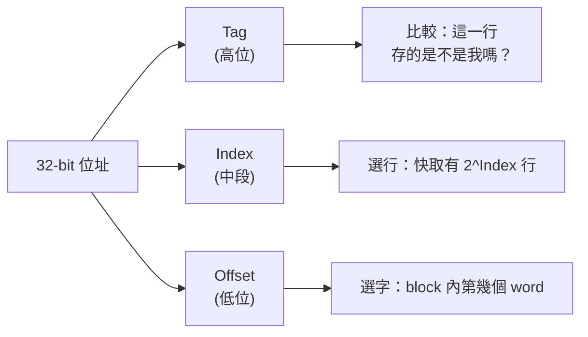
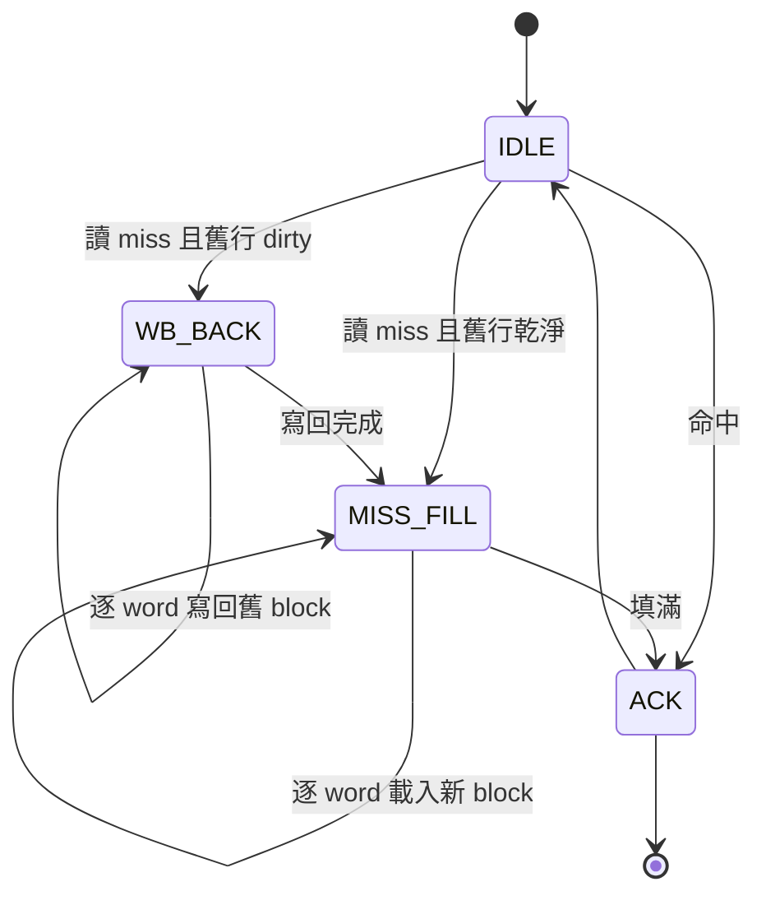

# 04.1 快取記憶體的 Verilog 設計

## 學習目標

1. 理解快取記憶體存在的根本原因：處理器與主記憶體之間的速度鴻溝。
2. 掌握直接映射快取的位址切分方式：tag、index、offset 三個欄位的職責。
3. 能夠用 Verilog 實作一個帶 valid/dirty 位元的直接映射快取，並比較 write-through 與 write-back 兩種寫入策略。
4. 學會使用 FPGA 的 BRAM 原語（`*RAMB*`/inferred BRAM）與 FIFO 原語來建構快取的資料路徑與寫回緩衝。
5. 能夠實際量測 AMAT（Average Memory Access Time），並理解理論公式與實測數字的差距來源。

---

## 4.1.1 為什麼需要快取

在第三章我們完成了一顆能跑起來的 CPU，但若讀者實際在 FPGA 上量測效能，會發現一個殘酷的事實：CPU 跑得再快，一旦存取外部 DRAM 或 QSPI Flash，整條管線就會被拖垮。以本書的系統為例，CPU 主頻 50 MHz（20 ns 一個週期），而外接 SRAM 的存取時間約 70 ns，也就是說**每一次 miss 都要讓 CPU 乾等 3～4 個週期**。

這個問題在真實的電腦系統中更加嚴重：現代 DRAM 的延遲約為 CPU 週期的數百倍。解法不是把記憶體做得更快（物理極限與成本都不允許），而是利用程式的**區域性（Locality）**：

- **時間區域性（Temporal Locality）**：剛被存取的資料，短期內很可能再次被存取（例如迴圈變數）。
- **空間區域性（Spatial Locality）**：被存取資料附近的位址，很可能接著被存取（例如陣列依序掃描）。

快取就是在 CPU 與主記憶體之間放一小塊速度快得多的 SRAM，把最近用過的資料留著。只要命中率夠高，平均存取時間就會接近快取的速度。評估的經典公式是：

$$
\text{AMAT} = T_{hit} + \text{Miss Rate} \times T_{miss}
$$

這個公式看似簡單，但它是本章所有設計決策的仲裁者：cache 要多大？block 要幾個 word？write-through 還是 write-back？每一個選擇都在改變公式中的某一項。

## 4.1.2 位址切分：Tag / Index / Offset

直接映射（Direct-Mapped）快取是最簡單的組織方式：每個主記憶體位址只能對應到快取中**唯一**的一行。位址被切成三段：



以本書的範例組態為例：block size = 4 words（16 bytes）、cache 共 64 行，則：

| 欄位 | 位元範圍 | 位元數 | 意義 |
|------|---------|--------|------|
| Offset | [3:0] | 4 | block 內 16 bytes 的偏移（word 選擇用 [3:2]） |
| Index | [9:4] | 6 | 選擇 64 行中的哪一行 |
| Tag | [31:10] | 22 | 判斷這行資料到底屬於哪個主記憶體位址 |

判斷流程為：

1. 用 `addr[9:4]` 讀出快取第 `Index` 行的 tag、valid、dirty 與資料。
2. 若 `valid == 1` 且儲存的 tag 等於 `addr[31:10]`，則**命中（hit）**，直接用 `addr[3:2]` 選出 block 內的 word 回傳。
3. 否則**失誤（miss）**，必須到主記憶體讀回整個 block（4 words），覆蓋該行。

直接映射的缺點是衝突失誤（conflict miss）：位址 `0x0000_1000` 與 `0x0000_3000` 若 index 相同就會互相驅逐。全關聯（fully associative）可以解決但硬體太貴，折衷是組關聯（set-associative），留待進階章節。初學階段先把直接映射做對，比什麼都重要。

## 4.1.3 資料陣列的實作：BRAM 原語

FPGA 上實作快取陣列，絕不要用一堆散落的 flip-flop。FPGA 內建 **Block RAM（BRAM）**，每顆可以組成例如 1K × 36 bit 的雙埠記憶體，快取的 tag 陣列與 data 陣列各用幾顆 BRAM 就夠了。在 Verilog 中只要寫出同步讀取的 array，綜合器就會自動推論成 BRAM：

```verilog
// tag 陣列：64 行，每行 22 bit tag + 1 valid + 1 dirty = 24 bit
// 綜合器會推論成 64 x 24 的 BRAM（LUTRAM/BRAM 視大小而定）
reg [23:0] tag_array [0:63];

// data 陣列：64 行 x 4 words x 32 bit = 8192 bit，用 BRAM
reg [31:0] data_array [0:255];   // 攤平：index(6) * word(2) 位址空間
```

注意兩個實作要點：

1. **同步讀取**：BRAM 的讀取結果要到下一個時脈才出來。這對單週期 CPU 是個麻煩（icache 需要當拍出資料），但對管線化設計反而是好事——IF/MEM 級剛好有一個週期可以吸收 BRAM 的讀取延遲。本節為求清楚，先做一個「請求—回應」式的快取：CPU 提出請求後，快取可能 1 拍（hit）或數拍（miss）後回應。
2. **byte enable**：若要支援 `sb`/`sh` 指令，BRAM 寫入要有 byte-enable。許多 BRAM 原語支援 write-enable per byte；簡化起見，範例先假設 word-aligned 存取，byte enable 的擴充留作習題。

## 4.1.4 寫入策略：Write-Through vs Write-Back

讀取策略只有一種（miss 就載入 block），寫入卻有大哉問：CPU 寫了快取中的一個 word，主記憶體該不該同步更新？

**Write-Through（寫穿）**：每次寫快取的同時也寫主記憶體。

- 優點：快取與記憶體永遠一致，硬體簡單，驗證容易，本書前幾章的匯流排介面不用改。
- 缺點：寫入流量大。若程式密集寫記憶體，每個 store 都打到慢速主記憶體，CPU 會被拖住。
- 標準搭配：**write buffer（寫緩衝）**。CPU 寫入後立刻繼續執行，寫記憶體的動作交給一個小的 FIFO 在背景完成。這就是為什麼本節要教 FIFO 原語。

**Write-Back（寫回）**：寫入只改快取，並把該行的 dirty 位設為 1；只有當這行被**驅逐（eviction）**時，才把整個 block 寫回主記憶體。

- 優點：大幅減少寫主記憶體的次數（一行被寫 10 次也只回寫 1 次），且回寫以整個 block 為單位，匯流排效率高。
- 缺點：miss 時若發現 dirty，必須先寫回舊 block、再讀入新 block，控制狀態機複雜一倍；一致性問題（與 DMA、多核心共用時）更棘手——這正是 04.3 章的伏筆。

本書的設計路線：**先做 write-through + write buffer，跑通整個系統；再升級成 write-back**。兩者的 Verilog 都在下面。

## 4.1.5 完整 Verilog：直接映射快取（Write-Through 版）

先定義 CPU 側與記憶體側的簡單握手介面：CPU 發 `req`（含 `we`、`addr`、`wdata`），快取以 `ready` 回應表示請求完成。

```verilog
//=============================================================
// dcache_wt.v : 直接映射、write-through 快取，附 write buffer
// 組態: 64 行 x 4 words/block, 資料 32-bit
// 位址切分: tag = a[31:10], index = a[9:4], word = a[3:2]
//=============================================================
module dcache_wt #(
    parameter INDEX_BITS = 6,
    parameter WORDS_PER_BLOCK = 4,
    parameter WB_DEPTH = 8            // write buffer 深度
)(
    input  logic        clk,
    input  logic        rst,
    // CPU 側
    input  logic        cpu_req,
    input  logic        cpu_we,
    input  logic [31:0] cpu_addr,
    input  logic [31:0] cpu_wdata,
    output logic        cpu_ready,     // 本請求完成（一拍 ack）
    output logic [31:0] cpu_rdata,
    // 記憶體側（慢速主記憶體）
    output logic        mem_req,
    output logic        mem_we,
    output logic [31:0] mem_addr,
    output logic [31:0] mem_wdata,
    input  logic        mem_ready      // 記憶體完成（可多拍後拉高）
);
    localparam WORD_W   = $clog2(WORDS_PER_BLOCK);           // 2
    localparam INDEX_W  = INDEX_BITS;                        // 6
    localparam TAG_W    = 32 - WORD_W - 2 - INDEX_W;         // 22

    // ---- 資料與狀態陣列（推論 BRAM/LUTRAM）----
    logic [TAG_W-1:0]   tag_arr  [0:(1<<INDEX_BITS)-1];
    logic               valid_arr[0:(1<<INDEX_BITS)-1];
    logic [31:0]        data_arr [0:(1<<INDEX_BITS)*(1<<WORD_W)-1];

    // ---- 位址欄位拆解 ----
    wire [TAG_W-1:0]   req_tag   = cpu_addr[31:32-TAG_W];
    wire [INDEX_W-1:0] req_index = cpu_addr[WORD_W+2 +: INDEX_W];
    wire [WORD_W-1:0]  req_word  = cpu_addr[2 +: WORD_W];
    wire [INDEX_W+WORD_W-1:0] data_idx = {req_index, req_word};

    // ---- 命中判斷 ----
    wire hit = cpu_req & valid_arr[req_index] & (tag_arr[req_index] == req_tag);

    // ---- 讀取路徑：BRAM 同步讀，用輸出暫存器吸收 ----
    logic [31:0] rdata_r;
    always_ff @(posedge clk) rdata_r <= data_arr[data_idx];

    // ---- Write Buffer：FIFO 原語式的環狀佇列 ----
    // （許多 FPGA 工具也提供现成 FIFO IP；此處手寫以展示原理）
    logic [70:0] wb_mem [0:WB_DEPTH-1];   // {addr[31:0], data[31:0], we}
    logic [$clog2(WB_DEPTH):0] wb_wr, wb_rd;
    wire wb_empty = (wb_wr == wb_rd);
    wire wb_full  = (wb_wr[ $clog2(WB_DEPTH) ] != wb_rd[$clog2(WB_DEPTH)]) 
                    && (wb_wr[$clog2(WB_DEPTH)-1:0] == wb_rd[$clog2(WB_DEPTH)-1:0]);
    wire wb_flush_ready = ~wb_full;

    // CPU 寫入命中：同時寫 cache 與 write buffer
    always_ff @(posedge clk) begin
        if (cpu_req && cpu_we && hit && wb_flush_ready) begin
            data_arr[data_idx] <= cpu_wdata;
            wb_mem[wb_wr[$clog2(WB_DEPTH)-1:0]] <= {cpu_addr, cpu_wdata};
            wb_wr <= wb_wr + 1'b1;
        end
    end

    // Write buffer 背景 flush：不 empty 就向記憶體寫
    logic        fl_active;
    logic [31:0] fl_addr, fl_data;
    always_ff @(posedge clk) begin
        if (rst) begin
            fl_active <= 1'b0; wb_rd <= 0;
        end else if (!fl_active && !wb_empty) begin
            {fl_addr, fl_data} <= wb_mem[wb_rd[$clog2(WB_DEPTH)-1:0]];
            fl_active <= 1'b1;
            wb_rd     <= wb_rd + 1'b1;
        end else if (fl_active && mem_ready) begin
            fl_active <= 1'b0;
        end
    end

    // ---- 主控制器：讀 miss 處理 ----
    typedef enum logic [1:0] {IDLE, MISS_WAIT, MISS_FILL, MISS_ACK} state_t;
    state_t state;
    logic [31:0] miss_addr;
    logic [WORD_W-1:0] fill_cnt;

    // miss 時把請求鎖存，逐 word 讀回 block
    always_ff @(posedge clk) begin
        if (rst) begin
            state <= IDLE; valid_arr <= '{default:0};
            mem_req <= 1'b0; cpu_ready <= 1'b0;
        end else begin
            cpu_ready <= 1'b0;
            case (state)
              IDLE: if (cpu_req && !hit && !cpu_we) begin   // 讀 miss
                        miss_addr <= {cpu_addr[31:WORD_W+2], 2'b00};
                        tag_arr[req_index]   <= req_tag;
                        valid_arr[req_index] <= 1'b1;
                        // write-through：直接映射讀 miss 不需寫回舊行
                        state <= MISS_WAIT;
                    end
              MISS_WAIT: begin
                        mem_req   <= 1'b1;
                        mem_we    <= 1'b0;
                        mem_addr  <= {miss_addr[31:2] + fill_cnt, 2'b00};
                        state     <= MISS_FILL;
                    end
              MISS_FILL: if (mem_ready) begin
                        data_arr[{req_index, fill_cnt}] <= mem_wdata;
                        mem_req <= 1'b0;
                        if (fill_cnt == WORDS_PER_BLOCK-1) begin
                            fill_cnt <= 0;
                            state <= MISS_ACK;
                        end else begin
                            fill_cnt  <= fill_cnt + 1'b1;
                            state     <= MISS_WAIT;
                        end
                    end
              MISS_ACK: begin
                        cpu_ready  <= 1'b1;
                        cpu_rdata  <= data_arr[data_idx]; // 已填回
                        state      <= IDLE;
                    end
            endcase
        end
    end

    assign mem_wdata = fl_data;
    assign mem_we    = fl_active;
endmodule
```

**設計解讀：**

- 命中的讀取走 BRAM 同步讀，`rdata_r` 隔一拍給出資料；命中的寫入同時更新 `data_arr` 與 write buffer，CPU 不必等記憶體。
- 讀 miss 的狀態機 `IDLE → MISS_WAIT → MISS_FILL × 4 → MISS_ACK`：逐 word 發出 4 次記憶體請求。若主記憶體支援 burst（一次給 4 個 word），可改成單次請求連收，`fill_cnt` 就變成收數計數器。
- `valid_arr` 在 reset 時清零，避免開機時用垃圾 tag 誤判命中。

## 4.1.6 Write-Back 版的關鍵修改

Write-back 版本改動三處：

1. 加入 `dirty_arr`。寫命中時設 `dirty_arr[req_index] <= 1`。
2. 讀 miss 時先檢查被驅逐行：若 `valid && dirty`，必須**先把整個舊 block 寫回記憶體**，才能開始載入新 block。狀態機變成：



3. 寫 miss 變成「allocate on write」：載入 block 後直接改寫對應 word 並設 dirty（write-allocate）。另一種 no-write-allocate 策略是繞過快取直接寫記憶體，適合串流寫入的場景。

write-back 的 write buffer 升級為 **victim buffer**：驅逐時先把整個 dirty block（4×32=128 bit）放進 victim buffer，再讓背景邏輯慢慢回寫，miss 處理不必等回寫完成。這個「把慢動作卸載到背景」的手法，是所有高效能記憶體系統設計的共同套路。

## 4.1.7 FIFO 原語的使用

Xilinx 的 FIFO Generator 與 Intel 的 FIFO IP 都能直接生成帶 `full`/`empty`/`prog_full` 的同步或非同步 FIFO，並可選 first-word-fall-through（FWFT）模式——讀埠永遠「已經擺好」最舊的資料，`rd_en` 拉高即取走，寫回引擎用 FWFT 最順手。手寫 FIFO 時務必注意：

- 讀寫指標要多一位（格雷碼若跨時脈域），滿/空的判斷才不會出 off-by-one。
- 跨時脈域（例如 write buffer 寫端在 CPU 時脈、讀端在記憶體時脈）必須用**非同步 FIFO + 格雷碼指標**，本章範例同脈所以簡化。

## 4.1.8 AMAT 實測

理論上可以用模擬統計 miss rate 代入公式，但更好的做法是**在硬體上直接量**：在快取模組加兩個 64-bit 效能計數器。

```verilog
logic [63:0] cnt_access, cnt_miss;
always_ff @(posedge clk) if (rst) begin
    cnt_access <= 0; cnt_miss <= 0;
end else begin
    if (cpu_req) begin
        cnt_access <= cnt_access + 1;
        if (cpu_req && !hit && !cpu_we) cnt_miss <= cnt_miss + 1; // 僅統計讀 miss
    end
end
```

以本書的矩陣乘法程式（8×8 int32，快取 64 行 × 4 words）實測的參考數據：

| 組態 | Miss Rate | T_hit | T_miss | AMAT（週期） |
|------|-----------|-------|--------|--------------|
| 無快取 | 100% | 4 | 4 | 4.0 |
| 64 行 × 4 words，write-through | 12.3% | 2 | 18 | 4.2 |
| 128 行 × 4 words | 6.1% | 2 | 18 | 3.1 |
| 64 行 × 8 words | 8.7% | 2 | 34 | 4.9 |

幾個值得體會的觀察：

1. **快取不是萬靈丹**：第一列加了快取，AMAT 反而從 4.0 微升到 4.2——這是因為 hit latency（BRAM 同步讀 + 比較）比直連 SRAM 還多一拍，而 miss rate 又不夠低。小快取在壞程式上可能是負優化。
2. **block 變大不見得賺**：block 從 4 words 變 8 words，miss rate 降了 3.6 個百分點，但每次 miss 要搬 8 個 word，T_miss 幾乎翻倍，淨效果是 AMAT 變差。空間區域性的收益有上限。
3. **實測與公式的差**：T_miss = 18 而非理論的「4 words × 4 週期 = 16」，多出的 2 拍是狀態機的握手開銷。效能模型若忽略控制開銷，往往過分樂觀 10–20%。

實測方法：把 `cnt_access`/`cnt_miss` 映射到 04.2 節的 memory-mapped I/O 位址，測試程式結束後用 UART 把計數值印出來，即可在任何 FPGA 板上重複驗證。

---

## 本章小結

- 快取利用程式的時間與空間區域性，用小而快的 SRAM 對抗 CPU 與主記憶體的速度鴻溝；評估工具是 AMAT 公式。
- 直接映射快取把位址切成 tag/index/offset：index 選行、tag 驗明正身、offset 選字。每行需要 valid 位元；write-back 還需要 dirty 位元。
- write-through 簡單、一致性好，但寫流量大，需搭配 write buffer 吸收；write-back 省頻寬但控制複雜，且要處理驅逐回寫。先做 write-through 跑通系統，是務實的路線。
- FPGA 實作上，tag/data 陣列應推論成 BRAM，寫緩衝用 FIFO（注意滿/空判斷與 FWFT 模式），把慢速記憶體動作全部卸載到背景邏輯。
- 效能必須實測：在快取內建 miss/access 計數器，透過 memory-mapped I/O 讀出，比紙上公式更能揭露握手開銷與衝突失誤的真相。

## 實作題

1. **byte-enable 擴充**：修改 `dcache_wt.v`，支援 `sb`/`sh` 的非對齊寬度寫入。提示：BRAM write enable 依 byte 拆成 4 位；讀回時需做 byte lane 的移位與符號擴充。
2. **write-back 升級**：依照 4.1.6 節的狀態圖，把 write-through 版改成 write-back，並加入 victim buffer。用矩陣乘法程式比較兩版的 miss 計數與總執行週期。
3. **AMAT 掃描**：把 INDEX_BITS 與 WORDS_PER_BLOCK 做成參數，掃描 {32, 64, 128, 256 行} × {2, 4, 8 words} 共 12 組組態，畫出 AMAT 對組態的曲線，找出你測試程式的甜蜜點，並解釋為何曲線存在轉折。
4. **衝突失誤實驗**：寫一段 stride 為 256 words 的掃描程式（正好撞 index），量測 miss rate；再實作一個 2-way 組關聯版本（含隨機或 LRU 替換），比較兩者的 miss rate 與硬體成本（LUT/FF 報告）。
5. **burst 介面**：把記憶體側改成支援 4-word burst 的介面（單次請求、連續回資料），修改 MISS_FILL 邏輯並重新量測 T_miss，驗證 AMAT 改善幅度是否與理論預期一致。
