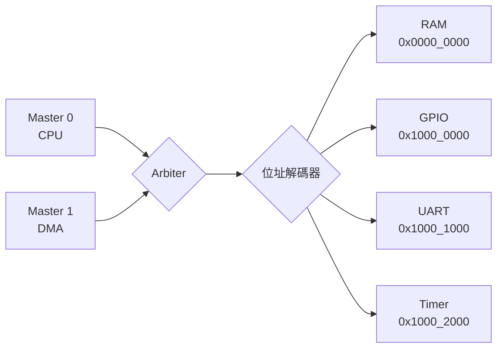

# 04.2 匯流排與記憶體映射 I/O

## 學習目標

1. 理解匯流排在 SoC 中的角色：為什麼 CPU、記憶體、周邊要透過匯流排而非直連。
2. 學會設計一個簡單的仲裁器（arbiter），處理多個 master 搶同一條匯流排的問題。
3. 掌握 memory-mapped I/O 的原理，能規劃一張完整的位址映射表，並理解位址解碼電路的實作。
4. 能實作 UART 收發控制器與 GPIO 模組，並將它們掛上自製匯流排。
5. 體會「把周邊當成特殊位址的記憶體」這個抽象如何簡化軟硬體介面。

---

## 4.2.1 為什麼需要匯流排

前三章的系統裡，CPU 直接接 SRAM，位址與資料線一對一相連。但真實 SoC 上有十幾個模組：快取後面的主記憶體、UART、GPIO、計時器、之後還有 DMA（04.3）。如果每對模組都直連，連線數會隨模組數量平方成長——這正是匯流排（bus）要解決的問題：**共享一組位址/資料/控制線，用仲裁與位址解碼來分時使用**。

工業界的標準匯流排是 AMBA 系列（AHB、APB、AXI），特性如下：

| 匯流排 | 定位 | 特點 |
|--------|------|------|
| AXI4 / AXI-Lite | 高效能主幹 | 位址/資料通道分離、支援 burst、outstanding、多層互連 |
| AHB | 中速 | 單通道、pipeline 位址與資料 |
| APB | 慢速周邊 | 極簡、兩拍以上、功耗低 |

本書為教學自訂一支極簡匯流排（下稱 sBus）：單 master 起步、可擴多 master。協定只有三個訊號組：



```verilog
// sBus 單次傳輸：master 拉高 req，slave 完成後拉一拍 done
// req    : 請求有效
// we     : 1=寫, 0=讀
// addr   : 全域位址
// wdata  : 寫資料
// rdata  : 讀資料（done 拍有效）
// done   : 傳輸完成，一拍脈衝
```

選擇「req/done 握手 + 可變延遲」的原因：SRAM 一拍完成、UART 移位要 87 拍、DMA 更久，周邊速度天差地別，固定延遲的匯流排（如早期 8086 系統）無法統一它們。

## 4.2.2 匯流排仲裁

當 04.3 的 DMA 加入後，匯流排有兩個 master：CPU 與 DMA。仲裁器決定誰能用匯流排。常見策略：

- **固定優先權（Fixed Priority）**：DMA > CPU。DMA 大量搬資料時可能讓 CPU 餓死。
- **輪替（Round-Robin）**：輪流使用，公平，實作只要一個「上次誰用過」的位址暫存器。
- **加權輪替（Weighted RR）**：兼顧即時性與公平。

以下是一個兩 master 的 Round-Robin 仲裁器：

```verilog
module arbiter_rr (
    input  logic clk, rst,
    // 兩個 master 的請求
    input  logic        req0,     // CPU
    input  logic        req1,     // DMA
    output logic        gnt0,     // 授權給 CPU
    output logic        gnt1,     // 授權給 DMA
    input  logic        done      // 匯流排傳輸完成
);
    typedef enum logic {OWN0, OWN1} state_t;
    state_t state;

    always_ff @(posedge clk) begin
        if (rst) state <= OWN0;
        else case (state)
            OWN0: if (done && req1) state <= OWN1;   // 用完就輪替
            OWN1: if (done && req0) state <= OWN0;
        endcase
    end

    assign gnt0 = (state == OWN0);
    assign gnt1 = (state == OWN1);
endmodule
```

兩個實作要點：**不要打斷進行中的傳輸**（只在 `done` 時切換授權，否則 Slave 端會看到半截事務）；**仲裁不要增加組合邏輯延遲到關鍵路徑**（此例仲裁純粹看暫存器狀態，零額外延遲）。

仲裁器之後，匯流排的多工器把被授權 master 的 `addr/we/wdata` 路由到共用線上；`rdata` 則反向多工回對應 master。

## 4.2.3 Memory-Mapped I/O 與位址映射表

Memory-mapped I/O 的核心思想：**周邊的暫存器就是特殊位址的「記憶體」**。CPU 用同樣的 load/store 指令存取它們，不需要額外的 IN/OUT 指令集（那是 x86 port I/O 的做法）。位址解碼器根據高位位址選出 slave，再把低位位址交給 slave 內部選暫存器。

本書系統的位址映射表（RISC-V 風格規劃）：

| 位址範圍 | 模組 | 暫存器（offset） | 讀/寫 | 說明 |
|----------|------|------------------|-------|------|
| `0x0000_0000–0x0000_7FFF` | SRAM | — | R/W | 32 KB 程式+資料記憶體 |
| `0x1000_0000–0x1000_00FF` | GPIO | `0x00` OUT、`0x04` IN、`0x08` OE | R/W | 8-bit 平行 I/O |
| `0x1000_1000–0x1000_10FF` | UART | `0x00` TX、`0x04` RX、`0x08` STAT | R/W | 見 4.2.4 |
| `0x1000_2000–0x1000_20FF` | Timer | `0x00` MTIME、`0x08` CMP | R/W | 64-bit 計數 |
| `0x1000_3000–0x1000_30FF` | 效能計數 | `0x00` ACCESS、`0x08` MISS | R | 04.1 的 AMAT 實測 |
| `0x2000_0000–0x2000_00FF` | DMA | `0x00` SA、`0x04` DA、`0x08` LEN、`0x0C` CTRL | R/W | 04.3 |
| `0x3000_0000–0x3000_00FF` | PLIC | `0x00` PENDING、`0x04` ENABLE、`0x08` CLAIM | R/W | 04.3 |

解碼器實作（組合邏輯，比較高位位址）：

```verilog
wire sel_ram   = (bus_addr <  32'h0000_8000);
wire sel_gpio  = (bus_addr[31:28] == 4'h1) && (bus_addr[27:16] == 12'h000);
wire sel_uart  = (bus_addr[31:28] == 4'h1) && (bus_addr[27:16] == 12'h001);
wire sel_timer = (bus_addr[31:28] == 4'h1) && (bus_addr[27:16] == 12'h002);
wire sel_dma   = (bus_addr[31:28] == 4'h2);
```

注意兩件事：位址區塊要**對齊到 2 的冪次且互不重疊**，否則解碼邏輯會出現多個 select 同時拉高；每個 slave 必須**回應 done**，未映射位址可以由一個 default slave 回應並（可選）觸發 bus error 中斷，幫助軟體抓野指標。

軟體端用指標存取周邊，C 語言要加 `volatile`：

```c
#define UART_TX  (*(volatile uint32_t *)0x10001000)
#define UART_STAT(*(volatile uint32_t *)0x10001008)
void putc(char c) { while (UART_STAT & 1) ; UART_TX = c; }  // 等 TX 空
```

`volatile` 禁止編譯器把「讀 STAT」最佳化成只讀一次——否則 while 迴圈會變成死迴圈。這是 memory-mapped I/O 軟體端最重要的觀念。

## 4.2.4 UART 控制器 Verilog 範例

UART（通用非同步收發器）是最經典的序列周邊：兩條線（TX/RX）、無時脈線，靠雙方約定鮑率對齊。8N1 格式：1 個起始位（0）、8 個資料位（LSB 先）、1 個停止位（1）。以 115200 鮑率、50 MHz 系統時脈，每個 bit 有 50_000_000/115200 ≈ 434 個時脈。

```verilog
//=============================================================
// uart.v : 8N1 UART，TX 含 16 深度 FIFO，RX 含 overrun 偵測
//=============================================================
module uart #(
    parameter CLK_HZ = 50_000_000,
    parameter BAUD   = 115_200
)(
    input  logic clk, rst,
    // sBus slave 介面
    input  logic        sel, req, we,
    input  logic [7:0]  addr,       // 暫存器 offset
    input  logic [31:0] wdata,
    output logic [31:0] rdata,
    output logic        done,
    // 序列腳位
    output logic tx, input  logic rx,
    // 中斷（給 04.3）
    output logic irq_rx, irq_tx
);
    localparam int BITCNT = CLK_HZ / BAUD;   // 434

    // ---------- TX ----------
    logic [7:0] tx_fifo [0:15];
    logic [3:0] f_wr, f_rd;
    wire f_empty = (f_wr == f_rd);
    wire f_full  = ((f_wr + 1) & 4'hF) == f_rd;

    logic [15:0] baud_cnt; logic [3:0] bit_idx;
    logic [9:0] shifter;   logic tx_busy;

    always_ff @(posedge clk) begin
        if (rst) begin
            f_wr <= 0; {baud_cnt, bit_idx} <= 0;
            shifter <= ~10'b0; tx_busy <= 0; tx <= 1'b1;
        end else begin
            // 匯流排寫入 TX 暫存器 -> 推入 FIFO
            if (sel && req && we && addr == 8'h00 && !f_full) begin
                tx_fifo[f_wr] <= wdata[7:0];
                f_wr <= f_wr + 1'b1;
            end
            // 移位器空了且 FIFO 有資料 -> 取出並加上 start/stop
            if (!tx_busy && !f_empty) begin
                shifter <= {1'b1, tx_fifo[f_rd], 1'b0};  // {stop, data, start}
                f_rd    <= f_rd + 1'b1;
                tx_busy <= 1'b1; bit_idx <= 0; baud_cnt <= 0;
            end
            // 鮑率產生與移位
            if (tx_busy) begin
                if (baud_cnt == BITCNT-1) begin
                    baud_cnt <= 0;
                    tx       <= shifter[0];
                    shifter  <= {1'b1, shifter[9:1]};
                    if (bit_idx == 9) tx_busy <= 0;
                    else bit_idx <= bit_idx + 1'b1;
                end else baud_cnt <= baud_cnt + 1'b1;
            end
        end
    end
    assign irq_tx = ~tx_busy & ~f_empty;  // 簡化：可改為 FIFO 半空

    // ---------- RX ----------
    logic [15:0] rx_cnt; logic [3:0] rx_bit;
    logic [7:0] rx_sh; logic rx_busy, rx_prev;
    always_ff @(posedge clk) begin
        if (rst) begin
            rx_busy <= 0; rx_prev <= 1'b1; rx_cnt <= 0; rx_bit <= 0;
        end else begin
            rx_prev <= rx;
            if (!rx_busy && rx_prev && !rx) begin        // 下降沿 = start bit
                rx_busy <= 1'b1; rx_cnt <= BITCNT/2; rx_bit <= 0; // 移到位元中央
            end else if (rx_busy) begin
                if (rx_cnt == 0) begin
                    rx_cnt <= BITCNT - 1;
                    if (rx_bit < 8) begin                 // 取樣在每個位元中央
                        rx_sh  <= {rx, rx_sh[7:1]};
                        rx_bit <= rx_bit + 1'b1;
                    end else begin
                        rx_busy <= 0;                     // 收完（應驗證 stop bit=1）
                        if (!f_full) begin
                            tx_fifo[f_wr] <= rx_sh;       // 與 TX 共用陣列僅為精簡
                            f_wr <= f_wr + 1'b1;          // 實作應分開 RX FIFO
                        end
                    end
                end else rx_cnt <= rx_cnt - 1'b1;
            end
        end
    end

    // ---------- 匯流排介面 ----------
    always_comb begin
        rdata = 32'b0;
        case (addr[7:0])
            8'h00: rdata = 32'b0;                             // TX: 寫暫存器
            8'h04: rdata = {24'b0, rx_sh};                    // RX: 讀資料
            8'h08: rdata = {f_empty, f_full, 30'b0};          // STAT[0]=TX空
            default: rdata = 32'b0;
        endcase
    end
    assign done = sel && req;   // 暫存器存取 1 拍完成
endmodule
```

**設計解讀：**

- TX 側用 FIFO + 移位器把「CPU 寫入」與「鮑率節奏的串列輸出」解耦：CPU 一次寫入整串字串，UART 自己慢慢吐，匯流排不被佔住。這是所有慢速周邊設計的通用模式。
- RX 在 start bit 的下降沿啟動，計數**半個 bit 時間**到達位元中央再取樣——之後每個位元的取樣點自然落在中央，抗誤差能力最好。嚴謹版本還應對 start bit 做兩次取樣確認（多數投票）以抗毛刺。
- 鮑率誤差：434 × 115200 = 49,972,800 Hz，誤差 0.005%，遠低於 UART 允許的 ±2%，但若換鮑率務必重算並檢查誤差。

## 4.2.5 GPIO 模組

GPIO 是最簡單的周邊，但正好展示 memory-mapped I/O 的全貌：

```verilog
module gpio (
    input  logic clk, rst,
    input  logic        sel, req, we,
    input  logic [7:0]  addr,
    input  logic [31:0] wdata,
    output logic [31:0] rdata,
    output logic        done,
    inout  logic [7:0]  io_pins
);
    logic [7:0] out_reg, oe_reg;      // 輸出值、輸出使能
    logic [7:0] in_reg;

    always_ff @(posedge clk) begin
        if (rst) begin out_reg <= 0; oe_reg <= 0; in_reg <= 0; end
        else begin
            if (sel && req && we) case (addr[7:0])
                8'h00: out_reg <= wdata[7:0];
                8'h08: oe_reg  <= wdata[7:0];
            endcase
            in_reg <= io_pins;        // 輸入同步（避免亞穩態傳播）
        end
    end

    assign io_pins = oe_reg ? out_reg : 8'hZZ;   // 三態
    always_comb case (addr[7:0])
        8'h00: rdata = {24'b0, out_reg};
        8'h04: rdata = {24'b0, in_reg};
        8'h08: rdata = {24'b0, oe_reg};
        default: rdata = 32'b0;
    endcase
    assign done = sel && req;
endmodule
```

FPGA 內部其實沒有真正的三態匯流排（只有 I/O ring 有），`inout` 只在頂層腳位合法；晶片內部要用方向暫存器 + mux 模擬。同步器 `in_reg <= io_pins` 若要抗亞穩態應做兩級（把 `io_pins` 先過兩個 FF 再用，習題會要求你改）。

## 4.2.6 把它們組起來：匯流排互連頂層

```verilog
module soc_bus (
    input logic clk, rst,
    // CPU master 介面
    input  logic        m_req, m_we,
    input  logic [31:0] m_addr, m_wdata,
    output logic [31:0] m_rdata,
    output logic        m_done,
    // 外部腳位
    output logic tx, input logic rx, inout logic [7:0] io_pins
);
    // slave select 與 rdata 多工
    logic [31:0] r_ram, r_gpio, r_uart;
    logic        d_ram, d_gpio, d_uart;
    wire sel_ram   = (m_addr < 32'h0000_8000);
    wire sel_gpio  = (m_addr[31:16] == 16'h1000) && (m_addr[15:8] == 8'h00);
    wire sel_uart  = (m_addr[31:16] == 16'h1000) && (m_addr[15:8] == 8'h01);

    assign m_rdata = sel_ram   ? r_ram   :
                     sel_gpio  ? r_gpio  : r_uart;
    assign m_done  = sel_ram   ? d_ram   :
                     sel_gpio  ? d_gpio  : d_uart;

    sram_controller u_ram  (.clk(clk), .rst(rst), .sel(sel_ram),
        .req(m_req), .we(m_we), .addr(m_addr), .wdata(m_wdata),
        .rdata(r_ram), .done(d_ram));
    gpio u_gpio (.clk(clk), .rst(rst), .sel(sel_gpio),
        .req(m_req), .we(m_we), .addr(m_addr[7:0]), .wdata(m_wdata),
        .rdata(r_gpio), .done(d_gpio), .io_pins(io_pins));
    uart u_uart (.clk(clk), .rst(rst), .sel(sel_uart),
        .req(m_req), .we(m_we), .addr(m_addr[7:0]), .wdata(m_wdata),
        .rdata(r_uart), .done(d_uart), .tx(tx), .rx(rx),
        .irq_rx(), .irq_tx());
endmodule
```

這個頂層目前是單 master；04.3 加入 DMA 時，只要在 CPU 與 slaves 之間插入 4.2.2 的仲裁器即可，所有 slave 介面完全不用改——這就是定義清楚介面所買到的擴充性。

---

## 本章小結

- 匯流排以共享線路取代模組兩兩直連，仲裁器（固定優先權、Round-Robin）解決多 master 競爭，切換授權必須等到傳輸 `done`，不可打斷進行中的事務。
- Memory-mapped I/O 把周邊暫存器映射到統一位址空間，CPU 用普通 load/store 存取；位址解碼用高位位址產生 select，區塊需對齊、不重疊，並為未映射位址提供預設回應。
- 位址映射表是軟硬體的契約：軟體端存取周邊的指標必須 `volatile`，防止編譯器最佳化掉狀態輪詢。
- UART 以「FIFO + 移位器」解耦匯流排與鮑率節奏，RX 在位元中央取樣；GPIO 展示了方向暫存器與輸入同步的基本功。
- 定義清晰的 slave 介面（req/done/rdata）讓新增 master（下一章的 DMA）只需插入仲裁器，不必動周邊。

## 實作題

1. **位址解碼改進**：把 4.2.6 頂層改成用 casez 與參數化的基地址進行解碼，並加入 default slave：存取未映射位址時回 `done` 且把錯誤旗標寫入一個可讀的錯誤暫存器，記錄最後一次非法存取的位址。
2. **RX FIFO 獨立化**：範例中 RX 共用了 TX 的儲存陣列（刻意精簡），請為 RX 建立獨立 FIFO 與 overrun 旗標，並在 STAT 暫存器新增 RX 有效/OVERRUN 位元。
3. **Round-Robin 驗證**：寫一個 testbench，讓兩個 master 以隨機間隔發請求，驗證 4.2.2 仲裁器在競爭時嚴格交替、在單方請求時不閒置，並統計兩者的頻寬佔比接近 50%。
4. **GPIO 雙級同步**：修改 GPIO 輸入路徑，加入兩級觸發器同步器與可选的去彈跳計數器（例如 20 ms 穩定才更新 in_reg），用實體按鍵驗證。
5. **printf 到 UART**：用 C 寫 `printf` 等級的輸出（至少支援 `%d`、`%x`、`%s`），透過 4.2.4 的 UART 列印 04.1 的效能計數器，完成「快取 miss rate 報表」的閉環。
