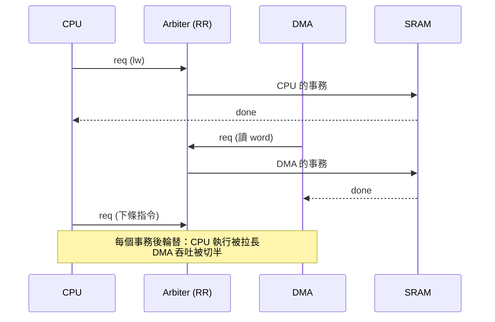
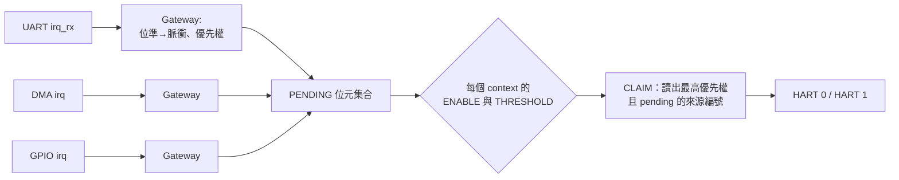

# 04.3 DMA 與中斷控制器實作

## 學習目標

1. 理解為什麼需要 DMA：CPU 複製大量資料時，週期被誰吃掉了。
2. 能設計一個完整的 DMA 引擎：暫存器介面、狀態機、匯流排請求與握手。
3. 掌握 PLIC（Platform-Level Interrupt Controller）的概念模型，並實作一個簡化版中斷控制器。
4. 理解 CPU 與 DMA 搶匯流排的現象：為什麼會互相拖慢、如何用仲裁與 burst 策略平衡。
5. 學會用中斷驅動取代輪詢，量測兩者的 CPU 佔用差異。

---

## 4.3.1 為什麼需要 DMA

考慮一個最常見的任務：把 4 KB 資料從記憶體搬到 UART，或從記憶體的一區搬到另一區。用 CPU 做（03 章的組合語言）：

```asm
loop:
    lw   t0, 0(a0)        # 讀 1 word：hit 2 拍 / miss 18 拍
    sw   t0, 0(a1)        # 寫 1 word：write-through 打 write buffer
    addi a0, a0, 4
    addi a1, a1, 4
    addi a2, a2, -4
    bnez a2, loop
```

搬 1024 個 word，光讀寫就至少 2048 次匯流排事務，加上迴圈開銷，CPU 的**每一個週期都在為搬資料服務**——這些週期本可以用來算東西。更糟的是，CPU 搬資料對快取的污染：大量串流資料把有用的工作集全部驅逐掉，之後的計算 miss rate 暴漲（這叫 cache pollution）。

**DMA（Direct Memory Access）**的解法：做一個專門搬資料的硬體引擎，CPU 只負責「下命令」（寫幾個暫存器），之後 DMA 自己發出匯流排讀寫、自己數長度、搬完發中斷叫醒 CPU。CPU 與 DMA 共享匯流排——CPU 算它的，DMA 搬它的，兩者分時使用匯流排頻寬。

## 4.3.2 DMA 引擎的介面與架構

DMA 對匯流排而言是**第二個 master**；對 CPU 而言是**一個 slave**（可被寫入命令暫存器）。這種雙重身份是理解 DMA 架構的關鍵：

```mermaid
flowchart TB
    subgraph CPU 側（DMA 是 slave）
        A[CPU 寫 CTRL 暫存器啟動]
    end
    subgraph DMA 核心
        B[來源/目的位址暫存器]
        C[長度計數器]
        D[傳輸狀態機<br/>REQ_RD → REQ_WR → NEXT → DONE]
    end
    subgraph 匯流排側（DMA 是 master）
        E[Arbiter] --> F[共用匯流排]
    end
    A --> B --> D
    C --> D
    D --> E
    D --> G[完成中斷 → 04.3 中斷控制器]
```

命令暫存器組（延續 04.2 的位址映射表，基地址 `0x2000_0000`）：

| Offset | 暫存器 | 說明 |
|--------|--------|------|
| `0x00` | `SA` | 來源位址（自動遞增） |
| `0x04` | `DA` | 目的位址（自動遞增） |
| `0x08` | `LEN` | 傳輸長度（bytes，word 對齊） |
| `0x0C` | `CTRL` | bit0 = 啟動（寫 1 開跑，硬體自動清零）、bit1 = 完成旗標（讀清）、bit2 = 中斷使能 |

## 4.3.3 DMA 引擎完整 Verilog

```verilog
//=============================================================
// dma.v : 單通道 DMA，word 傳輸，讀一個 word 立刻寫一個 word
//=============================================================
module dma #(
    parameter BURST = 1          // 每次搶到匯流排連搬幾個 word
)(
    input  logic clk, rst,
    // slave 介面（CPU 寫命令）
    input  logic        sel, req, we,
    input  logic [7:0]  addr,
    input  logic [31:0] wdata,
    output logic [31:0] rdata,
    output logic        done,
    // master 介面（經仲裁器上匯流排）
    output logic        m_req,     // 請求使用匯流排
    input  logic        m_gnt,     // 仲裁器授權
    output logic        m_we,
    output logic [31:0] m_addr,
    output logic [31:0] m_wdata,
    input  logic [31:0] m_rdata,
    input  logic        m_done,    // slave 回應完成
    // 中斷
    output logic        irq
);
    logic [31:0] sa, da, len;
    logic        en_irq, busy;

    // ---- 暫存器讀寫 ----
    always_ff @(posedge clk) begin
        if (rst) begin
            sa <= 0; da <= 0; len <= 0; busy <= 0; en_irq <= 0;
        end else begin
            if (sel && req && we) case (addr[7:0])
                8'h00: sa    <= wdata;
                8'h04: da    <= wdata;
                8'h08: len   <= wdata;
                8'h0C: if (wdata[0]) begin
                           busy   <= 1'b1;
                           en_irq <= wdata[2];
                       end
            endcase
            if (busy && (len == 0)) busy <= 1'b0;   // 搬完停機
        end
    end

    always_comb begin
        rdata = 32'b0;
        case (addr[7:0])
            8'h00: rdata = sa;
            8'h04: rdata = da;
            8'h08: rdata = len;
            8'h0C: rdata = {28'b0, en_irq, ~busy, busy};
            default: rdata = 32'b0;
        endcase
    end
    assign done = sel && req;
    assign irq  = busy ? 1'b0 : (len == 0 && en_irq && (sa != 0)); // 完成脈衝，簡化

    // ---- 傳輸狀態機 ----
    // IDLE: 等 busy；REQ_RD: 搶匯流排發讀；RD_WAIT: 等 slave 給資料；
    // REQ_WR: 換成寫事務；WR_WAIT: 寫入完成；NEXT: 遞增位址與計數
    typedef enum logic [2:0] {IDLE, REQ_RD, RD_WAIT, REQ_WR, WR_WAIT, NEXT} st_t;
    st_t st;
    logic [31:0] data_hold, sa_r, da_r, len_r;

    always_ff @(posedge clk) begin
        if (rst) begin
            st <= IDLE; m_req <= 0; m_we <= 0;
        end else begin
            case (st)
              IDLE: if (busy && len_r != 0) begin
                        sa_r <= sa; da_r <= da; len_r <= len;
                        m_req <= 1'b1; m_we <= 1'b0; m_addr <= sa;
                        st <= REQ_RD;
                    end
              REQ_RD: if (m_gnt) st <= RD_WAIT;          // 已上匯流排
              RD_WAIT: if (m_done) begin
                        data_hold <= m_rdata;
                        m_we   <= 1'b1;
                        m_addr <= da_r;
                        m_wdata<= m_rdata;
                        st     <= REQ_WR;
                    end
              REQ_WR: if (m_gnt) st <= WR_WAIT;
              WR_WAIT: if (m_done) begin
                        m_req <= 1'b0;
                        st    <= NEXT;
                    end
              NEXT: begin
                        sa_r <= sa_r + 4;
                        da_r <= da_r + 4;
                        // 回寫進度到暫存器，CPU 可查
                        sa <= sa_r + 4; da <= da_r + 4;
                        if (len_r <= 4) len_r <= 0;
                        else len_r <= len_r - 4;
                        if (len_r > 4) begin
                            m_req <= 1'b1; m_we <= 1'b0;
                            m_addr <= sa_r + 4;
                            st <= REQ_RD;
                        end else st <= IDLE;
                    end
              default: st <= IDLE;
            endcase
        end
    end
endmodule
```

**設計解讀：**

- 每搬一個 word 要**搶兩次匯流排**（一次讀、一次寫），中間 `m_gnt` 與 `m_done` 的等待讓單 word 傳輸效率偏低——這正是 BURST 參數存在的理由：把 `REQ_RD` 改成連續讀 BURST 個 word、`REQ_WR` 連續寫 BURST 個，搶匯流排的次數除以 BURST，也是下一節「匯流排搶佔」討論的槓桿。
- 進度回寫（`sa/da/len` 即時更新）讓 CPU 可以輪詢進度，配合中斷就有兩種完成通知方式。
- 真實 DMA 還需要：通道優先權（多通道）、link-list 描述符（一次命令搬多段不連續區域）、匯流排錯誤處理。單通道版本把核心觀念濃縮到 150 行以內。

## 4.3.4 CPU 與 DMA 的匯流排搶佔

現在匯流排上有兩個 master，用 04.2 的 Round-Robin 仲裁器接起來。會發生什麼？



兩個效應同時發生：

1. **DMA 佔用匯流排期間，CPU 的 miss 延遲被拉長**。原本 18 拍的 miss，若要排隊等 DMA 的事務，可能變 25 拍。這說明為什麼 04.1 的 AMAT 實測在「有 DMA 背景」的環境下會明顯變差——AMAT 不是快取單獨的性質，而是整個記憶體系統的性質。
2. **CPU 的高頻小事務會打斷 DMA**。Round-Robin 下 DMA 每搬一個 word 都要和 CPU 輪流，單 word 模式的 DMA 吞吐掉一半以上。

工程上的平衡手段：

- **Burst 傳輸**：DMA 一次連搬 4～16 個 word，仲裁切換次數減少，匯流排線利用率（資料位元/控制開銷）大幅上升。代價是 CPU 在 DMA burst 期間可能連續等好幾個 word 的時間——若 CPU 正在 miss，這段等待直接加進 AMAT。
- **優先權策略**：CPU 優先（DMA 是背景 bulk traffic，CPU 延遲優先）適合互動系統；DMA 優先適合串流即時（音訊、視訊，資料晚了就沒了）。更精緻的做法是**可搶佔 burst**：DMA 的 burst 允許被 CPU 的緊急 miss 打斷，前提是被打斷的事務能安全暫停——這要求 slave 與 master 都記住進度，複雜度不低，所以多數簡單 SoC 選擇「不搶佔 + 短 burst」。
- **限流**：DMA 在兩個 burst 之間強制空出幾拍，把頻寬上限限在例如 70%，留呼吸空間給 CPU。

**實測建議**：在仲裁器上加一個 `grant_holder` 計數器統計 CPU/DMA 各自持有匯流排的拍數，透過 memory-mapped 暫存器讀出。改變 BURST 參數與仲裁策略，畫出「DMA 吞吐 vs CPU 延遲」的取捨曲線——你會親手做出教科書上那張「頻寬分配」的示意圖。

## 4.3.5 PLIC 概念

RISC-V 平台的平台級中斷控制器 PLIC（Platform-Level Interrupt Controller）概念模型：



關鍵機制：

- **PENDING**：每個中斷源一位元，source 拉起就置 1，由 claim 清除。
- **ENABLE/THRESHOLD**：每個 hart（context）有自己的使能遮罩與優先權門檻，未過門檻的中斷不通知。
- **CLAIM/COMPLETE**：軟體讀 claim 拿到「目前最高優先權的 pending source 編號」（同時清該 pending），處理完寫回 complete。這個握手避免漏掉 claim 之後又來的新中斷。

簡化版（單 hart、8 源、無優先權門檻）足以教學。

## 4.3.6 簡化中斷控制器 Verilog

```verilog
//=============================================================
// plic_lite.v : 8 個中斷源、單 hart、固定優先權（編號越大越高）
//=============================================================
module plic_lite (
    input  logic clk, rst,
    input  logic [7:0] src,        // 各中斷源的位準訊號
    // sBus slave 介面
    input  logic        sel, req, we,
    input  logic [7:0]  addr,
    input  logic [31:0] wdata,
    output logic [31:0] rdata,
    output logic        done,
    output logic        irq        // 送到 CPU 的中斷線
);
    logic [7:0] pending, enable;

    always_ff @(posedge clk) begin
        if (rst) pending <= 8'b0;
        else     pending <= (pending | src) & ~claim_clr;
    end

    // 固定優先權：編號 7 最高。用組合迴路找最高 pending & enable
    logic [7:0] cand;
    assign cand = pending & enable;
    logic [2:0] claim_id;
    logic       claim_valid;
    always_comb begin
        claim_id = 3'd0; claim_valid = 1'b0;
        for (int i = 7; i >= 0; i--) begin
            if (cand[i]) begin
                claim_id = 3'(i);
                claim_valid = 1'b1;
            end
        end
    end

    logic [7:0] claim_clr;
    always_ff @(posedge clk) claim_clr <= 8'b0;
    // 讀 claim (0x08) -> 清對應 pending；寫 complete (0x0C) -> 無動作（簡化）

    always_comb begin
        rdata = 32'b0;
        case (addr[7:0])
            8'h00: rdata = {24'b0, pending};
            8'h04: rdata = {24'b0, enable};
            8'h08: rdata = {28'b0, claim_valid, claim_id};   // CLAIM
            default: rdata = 32'b0;
        endcase
    end

    always_ff @(posedge clk) begin
        if (rst) enable <= 8'b0;
        else if (sel && req && we && addr[7:0] == 8'h04)
            enable <= wdata[7:0];
    end

    logic [7:0] claiming;
    always_ff @(posedge clk) begin
        if (rst) claiming <= 8'b0;
        else if (sel && req && !we && addr[7:0] == 8'h08 && claim_valid)
            claiming <= 8'b0;                     // 讀 claim 時清除（簡化：當拍）
    end
    assign claim_clr = claiming;                  // 正式版應按 claim_id 清單一個位元

    assign done = sel && req;
    assign irq  = |cand;                          // 有可服務中斷就拉高
endmodule
```

CPU 端（RISC-V 語彙）的處理流程：`irq` 接到 CSR 的外部中斷輸入；中斷處理程式讀 `0x3000_0008`（claim）取得來源編號 → 分派到對應 ISR（例如 DMA 完成就清 DMA 的完成旗標並喚醒等待的任務）→ 寫 complete。若讀者使用支援 `mstatus.MIE`/`mtvec` 的核心，這些 CSR 在 03 章已備妥，此處只要把 `irq` 與 `mtvec` 導向的入口接起來。

**簡化之處的提醒**：範例的 claim 清除邏輯刻意簡化（當拍清、位準中斷源若仍拉高會立即重新 pending）。正式的 PLIC 用 gateway 把位準訊號轉成脈衝，配合 claim/complete 完整握手；請在習題中修補。

## 4.3.7 端到端：中斷驅動 vs 輪詢

把所有元件接起來：UART RX 中斷接到 PLIC source 1，DMA 完成中斷接到 source 2。比較兩種軟體風格收 1 KB 資料的成本：

| 策略 | CPU 佔用 | 延遲 | 程式複雜度 |
|------|---------|------|-----------|
| 輪詢（04.2 的 `while (STAT & …)`） | 100% 忙等 | 低 | 極低 |
| 中斷驅動 | 每次事件約 30–60 拍 | 中（含進出 ISR 開銷） | 中（需 ISR + 旗標） |
| DMA + 中斷 | 每批資料僅 1 次中斷 | 低 | 高（描述符管理） |

測量方法同 04.1：在 CPU 的 retire 通路與 ISR 入口各放計數器，透過 memory-mapped 暫存器讀出「ISR 週期數 / 總週期數」。在 50 MHz、UART 115200 的組態下，輪詢收 1 KB 要耗費約 89 ms 的全忙等；中斷驅動把 CPU 佔用壓到 3% 以下；DMA + 完成 中斷則近乎 0%——每個位元組的成本從數百拍降到個位數拍。這組數字就是「為什麼所有真實系統都有 DMA 與中斷」的實證答案。

---

## 本章小結

- DMA 用專屬硬體引擎取代 CPU 的搬運迴圈，同時解決兩個問題：CPU 週期被搬資料吃光、串流資料污染快取。DMA 對 CPU 是 slave（命令暫存器）、對匯流排是 master（發起讀寫）。
- DMA 引擎核心是「搶匯流排 → 讀 → 搶匯流排 → 寫 → 遞增/計數」的狀態機；burst 是提升匯流排利用率的關鍵參數。
- CPU 與 DMA 搶匯流排是零和遊戲：仲裁策略（Round-Robin、優先權、限流）與 burst 長度共同決定頻寬分配。AMAT 在有 DMA 的環境下必須重新實測。
- PLIC 的模型是「gateway → pending → enable/threshold → claim/complete」；簡化版中斷控制器只要 pending 集合、優先權選擇與 claim 握手即可支撐中斷驅動軟體。
- 輪詢、中斷、DMA+中斷三種 I/O 風格的成本可以用硬體計數器實證比較，這是本章最重要的能力：**用實測數據做出架構取捨**。

## 實作題

1. **Burst DMA**：把 4.3.3 的 DMA 改成 BURST=4（單次匯流排授權連讀 4 words、連寫 4 words），需要在 DMA 內加一個 4-word 資料緩衝。量測搬 4 KB 的總週期數與佔匯流排拍數，與單 word 版比較。
2. **仲裁取捨曲線**：實作三種仲裁（固定優先權 CPU>DMA、固定優先權 DMA>CPU、Round-Robin），分別量測「DMA 搬 4 KB 的總時間」與「同一時間 CPU 跑矩陣乘法的總時間」，畫出三條取捨曲線並討論哪種策略適合什麼應用。
3. **中斷控制器修補**：修正 4.3.6 的 claim 清除邏輯——讀 claim 只清除被 claim 的那個位元，且位準中斷源需要 gateway（位準轉脈衝 + complete 前不再置位）。寫 testbench 驗證：同一 source 連續兩次觸發，第二次在 complete 之前不會遺失也不會重複。
4. **UART DMA 化**：把 UART 的 RX 改成「FIFO 半滿就發中斷」，再進一步讓 DMA 把 RX FIFO 自動搬到記憶體環形緩衝區。量測收 1 KB 的 CPU 佔用率，填入 4.3.7 的表格。
5. **匯流排限流**：在 DMA 中實作兩個 burst 之間插入 N 拍閒置的限流器，掃描 N = 0, 2, 4, 8，找出「CPU miss 延遲退化 < 10%」前提下 DMA 吞吐最高的 N，並解釋限流為何能同時保護兩邊的效能。
